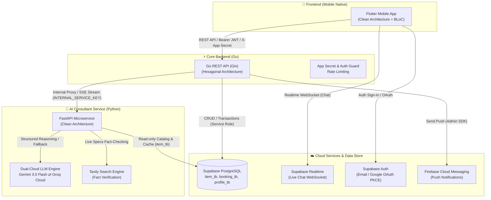

# 📦 ยืมหน่อย (Yuemnoi App) - Peer-to-Peer Rental Platform

[](https://flutter.dev)
[](https://dart.dev)
[](https://golang.org)
[](https://fastapi.tiangolo.com)
[](https://python.org)
[](https://supabase.com)
[](https://firebase.google.com)
[](https://ai.google.dev)
[](https://groq.com)

**ยืมหน่อย (Yuemnoi)** คือแพลตฟอร์มเช่าและแบ่งปันอุปกรณ์อิเล็กทรอนิกส์, กล้องถ่ายรูป, คอมพิวเตอร์ และแกดเจ็ตไอทีแบบ **Consumer-to-Consumer (C2C / Peer-to-Peer)** ครบวงจร 
พร้อมระบบจัดการขั้นตอนการเช่า-ส่งมอบ-ส่งคืนที่ปลอดภัย, กระเป๋าเงินดิจิทัล (Wallet), แชทสดเรียลไทม์ และ **AI Rental Consultant (ยืมหน่อย AI)** ผู้ช่วยอัจฉริยะที่ช่วยวิเคราะห์ความต้องการ เปรียบเทียบสเปก และแนะนำอุปกรณ์ที่เหมาะสมที่สุดจากคลังสินค้าจริง

---

## 📑 สารบัญ (Table of Contents)

1. [สถาปัตยกรรมระบบ (System Architecture)](#-สถาปัตยกรรมระบบ-system-architecture)
2. [ฟีเจอร์เด่นของระบบ (Key Features)](#-ฟีเจอร์เด่นของระบบ-key-features)
3. [เอกสารคู่มือแยกตามส่วน (Sub-project Documentation)](#-เอกสารคู่มือแยกตามส่วน-sub-project-documentation)
4. [สิ่งที่ต้องเตรียมก่อนติดตั้ง (Prerequisites)](#-สิ่งที่ต้องเตรียมก่อนติดตั้ง-prerequisites)
5. [คู่มือการติดตั้งและเริ่มต้นใช้งาน (Getting Started)](#-คู่มือการติดตั้งและเริ่มต้นใช้งาน-getting-started)
6. [แนวทางความปลอดภัย (Security Guidelines)](#-แนวทางความปลอดภัย-security-guidelines)

---

## 🏗️ สถาปัตยกรรมระบบ (System Architecture)

ระบบออกแบบตามแนวคิด **Hybrid Architecture & Clean/Hexagonal Architecture** โดยแบ่งการทำงานออกเป็น 3 ส่วนหลัก:



### บทบาทของแต่ละส่วน:
1. **Frontend (`frontend/`)**: พัฒนาด้วย **Flutter** รองรับ Android & iOS ใช้ Clean Architecture แบ่ง Layer ชัดเจน (`data`, `domain`, `presentation`), จัดการ State ด้วย `flutter_bloc` และใช้ UI ฟอนต์ Prompt ที่ทันสมัย
2. **Backend (`backend/`)**: พัฒนาด้วย **Go (Golang)** และ **Gin Web Framework** ใช้ Hexagonal Architecture (Ports and Adapters) สำหรับจัดการ Core Business Logic, ธุรกรรมการจอง, กระเป๋าเงิน, สิทธิ์ผู้ใช้งาน และเป็น AI Chatbot Gateway
3. **AI Service (`ai_service/`)**: พัฒนาด้วย **Python 3.12** และ **FastAPI** เป็น Microservice ผู้ช่วยอัจฉริยะแบบ Dual-Cloud ไร้ค่าใช้จ่าย (Google Gemini API เป็น Primary และ Groq API เป็น Fallback) ตรวจสอบสเปกผ่าน Tavily Search API และยึดหลัก Zero-Regex, Zero-Keyword, Zero-Hardcode, Zero-Bias อย่างเคร่งครัด
4. **Cloud Infrastructure**: 
   - **Supabase**: ฐานข้อมูล PostgreSQL, User Authentication, Realtime WebSocket Streams สำหรับห้องแชท, และ Cloud Storage
   - **Firebase Cloud Messaging (FCM)**: ระบบ Push Notification แจ้งเตือนข้อความแชทและอัปเดตสถานะการเช่า

---

## ✨ ฟีเจอร์เด่นของระบบ (Key Features)

### 1. 🔍 การค้นหาและแสดงรายการอุปกรณ์ (Item Discovery)
- **Smart Recommendation Feed**: คำนวณอันดับแสดงผลตามความนิยม (Popularity), ความสดใหม่ (Recency) และจัดสมดุลหมวดหมู่ผ่าน Database View `home_feed_ranked_v`
- **หมวดหมู่อุปกรณ์หลากหลาย**: กล้องถ่ายภาพ, เลนส์, แล็ปท็อป, แท็บเล็ต, อุปกรณ์เกมมิ่ง, โดรน, ไฟสตูดิโอ ฯลฯ
- **ค้นหาละเอียด**: ค้นหาตามคำสำคัญ หมวดหมู่ ราคาเช่าต่อวัน พร้อมระบบ Skeleton Loading ระหว่างรอข้อมูล

### 2. 🔄 วงจรการเช่าครบวงจร (Full Rental Lifecycle)
- **การส่งคำขอจอง (Booking Request)**: เลือกระยะเวลาเช่า (วันเริ่มต้น - สิ้นสุด), ระบบคำนวณค่าเช่ารวมอัตโนมัติ
- **ระบบกระเป๋าเงิน (Wallet Payment)**: ตัดเงินค่าเช่าและเงินประกันผ่าน In-App Wallet ปลอดภัยไม่ต้องโอนเงินสดนอกรอบ
- **การส่งมอบอุปกรณ์ (Handover Confirmation)**: ยืนยันการรับมอบด้วยรหัสลับ OTP / สแกน QR Code ตรวจสอบความถูกต้องแบบ Face-to-Face
- **แผนที่และการติดตาม (Location Tracking Map)**: ดูพิกัดจุดนัดพบ คำนวณระยะทางผ่าน `flutter_map` และ `geolocator`
- **การส่งคืนอุปกรณ์ (Rental Return)**: ตรวจสอบสภาพอุปกรณ์ ส่งมอบคืน และปลดล็อกยอดเงิน
- **ระบบรีวิวและให้คะแนน (Reviews & Ratings)**: ให้คะแนนและเขียนรีวิวประสบการณ์เช่าเพื่อสร้างความน่าเชื่อถือ

### 3. 💬 ระบบแชทเรียลไทม์ (Real-time Messaging)
- เชื่อมต่อผ่าน **Supabase Realtime WebSockets** รับส่งข้อความได้ทันทีโดยไม่ต้อง Refresh
- รองรับการส่งภาพถ่ายสภาพอุปกรณ์ก่อนและหลังเช่า
- ระบบนับจำนวนข้อความที่ยังไม่ได้อ่าน (Unread Badges)
- ระบบดึงข้อมูลผู้ติดต่อแบบปลอดภัยผ่าน Backend API (`/api/v1/chat/contact`) ป้องกันข้อมูลส่วนตัวรั่วไหล

### 4. 🔔 ระบบแจ้งเตือน (Push Notifications)
- เชื่อมต่อ **Firebase Cloud Messaging (FCM)** แจ้งเตือนทั้งขณะเปิดแอป (Foreground) และปิดแอป (Background)
- แจ้งเตือนเมื่อมีคำขอเช่าใหม่, สถานะการจองเปลี่ยนแปลง, หรือได้รับข้อความแชทใหม่

### 5. 🤖 ผู้ช่วยอัจฉริยะ AI (AI Rental Consultant)
- **100% Free Dual-Cloud Cascade**: Google Gemini (Primary) สลับไป Groq Cloud (Fallback) อัตโนมัติเมื่อโควตาเต็มหรือเกิดข้อผิดพลาด
- **Zero-Keyword & Semantic Intent Routing**: วิเคราะห์เจตนาผู้ใช้ด้วย Pydantic Structured Output โดยไม่มีการเขียน Regex หรือล็อคคีย์เวิร์ด
- **Fact Verification & Anti-Hallucination**: สรุปข้อมูลสเปกจากคลังสินค้าจริง (`item_tb`) และค้นหาข้อมูลภายนอกผ่าน **Tavily Search API** เพื่อตรวจสอบความถูกต้องก่อนตอบ
- **Interactive Clarification**: หากผู้ใช้ถามคลุมเครือ AI จะสร้างคำถามเจาะจงพร้อม Choice Buttons ให้กดเลือกตอบได้ทันที
- **Server-Sent Events (SSE) Streaming**: พิมพ์ตอบแบบ Real-time ให้ความรู้สึกเป็นธรรมชาติ

### 6. 🛡️ ความปลอดภัยมาตรฐานสูง (Security & Privacy)
- ป้องกันสิทธิ์ API ผ่าน `X-App-Secret` (รองรับ Zero-downtime Key Rotation)
- ป้องกัน Brute-force & DoS ด้วย In-memory Rate Limiter
- บล็อก Bot / Scanner อัตโนมัติ (`.env`, `.git`, `.php`)
- แยกกุญแจ `SUPABASE_SERVICE_ROLE_KEY` ไว้เฉพาะใน Backend ห้ามรั่วไหลออก Client

---

## 📚 เอกสารคู่มือแยกตามส่วน (Sub-project Documentation)

สำหรับรายละเอียดโครงสร้างโฟลเดอร์เชิงลึก, การตั้งค่า Environment Variables, รายการ API Endpoints และคำสั่งรันชุดทดสอบของแต่ละโมดูล สามารถอ่านเพิ่มเติมได้ที่:

| โมดูล | รายละเอียดและลิงก์คู่มือ |
|---|---|
| 📱 **Frontend** | [คู่มือการพัฒนาและการตั้งค่า Frontend](frontend/README.md)<br/>- อธิบาย Clean Architecture + BLoC<br/>- การตั้งค่า `frontend/.env.local`<br/>- คำสั่งคอมไพล์โค้ด `build_runner` และ `flutter test` |
| ⚡ **Backend** | [คู่มือการพัฒนาและการตั้งค่า Backend](backend/README.md)<br/>- อธิบาย Hexagonal Architecture (Ports and Adapters)<br/>- การตั้งค่า `backend/.env`<br/>- รายการ API Routes ทั้งหมด และคำสั่ง `go test` |
| 🤖 **AI Service** | [คู่มือการพัฒนาและการตั้งค่า AI Service](ai_service/README.md)<br/>- อธิบาย Clean Architecture และนโยบาย Zero-Keyword/Zero-Bias<br/>- การตั้งค่า `ai_service/.env` และโมเดลสำรอง Dual-Cloud<br/>- รายการ Endpoints และคำสั่งรัน `pytest` |

---

## 📋 สิ่งที่ต้องเตรียมก่อนติดตั้ง (Prerequisites)

| ซอฟต์แวร์ / เครื่องมือ | เวอร์ชันที่ต้องการ | วัตถุประสงค์ |
|---|---|---|
| **Flutter SDK** | `^3.11.5` หรือ 3.29+ | รันและคอมไพล์แอปพลิเคชันมือถือ |
| **Go (Golang)** | `1.26` ขึ้นไป | คอมไพล์และรัน Core REST API Backend |
| **Python** | `3.12` | รัน AI Consultant Microservice |
| **Supabase Project** | Cloud หรือ Self-hosted | PostgreSQL, Auth, Realtime, Storage |
| **Firebase Project** | Blaze หรือ Spark | Firebase Cloud Messaging (FCM) |
| **Google Gemini API Key** | Free Tier (Google AI Studio) | Primary LLM Provider |
| **Groq API Key** | Free Tier (Groq Cloud) | Fallback LLM Provider |
| **Tavily Search API Key** | Free Tier (1,000 requests/mo) | ตรวจสอบสเปกอุปกรณ์จริงผ่าน Search API |

---

## 🚀 คู่มือการติดตั้งและเริ่มต้นใช้งาน (Getting Started)

> 💡 **หมายเหตุ:** กรุณาสร้างและตั้งค่าไฟล์ `.env` ในแต่ละโฟลเดอร์ให้เรียบร้อยก่อนเริ่มต้น โดยดูรายละเอียดตัวแปรทั้งหมดได้จากคู่มือของแต่ละส่วน

### ขั้นตอนที่ 1: รัน Python AI Service

```bash
# 1. เข้าสู่โฟลเดอร์ ai_service
cd ai_service

# 2. สร้างและเปิดใช้งาน Virtual Environment (Python 3.12)
python -m venv .venv

# บน Windows:
.\.venv\Scripts\activate
# บน macOS/Linux:
# source .venv/bin/activate

# 3. ติดตั้ง Dependencies
pip install -r requirements.txt

# 4. เริ่มต้นรันเซิร์ฟเวอร์ AI Service
python main.py
```
> เซิร์ฟเวอร์ AI จะเริ่มต้นทำงานที่ `http://localhost:8000` (ดู Swagger Docs ได้ที่ `http://localhost:8000/docs`)

---

### ขั้นตอนที่ 2: รัน Go Backend Server

```bash
# 1. เข้าสู่โฟลเดอร์ backend
cd backend

# 2. ดาวน์โหลด Go Modules
go mod download

# 3. เริ่มต้นรันเซิร์ฟเวอร์
go run cmd/server/main.go
```
> Backend จะเริ่มทำงานที่ `http://localhost:8080` (ตรวจสอบสถานะผ่าน `http://localhost:8080/health`)

---

### ขั้นตอนที่ 3: รัน Flutter Mobile Application

```bash
# 1. เข้าสู่โฟลเดอร์ frontend
cd frontend

# 2. ดึง Dependencies ทั้งหมด
flutter pub get

# 3. เจเนอเรตไฟล์ Model DTO (json_serializable)
dart run build_runner build --delete-conflicting-outputs

# 4. รันแอปพลิเคชันโดยโหลดค่าคอนฟิกจาก .env.local
flutter run --dart-define-from-file=.env.local
```

---

## 🔒 แนวทางความปลอดภัย (Security Guidelines)

1. **ไม่บันทึกความลับลง Version Control**: ไฟล์ `.env`, `service-account.json`, และ Key ต่างๆ จะต้องถูกระบุไว้ใน `.gitignore` เสมอ
2. **การป้องกัน API ของ Backend**: ทุกคำขอที่ส่งมาจากแอปมือถือไปยัง Backend จะต้องแนบ Header `X-App-Secret` และ `Authorization: Bearer <JWT>` ในคำขอที่มีการเปลี่ยนแปลงข้อมูล
3. **ป้องกันข้อมูลรั่วไหลในแชท**: ไม่เปิดให้แอป Query เบอร์โทรศัพท์ของผู้ใช้งานรายอื่นโดยตรง แต่จะต้องดึงผ่าน `/api/v1/chat/contact` ที่มีการตรวจสอบสิทธิ์แล้วเท่านั้น
4. **AI Zero-Bias Policy**: ระบบ AI ให้คำแนะนำจากคุณสมบัติทางเทคนิคและความคุ้มค่าต่อผู้ใช้จริง โดยไม่มีการโปรโมตแบรนด์หรือร้านค้าใดเป็นพิเศษ

---

## 👥 ลิขสิทธิ์และทีมพัฒนา (License & Contributors)

โปรเจกต์นี้พัฒนาขึ้นสำหรับ **แอปพลิเคชันยืมหน่อย (Yuemnoi App)** สงวนลิขสิทธิ์ตามมาตรฐานซอฟต์แวร์ภายในโครงการ
หากมีข้อสงสัยหรือพบปัญหาในการติดตั้ง สามารถเปิด Issue หรือสอบถามทีมผู้พัฒนาได้ทันที
