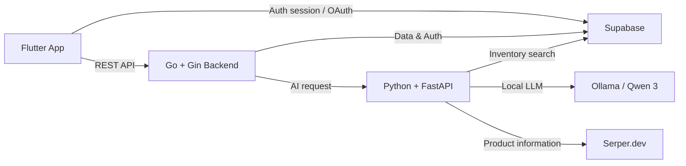

# Yuemnoi (ยืมหน่อย)

Yuemnoi คือแอปพลิเคชันสำหรับค้นหาและจัดการการเช่าอุปกรณ์ โดยประกอบด้วยแอป Flutter, Backend API และ AI Service สำหรับช่วยค้นหาและแนะนำอุปกรณ์จากข้อมูลในระบบ

> สถานะปัจจุบัน: ฝั่ง Flutter รองรับขั้นตอน Authentication แล้ว ส่วนหน้าหลักและฟีเจอร์เช่าอุปกรณ์ยังอยู่ระหว่างพัฒนา ขณะที่ Backend มี API สำหรับผู้ใช้ อุปกรณ์ การเช่า และ AI Chat

## สถาปัตยกรรมระบบ



## โครงสร้างโปรเจกต์

| โฟลเดอร์ | รายละเอียด | เอกสาร |
| --- | --- | --- |
| `frontend/` | Mobile/Web client พัฒนาด้วย Flutter | [Frontend README](frontend/README.md) |
| `backend/` | REST API พัฒนาด้วย Go และ Gin | [Backend README](backend/README.md) |
| `ai_service/` | AI pipeline พัฒนาด้วย FastAPI และใช้ Qwen ผ่าน Ollama | [AI Service README](ai_service/README.md) |

## เทคโนโลยีหลัก

- Flutter และ Dart สำหรับแอปพลิเคชันฝั่งผู้ใช้
- Go และ Gin สำหรับ Backend API
- Python และ FastAPI สำหรับ AI Service
- Supabase สำหรับ Authentication, PostgreSQL และ Storage
- Ollama + Qwen 3 สำหรับโมเดลภาษาที่รันภายในเครื่อง
- Serper.dev สำหรับค้นหาข้อมูลผลิตภัณฑ์ภายนอก

## สิ่งที่ต้องติดตั้ง

- [Flutter SDK](https://docs.flutter.dev/get-started/install) ที่รองรับ Dart `^3.11.5`
- [Go](https://go.dev/dl/) `1.26.2` ขึ้นไป
- [Python](https://www.python.org/downloads/) `3.10` ขึ้นไป
- [Ollama](https://ollama.com/download)
- Supabase project และ Serper.dev API key

ตรวจสอบเครื่องมือเบื้องต้น:

```bash
flutter doctor
go version
python --version
ollama --version
```

## การตั้งค่า Environment Variables

ไฟล์ environment ทุกไฟล์ถูก ignore จาก Git ให้สร้างไฟล์ต่อไปนี้ในเครื่องของผู้พัฒนา

### 1. Frontend — `frontend/.env.local`

```env
SUPABASE_URL=https://your-project.supabase.co
SUPABASE_PUBLISHABLE_KEY=your_publishable_key
API_URL=http://localhost:8080
```

`API_URL` ต้องเป็น URL ที่อุปกรณ์เข้าถึง Backend ได้ ดูตัวอย่างสำหรับ Emulator และเครื่องจริงใน [Frontend README](frontend/README.md#การเชื่อมต่อ-backend-จากแต่ละอุปกรณ์)

> ห้ามใส่ `SUPABASE_SERVICE_ROLE_KEY` หรือ secret ใด ๆ ใน `frontend/.env.local` เพราะไฟล์นี้ถูก bundle ไปกับแอป

### 2. Backend — `backend/.env`

```env
GIN_MODE=debug
PORT=8080
SUPABASE_URL=https://your-project.supabase.co
SUPABASE_SERVICE_ROLE_KEY=your_service_role_key
AI_SERVICE_URL=http://localhost:8000
STRIPE_SECRET_KEY=sk_test_your_test_key
STRIPE_WEBHOOK_SECRET=whsec_your_test_webhook_secret
STRIPE_PAYMENT_SUCCESS_URL=https://your-api.example.com/payments/return
STRIPE_PAYMENT_CANCEL_URL=https://your-api.example.com/payments/return
```

ตัวแปร Stripe ใช้สำหรับ Stripe-hosted Checkout เท่านั้น โดย Backend เป็นผู้คำนวณยอดและเก็บ secret ทั้งหมด แอป Flutter จะได้รับเฉพาะ Checkout URL และสถานะการชำระเงินเท่านั้น หากยังไม่ตั้งค่า Stripe ตัว Backend ส่วนอื่นยังเริ่มทำงานได้ แต่ endpoint สร้าง Checkout จะตอบว่า service ยังไม่พร้อม

ก่อนทดสอบการชำระเงิน ให้ตรวจ migration ที่ [`supabase/migrations/20260903115705_stripe_checkout_payments.sql`](supabase/migrations/20260903115705_stripe_checkout_payments.sql) แล้วจึงรันกับ Supabase project ที่ต้องการ ไฟล์นี้ยังไม่ถูกนำไปใช้กับฐานข้อมูลโดยอัตโนมัติ

Backend อ่านค่าจาก environment ของ process จึงต้อง export ค่าจากไฟล์ก่อนรัน ตัวอย่างสำหรับ PowerShell:

```powershell
cd backend
Get-Content .env | ForEach-Object {
  if ($_ -match '^\s*([^#][^=]*)=(.*)$') {
    [Environment]::SetEnvironmentVariable($matches[1].Trim(), $matches[2].Trim(), 'Process')
  }
}
go run ./cmd/server/main.go
```

### 3. AI Service — `ai_service/.env`

```env
SUPABASE_URL=https://your-project.supabase.co
SUPABASE_KEY=your_supabase_key
SERPER_API_KEY=your_serper_api_key
MODEL_NAME=qwen3:8b
OLLAMA_ENDPOINT=http://localhost:11434
OLLAMA_CONTEXT_LENGTH=4096
OLLAMA_KEEP_ALIVE=-1
```

## วิธีรันระบบสำหรับพัฒนา

เปิด Terminal แยกสำหรับแต่ละ service และรันตามลำดับต่อไปนี้

### 1. เตรียมโมเดล Ollama

```bash
ollama pull qwen3:8b
ollama serve
```

หาก Ollama ทำงานเป็น background service อยู่แล้ว ไม่ต้องรัน `ollama serve` ซ้ำ

### 2. รัน AI Service

```bash
cd ai_service
python -m venv .venv
```

Windows PowerShell:

```powershell
.venv\Scripts\Activate.ps1
pip install -r requirements.txt
python main.py
```

macOS/Linux:

```bash
source .venv/bin/activate
pip install -r requirements.txt
python main.py
```

AI Service จะเปิดที่ `http://localhost:8000` และตรวจสอบได้ที่ `GET /health`

### 3. รัน Backend

โหลดค่า `backend/.env` เข้า process ตามตัวอย่างด้านบน แล้วรัน:

```bash
cd backend
go mod download
go run ./cmd/server/main.go
```

Backend จะเปิดที่ `http://localhost:8080` และตรวจสอบได้ที่ `GET /health`

สำหรับ Stripe test mode ให้ตั้ง webhook มาที่ `POST /api/v1/webhooks/stripe` และเปิด payment methods ที่ต้องการใน Stripe Dashboard (บัตรและ PromptPay) สามารถ forward event จาก Stripe CLI ระหว่างพัฒนาได้ เช่น:

```bash
stripe listen --forward-to localhost:8080/api/v1/webhooks/stripe
```

นำ signing secret ที่ CLI แสดงไปตั้งเป็น `STRIPE_WEBHOOK_SECRET` ใน process เท่านั้น ห้าม commit ลง Git การกลับจาก Checkout ผ่าน `GET /payments/return` มีหน้าที่พาผู้ใช้กลับเข้าแอป ส่วน webhook ที่ตรวจลายเซ็นแล้วเท่านั้นที่ยืนยันสถานะ `paid`

### 4. รัน Flutter App

```bash
cd frontend
flutter pub get
flutter run
```

ดูรายละเอียดการตั้งค่า Supabase OAuth, การเลือกอุปกรณ์ และคำสั่งทดสอบได้ที่ [Frontend README](frontend/README.md)

## การทดสอบ

```bash
# Flutter
cd frontend
flutter analyze
flutter test

# Go
cd backend
go test ./...
```

ตรวจสอบ service ขณะระบบทำงาน:

```bash
curl http://localhost:8000/health
curl http://localhost:8080/health
```

## ข้อควรระวังด้านความปลอดภัย

- อย่า commit ไฟล์ `.env`, `.env.local`, API key หรือ token ลง Git
- ใช้ Supabase publishable key ใน Frontend เท่านั้น
- เก็บ service role key และ JWT secret ไว้เฉพาะฝั่ง Backend/Server
- ก่อน deploy ให้จำกัด CORS และตรวจสอบนโยบาย Supabase Row Level Security (RLS) ให้เหมาะสม
