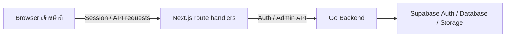

<div align="center">


# ยืมหน่อย · Admin

**พื้นที่ดูแลทุกการแบ่งปัน**

ติดตามภาพรวม ตรวจคำขอ และดูแลชุมชนยืมหน่อยในที่เดียว


[หน้าจอและงานที่รองรับ](#features) · [เริ่มใช้งาน](#setup) · [ดูหน้าตาด้วย Preview](#preview) · [ตรวจตัวตน](#identity) · [พัฒนา](#development) · [แก้ปัญหา](#troubleshooting)

[รู้จักยืมหน่อย](../README.md) / [Frontend](../frontend/README.md) / [Backend](../backend/README.md) / **Admin**

</div>

---

<a id="features"></a>

## 🧭 เปิดมาทำอะไรได้บ้าง

เว็บสำหรับบัญชีที่ได้รับสิทธิ์เจ้าหน้าที่ ใช้ Go Backend ตรวจสิทธิ์และจัดการข้อมูล รองรับหน้าจอขนาดเล็ก โหมดสว่าง/มืด และฟอนต์ไทย Prompt

การล็อกอินผ่าน server เรียก `POST /api/admin/login` แล้วตรวจ `/api/admin/me` ก่อนเก็บ HttpOnly cookie จึงรองรับบัญชี `app_metadata.dashboard_only = true` ที่ถูกปฏิเสธจากแอปมือถือ ต้องใช้ backend รุ่นที่มี endpoint นี้ร่วมกัน การกำหนด `dashboard_only` ไม่ได้เพิ่มสิทธิ์เจ้าหน้าที่ให้บัญชีทั่วไป

| หน้าจอ | ใช้ทำอะไร | เส้นทาง |
| --- | --- | --- |
| ภาพรวม | ดูสถิติ แนวโน้ม และงานที่รอดำเนินการ พร้อมส่งออก CSV และพิมพ์สรุปเป็น PDF | `/overview` |
| ยืนยันตัวตน | ตรวจข้อมูล ภาพบัตร และใบหน้า ก่อนพิจารณาคำขอ | `/identity` |
| ผู้ใช้ | ค้นหาบัญชี ดูสถานะ และระงับบัญชี | `/users` |
| สินค้า | ตรวจประกาศและจัดการสินค้าที่ผิดกฎ | `/items` |
| การเช่า | ติดตามคำขอเช่าและสถานะส่งคืน | `/bookings` |
| รีวิว | ตรวจความคิดเห็นและจัดการรีวิวที่ไม่เหมาะสม | `/reviews` |
| ร้องเรียน | รับเรื่อง ติดตาม และบันทึกผลดำเนินการ | `/complaints` |
| เจ้าหน้าที่ | จัดการบัญชีเจ้าหน้าที่ | `/staff` |
| ประวัติการทำงาน | ตรวจการเข้าถึงหลักฐานและการดำเนินงาน | `/audit` |
| ตั้งค่า | จัดการข้อกำหนดการยืนยันตัวตนก่อนปล่อยเช่า | `/settings` |
| สถานะระบบ | ตรวจความพร้อมของบริการ | `/health` |

> มูลค่าการจองในรายงานเป็นข้อมูลการเช่า ยังไม่ใช่ยอดรับชำระเงินจริง

ประกาศใหม่และประกาศที่แก้เนื้อหาจะเข้าคิว `รอตรวจสอบประกาศ` เจ้าหน้าที่ตรวจรายละเอียดและรูปก่อนอนุมัติให้ปรากฏในฟีด หรือปฏิเสธพร้อมบันทึกเหตุผล

<a id="setup"></a>

## 🚀 เริ่มใช้งาน

### สิ่งที่ต้องเตรียม

- **Node.js และ npm** ที่รองรับ dependencies ใน [package-lock.json](package-lock.json); Next.js รุ่นนี้ต้องการ Node.js ≥ 20.9.0
- **Go Backend ที่พร้อมใช้งาน** พร้อมฐานข้อมูลของ environment นั้น เปิด `OPERATIONS_ENABLED=true` และตั้ง identity encryption/HMAC keys ตาม [คู่มือ Backend](../backend/README.md)
- **บัญชีที่มีสิทธิ์เจ้าหน้าที่** การมีบัญชีผู้ใช้ทั่วไปอย่างเดียวจะยังเข้า Admin ไม่ได้

ขั้นตอนตรวจตัวตนไม่ต้องใช้ AI Service ส่วน schema, RPC และ Storage ต้องเตรียมให้ตรงกับ Backend ก่อนใช้งานจริง เนื่องจาก checkout นี้ไม่มีชุด SQL migrations สำหรับติดตั้งระบบใหม่ครบชุด

### 1. ติดตั้ง dependencies

จาก root ของ repository:

```powershell
cd admin
npm ci
```

### 2. สร้างไฟล์ `.env.local`

สร้างไฟล์ในโฟลเดอร์ `admin/` แล้วปรับค่าตาม environment ที่ใช้:

```dotenv
BACKEND_URL=http://127.0.0.1:8080
BACKEND_APP_SECRET=replace-with-backend-app-key
ADMIN_ORIGIN=http://127.0.0.1:3000
ADMIN_PREVIEW=false
```

| ตัวแปร | ตั้งค่าอย่างไร |
| --- | --- |
| `BACKEND_URL` | URL ของ Go Backend เช่น `http://127.0.0.1:8080` โดยไม่ต่อ `/api` |
| `BACKEND_APP_SECRET` | ใช้คีย์หนึ่งตัวที่ตรงกับ `APP_SECRET_KEY` หรือรายการ `APP_SECRET_KEYS` ฝั่ง Backend; จำเป็นเมื่อ Backend บังคับ app key |
| `ADMIN_ORIGIN` | Origin ที่ใช้เปิดเว็บจริง รวม protocol และ port; ตั้งให้ตรงเมื่อใช้งานผ่าน reverse proxy |
| `ADMIN_PREVIEW` | ตั้ง `true` เมื่อต้องการเปิด preview ใน development |

ค่าฝั่ง server เหล่านี้อ่านผ่าน route handlers ให้เก็บใน `.env.local` หรือระบบจัดการ environment ของเครื่องที่รันเว็บ

<details>
<summary>กรณีใช้ขั้นตอนตั้งรหัสผ่านบัญชีแรก</summary>

Endpoint `/api/activate` ใช้ `SUPABASE_URL`, `SUPABASE_PUBLISHABLE_KEY` และไฟล์ `.setup-token.json` ที่ผู้ดูแลเตรียมไว้ในเครื่องด้วย ขั้นตอนนี้เปิดเฉพาะ origin แบบ loopback เช่น `127.0.0.1` หรือ `localhost` และลบไฟล์ token เมื่อสำเร็จ ดูเงื่อนไขใน [activation route](src/app/api/activate/route.ts)

</details>

### 3. เปิดเว็บ

```powershell
npm run dev -- --port 3000
```

เปิด [http://127.0.0.1:3000](http://127.0.0.1:3000) แล้วเข้าสู่ระบบด้วยบัญชีเจ้าหน้าที่ ระบบจะพาไปหน้าภาพรวม

> ใช้ hostname ให้ตรงกับ `ADMIN_ORIGIN` เช่น หากตั้ง `127.0.0.1` ให้เปิดด้วย `127.0.0.1` เพราะ `localhost` ถือเป็นคนละ origin เมื่อแก้ env ให้ restart server

<a id="preview"></a>

## 🎨 ดูหน้าตาด้วย Preview

ใช้ตรวจโครงหน้าจอโดยไม่ต้องเชื่อมบัญชีเจ้าหน้าที่ ตั้งค่าใน `.env.local` เป็น:

```dotenv
ADMIN_PREVIEW=true
```

จากนั้น restart development server แล้วเปิด [ภาพรวม](http://127.0.0.1:3000/preview/overview) หรือ [หน้ายืนยันตัวตน](http://127.0.0.1:3000/preview/identity) หน้าอื่นใช้รูปแบบ `/preview/<section>` ตามตารางด้านบน

Preview ไม่ดึงข้อมูลจริงและปิดปุ่มดำเนินการ รวมถึง export จึงเหมาะกับการตรวจ layout, responsive และโหมดสว่าง/มืด เส้นทางนี้เปิดเฉพาะ development; production จะตอบ 404

<a id="identity"></a>

## 🪪 ตรวจตัวตนอย่างไร

ทุกวัยใช้คิวเดียวกัน เจ้าหน้าที่ตรวจหลักฐานด้วยตนเอง โดยดูข้อมูลที่ผู้ใช้กรอกเทียบกับภาพบัตรและใบหน้า

1. เปิดคำขอและตรวจข้อมูลกับหลักฐานให้ครบ
2. เลือก **อนุมัติ**, **ขอข้อมูลเพิ่ม** หรือ **ปฏิเสธ** ตามผลตรวจ
3. ยืนยันว่าตรวจหลักฐานแล้ว การอนุมัติไม่ต้องกรอกอายุบัตร วันหมดอายุ หรือเหตุผล
4. หากขอข้อมูลเพิ่มหรือปฏิเสธ ต้องระบุเหตุผลก่อนบันทึก ระบบตรวจเงื่อนไขฝั่ง Backend และเก็บประวัติการดำเนินงาน

ติดตั้ง [migration สำหรับฟอร์มอนุมัติ](../supabase/migrations/20261017083657_simplify_identity_approval.sql) และ [migration ยกเลิกอายุบัตร](../supabase/migrations/20261017132150_remove_identity_card_expiry.sql) ก่อนใช้งาน ผลอนุมัติและสิทธิ์ปล่อยเช่าไม่ใช้วันหมดอายุบัตร รวมถึงค่าที่เคยบันทึกไว้หรือส่งมาจาก client รุ่นเดิม รายละเอียด contract อยู่ใน [Backend README](../backend/README.md)

<a id="development"></a>

## 🛠️ สำหรับผู้พัฒนา

### คำสั่งที่ใช้บ่อย

รันจากโฟลเดอร์ `admin/`:

| คำสั่ง | หน้าที่ |
| --- | --- |
| `npm ci` | ติดตั้ง dependencies ตาม lockfile |
| `npm run dev -- --port 3000` | เปิด development server |
| `npm run check` | ตรวจ TypeScript |
| `npm run build` | สร้าง production build |
| `npm run start -- --port 3000` | เปิด production server หลัง build |
| `npm test` | รัน `tests/**/*.test.ts` รวมโฟลเดอร์ย่อย เมื่อมีไฟล์ทดสอบและ Node.js รองรับ `--experimental-strip-types` |

เตรียม [tests/](tests/) แยกตามส่วนของ `src/` แล้ว แต่ยังไม่มี test cases ดูแนวทางเพิ่มไฟล์ใน [tests/README.md](tests/README.md) จึงยังใช้ `npm test` ยืนยันพฤติกรรมหรือ coverage ไม่ได้ สำหรับการแก้โค้ดให้ตรวจด้วย `npm run check` และ `npm run build` พร้อมเปิดหน้าที่เกี่ยวข้องตรวจพฤติกรรมจริง

### โครงสร้างที่ควรรู้

```text
admin/
├── public/brand.png           # โลโก้แอป
├── src/
│   ├── app/                   # Pages, layout และ styles
│   │   ├── api/               # Session, activation และ Go API proxy
│   │   └── preview/           # Preview สำหรับ development
│   ├── components/            # Dashboard, identity และ UI ที่ใช้ร่วมกัน
│   ├── fonts/                 # Prompt font ที่โหลดจากไฟล์ในโปรเจ็กต์
│   └── lib/                   # API helpers, catalog, reports และ CSV export
├── tests/                    # โครงสร้างทดสอบตามส่วนของ src; ยังไม่มี test cases
├── .env.local                 # ค่าตั้งเฉพาะ environment — สร้างเอง
├── next.config.ts             # Next.js และ security headers
└── package.json               # Dependencies และ scripts
```

### การเชื่อมต่อและข้อมูลส่วนตัว



- เก็บ session ใน HttpOnly cookie และตรวจสิทธิ์เจ้าหน้าที่ผ่าน Go Backend
- คำขอข้อมูลจาก browser ผ่าน `/api/ops/*` ไป `/api/admin/*`; ตรวจ same-origin สำหรับคำขอที่เปลี่ยนข้อมูล
- หลักฐานตัวตนส่งผ่าน proxy ที่ตรวจสิทธิ์ โดย browser ไม่อ่านข้อมูลตัวตนจาก Supabase โดยตรง
- Export CSV ผ่าน `src/lib/export.ts` ซึ่งตัด fields ข้อมูลตัวตน/หลักฐานที่กำหนดไว้ และป้องกันสูตรแฝงในเซลล์

Development และ production scripts ฟังที่ `127.0.0.1` หากเปิดใช้งานผ่าน reverse proxy ให้กำหนด `ADMIN_ORIGIN` เป็น origin ภายนอกที่เจ้าหน้าที่ใช้งานจริง อ่านกติกาแก้โค้ดเพิ่มเติมใน [AGENTS.md](AGENTS.md)

<a id="troubleshooting"></a>

## 💡 ติดตรงไหน ลองเช็กตรงนี้

| อาการ | สิ่งที่ควรตรวจ |
| --- | --- |
| เข้าสู่ระบบแล้วแจ้งว่าไม่มีสิทธิ์เจ้าหน้าที่ | สิทธิ์บัญชี, `OPERATIONS_ENABLED`, app key และความพร้อมของ `/api/admin/me` ฝั่ง Backend |
| ขึ้น “ระบบเข้าสู่ระบบยังไม่พร้อม” | `BACKEND_URL`, การเชื่อมต่อ Backend และ log `admin_session_failed` ใน terminal |
| ขึ้น “ไม่อนุญาตคำขอนี้” | Protocol, hostname และ port ต้องตรงกับ `ADMIN_ORIGIN` |
| Preview เปิดแล้ว 404 | ต้องรัน development, ตั้ง `ADMIN_PREVIEW=true` และ restart server แล้ว |
| แสดงข้อผิดพลาดระหว่างโหลดข้อมูล | ตรวจ Backend, schema/RPC ของ environment และ session เจ้าหน้าที่ |
| อนุมัติคำขอไม่ได้ | ตรวจการยืนยันหลักฐาน การติดตั้ง migration สำหรับฟอร์มอนุมัติ และ error ที่ Backend ส่งกลับ |
| `npm test` ไม่มีชุดทดสอบให้รัน | `tests/` ยังไม่มี test cases ดูแนวทางเพิ่มไฟล์ใน `tests/README.md` |

---

รายละเอียดเทคโนโลยีและเวอร์ชันเต็มอยู่ใน [package.json](package.json) · การตั้งค่า API อยู่ใน [Backend README](../backend/README.md)
