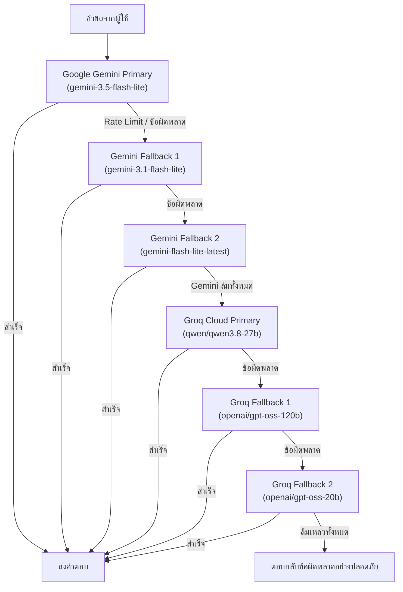

# 🤖 AI Service: ยืมหน่อย AI Rental Consultant (FastAPI)

[](https://python.org)
[](https://fastapi.tiangolo.com)
[](https://ai.google.dev)
[](https://groq.com)
[](https://tavily.com)

ไมโครเซอร์วิสผู้ช่วยอัจฉริยะ **ยืมหน่อย AI (Rental Consultant)** พัฒนาด้วย **Python 3.12** และ **FastAPI** ภายใต้สถาปัตยกรรม **Clean Architecture** ทำหน้าที่ให้คำปรึกษา แนะนำอุปกรณ์ เปรียบเทียบสเปก และตอบข้อซักถามของผู้ใช้งาน โดยเชื่อมต่อกับคลังสินค้าจริงใน Supabase (`item_tb`) และตรวจสอบข้อมูลทางเทคนิคภายนอกผ่าน Tavily Search API

---

## 📑 สารบัญ (Table of Contents)

1. [สถาปัตยกรรม Clean Architecture](#-สถาปัตยกรรม-clean-architecture)
2. [หลักการและข้อกำหนดเข้มงวด (Strict Architectural Policies)](#-หลักการและข้อกำหนดเข้มงวด-strict-architectural-policies)
3. [กลไก Dual-Cloud Cascade Failover](#-กลไก-dual-cloud-cascade-failover)
4. [โครงสร้างไดเรกทอรี (Directory Structure)](#-โครงสร้างไดเรกทอรี-directory-structure)
5. [โฟลว์การทำงานสำคัญ (Core Workflows)](#-โฟลว์การทำงานสำคัญ-core-workflows)
6. [ข้อกำหนดเบื้องต้นและการติดตั้ง (Getting Started)](#-ข้อกำหนดเบื้องต้นและการติดตั้ง-getting-started)
7. [การตั้งค่า Environment Variables](#-การตั้งค่า-environment-variables)
8. [API Endpoints Reference](#-api-endpoints-reference)
9. [การทดสอบ (Testing)](#-การทดสอบ-testing)

---

## 🏛️ สถาปัตยกรรม Clean Architecture

โค้ดทั้งหมดปฏิบัติตามหลัก Clean Architecture โดยความสัมพันธ์ของการเรียกใช้งานจะชี้ **เข้าสู่ด้านใน (Inward Only)** เท่านั้น:

```text
Domain (Pure Python)
  ▲
  │
Application (Use Cases, Domain Services, DTOs)
  ▲
  │
Infrastructure (Adapters: LLM, Tavily, Supabase, Cache) & Interface (FastAPI Controllers)
```

- **`app/domain/`**: แกนกลางธุรกิจ (Pure Python Entities) ปราศจากการพึ่งพา Framework เช่น `Item`, `ChatMessage`, `IntentDecision`, `ComparisonMatrix`, `ClarificationQuestion` และ Interface Ports (`LLMServiceInterface`, `ItemRepositoryInterface`, `SearchServiceInterface`, `CacheServiceInterface`)
- **`app/application/`**: Use Cases ตามหลัก Single Responsibility Principle (SRP):
  - `RouteIntentUseCase`: จำแนกเจตนาและความคลุมเครือของผู้ใช้โดยไม่ใช้ Keyword
  - `QueryItemsUseCase`: ค้นหาและจับคู่อุปกรณ์จากคลังสินค้าด้วยความหมายเชิงบริบท
  - `CompareItemsUseCase`: ประสานงานเปรียบเทียบอุปกรณ์ ตรวจสอบข้อเท็จจริง และสังเคราะห์ผลลัพธ์
  - `GenerateClarificationUseCase`: สร้างคำถามเจาะจงและปุ่มตัวเลือกตอบ (Actionable Choices)
  - `ProcessChatMessageUseCase`: ตัวควบคุมลำดับงานหลัก (Master Orchestrator)
- **`app/infrastructure/`**: จัดการเชื่อมต่อกับระบบภายนอก:
  - `llm/`: จัดการสลับโมเดล Dual-Cloud ระหว่าง Google Gemini และ Groq Cloud
  - `search/`: ดึงข้อมูลเปรียบเทียบผ่าน Tavily Search API
  - `database/`: เชื่อมต่อ Supabase เพื่ออ่านรายการสินค้า
  - `cache/`: In-Memory Catalog Cache (TTL 300 วินาที) ลดโหลดฐานข้อมูล
- **`app/interface/`**: รับคำขอผ่าน REST API และ SSE Streaming

---

## 🚫 หลักการและข้อกำหนดเข้มงวด (Strict Architectural Policies)

### 1. นโยบายไร้คีย์เวิร์ด ไร้ Regex ไร้การฮาร์ดโค้ด (Zero-Regex, Zero-Keyword, Zero-Hardcode)
- **ห้ามจับคู่คีย์เวิร์ด (Zero-Keyword Policy)**: ไม่ใช้คำสั่ง `if "กล้อง" in text:` หรือ `if "compare" in text:` ในโค้ด และไม่ฮาร์ดโค้ดลิสต์ประโยคตัวอย่างลงใน System Prompt ทุกอย่างต้องวิเคราะห์ด้วย AI Semantic Intent และ Pydantic Schema
- **ห้ามใช้ Regular Expressions (No Regex)**: ไม่ใช้ `re.search()` หรือ Pattern ใดๆ ในการสกัด Entities หรือความคลุมเครือ
- **ห้ามฮาร์ดโค้ดข้อมูล (Strictly Zero-Hardcode Policy)**: ห้ามใส่ค่าคงที่ แคตตาล็อกสินค้า หรือคำตอบสำเร็จรูป (Canned Responses) ลงในโค้ด ข้อมูลสินค้าต้องดึงสดจาก Supabase และคำตอบต้องสร้างขึ้นตามบริบทจริง

### 2. นโยบายความเป็นกลาง 100% (Strict Neutrality & Zero-Bias)
- **ไม่เอนเอียงตามแบรนด์หรือร้านค้า**: แนะนำสินค้าตามความสอดคล้องกับความต้องการของผู้ใช้และงบประมาณอย่างเป็นกลาง
- **ระบุข้อดี-ข้อเสียตามจริง**: แสดงจุดเด่นและข้อจำกัดของอุปกรณ์ตามสเปกทางเทคนิคที่ผ่านการตรวจสอบแล้ว โดยไม่มีการโฆษณาเกินจริง
- **การเปรียบเทียบกับภายนอก**: หากอุปกรณ์นอกร้านมีความเหมาะสมกับงานของผู้ใช้มากกว่า ให้ระบุตามจริงอย่างสุภาพโดยไม่กดดันให้เช่าสินค้าในร้าน

### 3. ระบบคลาวด์ฟรี 100% (100% Free Cloud API Policy)
- ไม่พึ่งพา Local Ollama หรือ GPU ในเครื่องของผู้ใช้
- ใช้บริการคลาวด์ระดับฟรีโดยไม่ต้องผูกบัตรเครดิต (Google Gemini Free Tier & Groq Cloud Free Tier)

---

## ⚡ กลไก Dual-Cloud Cascade Failover

ระบบมีระบบสำรองคู่ขนาน (Cascade Failover) รับประกันความพร้อมใช้งานสูง (High Availability):



---

## 📁 โครงสร้างไดเรกทอรี (Directory Structure)

```text
ai_service/
├── app/
│   ├── application/
│   │   ├── dtos/                # Data Transfer Objects (chat, item, clarification)
│   │   ├── services/            # FactVerificationService (กรองสแปม ตรวจสอบสเปก)
│   │   └── use_cases/           # Intent Routing, Item Querying, Comparison, Clarification
│   ├── core/
│   │   ├── config.py            # การอ่าน Environment Variables ผ่าน Pydantic Settings
│   │   ├── container.py         # Dependency Injection Container เชื่อม Port กับ Adapter
│   │   ├── exceptions.py        # Custom Domain Exceptions
│   │   └── logging.py           # Structured Logging Setup
│   ├── domain/
│   │   ├── entities/            # Pydantic Domain Models
│   │   └── interfaces/          # Protocol / ABC Interfaces
│   ├── infrastructure/
│   │   ├── cache/               # In-memory TTL Cache Service
│   │   ├── database/            # Supabase PostgREST Client Adapter
│   │   ├── llm/                 # GeminiClient, GroqClient, MultiProviderLLMService
│   │   ├── prompts/             # Prompt Templates ภาษาไทย
│   │   └── search/              # TavilyClient Adapter
│   └── interface/
│       ├── api/v1/
│       │   ├── endpoints/       # chat.py, items.py, health.py
│       │   └── router.py        # API Router Grouping
│       └── schemas/             # Pydantic Request & Response Schemas
├── tests/                       # Unit & Integration Tests (pytest, pytest-asyncio)
├── requirements.txt             # Python Package Dependencies
└── main.py                      # จุดเริ่มต้นรันเซิร์ฟเวอร์ FastAPI (Port 8000)
```

---

## 🔄 โฟลว์การทำงานสำคัญ (Core Workflows)

### 1. โฟลว์การเปรียบเทียบอุปกรณ์และตรวจสเปก (Fact-Checking & Comparison)
1. **Catalog Retrieval**: ค้นหาอุปกรณ์ที่เกี่ยวข้องจาก `item_tb`
2. **Search Query Generation**: สร้างข้อความค้นหาสเปกเชิงลึกอัตโนมัติ
3. **Web Search**: ค้นหาผลลัพธ์ผ่าน Tavily Search API
4. **Fact Verification Engine**: LLM ตรวจสอบและตัดโฆษณาแฝง สกัดสเปกจริง (เช่น เซนเซอร์, ความละเอียด, พอร์ตเชื่อมต่อ, น้ำหนัก)
5. **Grounded Synthesis**: เรียบเรียงคำตอบเป็นภาษาไทย เปรียบเทียบราคาเช่าในร้านกับความคุ้มค่า

### 2. โฟลว์ถามกลับเมื่อข้อมูลไม่ชัดเจน (Interactive Clarification)
1. ตรวจพบว่าคำถามคลุมเครือ (`ambiguity_level >= 0.5`)
2. ดึงหมวดหมู่สินค้าจริงในร้านจาก Cache
3. สังเคราะห์คำถามเจาะจง พร้อมตัวเลือก 3-4 ข้อ (`ChoiceOption` ที่มี `id`, `label`, `description`, `action_value`)
4. ฝั่ง Flutter นำตัวเลือกไปแสดงเป็นปุ่มกด Interactive Chips ให้ผู้ใช้แตะเลือกได้ทันที

---

## 📋 ข้อกำหนดเบื้องต้นและการติดตั้ง (Getting Started)

### ข้อกำหนด
- **Python**: เวอร์ชัน `3.12`
- API Key สำหรับ **Google Gemini** (Google AI Studio)
- API Key สำหรับ **Groq Cloud**
- API Key สำหรับ **Tavily Search**

### ขั้นตอนการติดตั้งและรันเซิร์ฟเวอร์

```bash
cd ai_service

# 1. สร้าง Virtual Environment
python -m venv .venv

# 2. เปิดใช้งาน Virtual Environment
# Windows:
.\.venv\Scripts\activate
# macOS / Linux:
# source .venv/bin/activate

# 3. ติดตั้ง Dependencies
pip install -r requirements.txt

# 4. เริ่มต้นรันเซิร์ฟเวอร์
python main.py
```
> เซิร์ฟเวอร์จะรันที่ `http://localhost:8000` (เข้าดูเอกสาร API ได้ที่ `http://localhost:8000/docs`)

---

## ⚙️ การตั้งค่า Environment Variables

สร้างไฟล์ `.env` ในโฟลเดอร์ `ai_service/`:

```env
# แอปพลิเคชัน
APP_NAME="Yuemnoi AI Service"
APP_ENV=production
LOG_LEVEL=INFO
CACHE_TTL_SECONDS=300
HTTP_TIMEOUT_SECONDS=30.0

# ฐานข้อมูลและการยืนยันสิทธิ์ภายในระบบ
SUPABASE_URL=https://your-project.supabase.co
SUPABASE_KEY=your-supabase-service-role-or-anon-key
INTERNAL_SERVICE_KEY=your-internal-shared-service-key-32chars

# กุญแจ API ผู้ให้บริการ AI (ฟรี 100%)
GEMINI_API_KEY=your-google-gemini-api-key
GROQ_API_KEY=your-groq-cloud-api-key
TAVILY_API_KEY=your-tavily-search-api-key

# ลำดับโมเดลสำรอง (Cascade Models)
GEMINI_PRIMARY_MODEL=gemini-3.5-flash-lite
GEMINI_FALLBACK_MODEL_1=gemini-3.1-flash-lite
GEMINI_FALLBACK_MODEL_2=gemini-flash-lite-latest

GROQ_PRIMARY_MODEL=qwen/qwen3.8-27b
GROQ_FALLBACK_MODEL_1=openai/gpt-oss-120b
GROQ_FALLBACK_MODEL_2=openai/gpt-oss-20b
```

---

## 🌐 API Endpoints Reference

### `GET /health`
ตรวจสอบสถานะของระบบย่อยทั้งหมด (Gemini, Groq, Supabase, Tavily):
```json
{
  "status": "healthy",
  "gemini": "ok",
  "groq": "ok",
  "supabase": "ok",
  "tavily": "ok"
}
```

### `GET /api/v1/items`
ดึงรายการอุปกรณ์ให้เช่าทั้งหมดที่บันทึกอยู่ใน In-Memory Cache

### `POST /api/v1/chat`
ส่งข้อความสนทนาและรับผลลัพธ์เป็น JSON สมบูรณ์ (รวมถึงข้อความตอบกลับ, รายการสินค้าที่แนะนำ และตัวเลือก Clarification)

### `POST /api/v1/chat/stream`
สตรีมคำตอบของ AI แบบ Server-Sent Events (SSE) เหมาะสำหรับแอปพลิเคชันมือถือที่ต้องการแสดงผลข้อความพิมพ์สดแบบเรียลไทม์

---

## 🧪 การทดสอบ (Testing)

รันชุดการทดสอบทั้งหมดผ่าน `pytest`:

```bash
# Windows
.\.venv\Scripts\python.exe -m pytest tests/ -v

# macOS / Linux
pytest tests/ -v
```

ชุดการทดสอบครอบคลุม:
- `test_use_cases.py`: ทดสอบการจำแนกเจตนา (Intent Routing), การจับคู่อุปกรณ์ และการสร้างตัวเลือก Clarification
- `test_model_cascade.py`: ทดสอบกลไกการสลับผู้ให้บริการเมื่อ Primary Provider ไม่พร้อมใช้งาน
- `test_api_endpoints.py`: ทดสอบ Integration ระดับ API Endpoint ผ่าน TestClient
