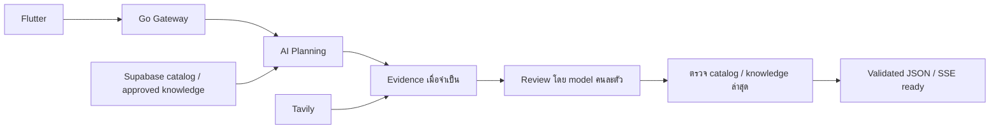

<div align="center">


# ยืมหน่อย · AI Service

**ผู้ช่วยคุยเรื่องอุปกรณ์ โดยอิงคลังจริงและหลักฐานที่ตรวจได้**


[ภาพรวม](#overview) · [Tech stack](#stack) · [ตั้งค่า](#setup) · [เริ่มรัน](#run) · [API](#api) · [Runtime](#runtime) · [ตรวจงาน](#development) · [แก้ปัญหา](#troubleshooting)

[Project](../README.md) / [Frontend](../frontend/README.md) / [Backend](../backend/README.md) / **AI Service**

</div>

---

<a id="overview"></a>

## ✨ ส่วนนี้ทำอะไร

Python service ของ **Yuemnoi** ใช้ FastAPI เป็น API ให้ Go Backend เรียก ค้นข้อมูลอุปกรณ์จาก Supabase สร้างคำตอบผ่าน Gemini / Groq และใช้ Tavily เมื่อ flow ต้องการหลักฐานทางเทคนิคจากภายนอก

| ความสามารถ         | สิ่งที่ service ทำ                                                 |
| ------------------ | ------------------------------------------------------------------ |
| 💬 Conversation    | ตอบบทสนทนาและรักษาบริบทเฉพาะ session ปัจจุบัน                      |
| 📚 App information | ใช้ข้อเท็จจริงเกี่ยวกับแอปจาก knowledge ที่มีสถานะอนุมัติ          |
| 🔎 Catalog         | อ่านคลังจริง, แสดงภาพรวม, รายละเอียด และแนะนำอุปกรณ์ตามความต้องการ |
| 📝 Clarification   | สร้างแบบสอบถามเมื่อข้อมูลยังไม่ครบ พร้อม question / option IDs     |
| ⚖️ Comparison      | จัดคำตอบเปรียบเทียบและข้อมูลเทคนิค พร้อม evidence เมื่อมี          |
| ✅ Response review | ให้ actual model คนละตัวตรวจคำตอบก่อนเผยแพร่                       |
| ⚡ JSON / SSE      | ส่งผลที่ผ่านการตรวจเป็น JSON หรือ SSE พร้อมการ์ดและ references     |

Service ใช้ **Cloud APIs** ไม่มี local model / Ollama / GPU เป็น dependency ของการติดตั้ง และใช้ HTTPX adapters โดยตรง จึงไม่ต้องติดตั้ง SDK ของ Gemini, Groq, Tavily หรือ Supabase เพิ่มนอก requirements

### คำตอบเดินทางอย่างไร



คำตอบ, แบบสอบถาม, ตัวเลือก, การ์ด, suggested replies และ references ต้องผ่าน review หากถูกปฏิเสธคุณภาพจะกู้ได้หนึ่งรอบและตรวจทั้งคำตอบใหม่ด้วยโมเดลคนละตัว หากยังไม่ผ่านจะคืน error โดยไม่เผยแพร่ draft

SSE ส่งคำตอบฉบับครบใน event `ready` แล้วจึงส่ง `metadata`, `delta` และ `done` การทยอยแสดงข้อความจึงเกิดหลังตรวจคำตอบครบแล้ว ส่วน session context ไม่ใช่ระบบเก็บความทรงจำระยะยาวตามบัญชี

ก่อน `ready` บริการส่ง `event: status` พร้อม `step` และ `message` ตามขั้นตอนจริง: `preparing` เตรียมข้อมูล, `planning` วิเคราะห์คำถาม, `evidence` สร้างคำตอบ, `review` ตรวจคำตอบ และ `repair` ปรับปรุงคำตอบเมื่อผลตรวจไม่ผ่าน สถานะผูกกับแต่ละคำขอและส่งทันทีที่เริ่มขั้นตอน จึงอาจข้ามขั้นที่ไม่ได้ใช้หรือกลับมาตรวจหลังปรับปรุง โดยไม่เพิ่มการเรียกโมเดล เมื่อ client ปิด stream งานที่กำลังทำจะถูกยกเลิก

<a id="stack"></a>

## 🧰 Tech stack & versions

[requirements.txt](requirements.txt) ระบุ **เวอร์ชันขั้นต่ำแบบ `>=`** และไม่มี dependency lockfile จึงอาจติดตั้งได้คนละ patch / minor version ในแต่ละเครื่อง

| เครื่องมือ         | ข้อกำหนดในโปรเจกต์     | Snapshot metadata ในเครื่องที่ตรวจ\* | หน้าที่                       |
| ------------------ | ---------------------- | ------------------------------------ | ----------------------------- |
| Python             | **3.12** ตาม AGENTS.md | 3.12.0                               | Runtime                       |
| FastAPI            | ≥ 0.115.0              | 0.142.2                              | API / OpenAPI                 |
| Uvicorn [standard] | ≥ 0.30.0               | 0.54.0                               | ASGI server                   |
| Pydantic           | ≥ 2.8.0                | 2.13.5                               | Structured output validation  |
| pydantic-settings  | ≥ 2.4.0                | 2.15.0                               | Typed env configuration       |
| HTTPX              | ≥ 0.27.0               | 0.28.1                               | Async HTTP / connection pools |
| pytest             | ≥ 8.3.0                | 9.1.1                                | Tests                         |
| pytest-asyncio     | ≥ 0.24.0               | 1.4.0                                | Async tests                   |

<a id="setup"></a>

## ⚙️ เตรียมเครื่อง & configuration

### 1. สิ่งที่ต้องมี

- Git และ Python **3.12** พร้อม `venv` / pip ดู [Python venv guide](https://docs.python.org/3.12/library/venv.html)
- Supabase project และ credential ที่อ่าน catalog ผ่าน PostgREST ได้
- API keys ของ [Gemini](https://ai.google.dev/gemini-api/docs/api-key) และ [Groq](https://console.groq.com/docs/quickstart) สำหรับ profiles ที่เปิดใช้
- [Tavily API key](https://docs.tavily.com/documentation/quickstart) เมื่อต้องค้นหลักฐานภายนอก
- อินเทอร์เน็ตออกไปยัง APIs และพื้นที่เขียน state / lock files ของ service
- Go Backend สำหรับ flow จากแอป; สามารถตรวจ AI API โดยตรงระหว่างพัฒนาได้

การ review ต้องมี **actual model อย่างน้อยสองตัวที่ใช้งานได้และต่างกัน** การมี key หรือ health flag ว่า configured ยังไม่ยืนยันสิทธิ์เรียก model / structured output ทุกตัว

### 2. เตรียม catalog

AI อ่าน `item_tb` ผ่าน Supabase REST โดยใช้ columns:

```text
id, item_name, category, price, type, status, item_image_url, description
```

ราคาเป็นตัวเลข finite ที่ไม่ติดลบ, `type` ต้องไม่ว่าง และสถานะพร้อมเช่าที่ domain ใช้คือ `available` เมื่อเทียบแบบ lowercase รูปอาจเป็น URL เดี่ยว, list หรือ JSON-encoded list จำนวนสินค้าขึ้นกับฐานข้อมูลจริง

Service นี้อ่าน URL รูปที่มีอยู่แล้ว ไม่มีการอัปโหลด Storage, ไม่ใช้ Firebase service account และไม่ต้องใช้ direct PostgreSQL connection ขอ schema / permissions ของ environment ตาม [Backend setup](../backend/README.md#setup) เพราะไม่มี SQL bootstrap ในส่วน AI

### 3. สร้างไฟล์ `.env`

สร้างใน `ai_service/` ไม่มีไฟล์ `.env.example` ใน checkout นี้ แทนค่า placeholder ด้วยค่าจริง และใช้ internal key เดียวกับ Backend

```dotenv
APP_NAME="Yuemnoi AI Service"
APP_ENV=development
LOG_LEVEL=INFO
CACHE_TTL_SECONDS=300

SUPABASE_URL=https://your-project.supabase.co
SUPABASE_KEY=replace-with-server-catalog-access-key
GEMINI_API_KEY=replace-with-gemini-api-key
GROQ_API_KEY=replace-with-groq-api-key
TAVILY_API_KEY=replace-with-tavily-api-key
INTERNAL_SERVICE_KEY=replace-with-shared-internal-key-at-least-32-chars
```

| ตัวแปรหลัก             | Default              | ต้องตั้งเมื่อ / ความหมาย                                              |
| ---------------------- | -------------------- | --------------------------------------------------------------------- |
| `SUPABASE_URL`         | ว่าง                 | อ่าน catalog; project base URL                                        |
| `SUPABASE_KEY`         | ว่าง                 | อ่าน `item_tb` ผ่าน PostgREST; ต้องมีสิทธิ์ตรงกับ integration         |
| `GEMINI_API_KEY`       | ว่าง                 | ใช้ Gemini profiles ที่เปิดไว้                                        |
| `GROQ_API_KEY`         | ว่าง                 | ใช้ Groq profiles ที่เปิดไว้                                          |
| `TAVILY_API_KEY`       | ว่าง                 | ค้นข้อมูลเทคนิค; หากไม่ตั้งจะไม่มี search sources จาก adapter         |
| `INTERNAL_SERVICE_KEY` | ว่าง                 | ถ้าตั้ง จะบังคับ header บน chat routes; ต้องตรงกับ Go                 |
| `APP_NAME`             | `Yuemnoi AI Service` | ชื่อ API / logs                                                       |
| `APP_ENV`              | `production`         | ป้าย environment ใน logs                                              |
| `LOG_LEVEL`            | `INFO`               | ระดับ logging                                                         |
| `CACHE_TTL_SECONDS`    | `300`                | อายุ catalog cache                                                    |
| `HTTP_TIMEOUT_SECONDS` | `30.0`               | Settings มีฟิลด์นี้ แต่ adapters ปัจจุบันใช้ timeout จาก runtime JSON |

ชื่อคีย์ Supabase ฝั่งนี้คือ `SUPABASE_KEY` ส่วน Go ใช้ `SUPABASE_SERVICE_ROLE_KEY` และ Flutter ใช้ `SUPABASE_PUBLISHABLE_KEY` เลือก credential ตามสิทธิ์ที่จำเป็นและตรวจ [Supabase API keys](https://supabase.com/docs/guides/getting-started/api-keys) เก็บ server credentials และคีย์ providers ฝั่ง service

### Paths และ configuration precedence

| ตัวแปร                       | Default ที่ใช้กับ runtime ปัจจุบัน                      | หมายเหตุ                                                       |
| ---------------------------- | ------------------------------------------------------- | -------------------------------------------------------------- |
| `AI_RUNTIME_PATH`            | `config/ai_runtime.json` ใต้ service root               | เปลี่ยน path ของ runtime document                              |
| `APP_KNOWLEDGE_PATH`         | `knowledge/app_knowledge.json` ใต้ service root         | JSON เติมค่าให้; explicit relative path อิง working directory  |
| `INTERPRETATION_POLICY_PATH` | `knowledge/interpretation_policy.json` ใต้ service root | JSON เติมค่าให้                                                |
| `AI_QUOTA_LEDGER_PATH`       | `.state/llm_quota.json` ใต้ service root                | ต้องเขียนได้; ทุก process บน host เดียวกันควรใช้ path เดียวกัน |
| `GEMINI_QUOTA_ACCOUNT_ID`    | ว่าง: ใช้ bucket เดิม                                  | รหัสคงที่ของขอบเขต Google Cloud project สำหรับโควต้า Gemini |
| `GROQ_QUOTA_ACCOUNT_ID`      | ว่าง: ใช้ bucket เดิม                                  | รหัสคงที่ของขอบเขต Groq organization สำหรับโควต้า Groq     |

เมื่อย้ายไป **project / organization ใหม่ที่มีขอบเขตโควต้าแยกจากเดิม** ให้ตั้งรหัสใหม่ใน `.env` เช่น `GEMINI_QUOTA_ACCOUNT_ID=gemini-project-20261006` และ `GROQ_QUOTA_ACCOUNT_ID=groq-org-20261006` แล้ว restart AI service ทุก process รหัสนี้เป็นชื่อที่ผู้ดูแลกำหนด ไม่ใช่ API key และทุก process ที่ใช้บัญชีเดียวกันต้องตั้งตรงกัน

คงรหัสเดิมเมื่อเปลี่ยน API key ภายใน project / organization เดิม เพราะการหมุน key ไม่ได้สร้างโควต้าใหม่ อย่าใช้ hash ของ key เป็นรหัสบัญชี หรือกำหนดรหัสใหม่ให้บัญชีเดิมเพื่อเริ่มยอดใหม่ หากบัญชีเดิมยังใช้ bucket legacy ให้คงค่าว่างไว้จนมีการย้ายยอดอย่างถูกต้อง

Bucket ของบัญชีใหม่มี account scope นำหน้าตัวตน provider / model เดิม; ledger version 1 เก็บยอด legacy และบัญชีอื่นไว้ทั้งหมด ไม่มีการล้างยอดเดิม การสร้างคำตอบและการตรวจโดย actual model อีกตัวยังคงใช้โควต้าของ API คำขอเล็กที่ได้ HTTP 200 หรือ health ว่า configured จึงยังไม่ยืนยันว่ามีโควต้าพอสำหรับแชตทั้งรอบ

Runtime ปัจจุบันตั้ง `quota.authority = "provider"` ทั้ง Gemini และ Groq ค่าตัวเลข `requests_per_window`, `tokens_per_window`, `requests_per_day`, `tokens_per_day` ใช้เฉพาะโหมด `configured` สำหรับระบบที่เลือกเพดานภายในเอง ในโหมด provider จะไม่เอาประวัติ token ในเครื่องไปสรุปว่า API หมดโควต้ารายวัน และไม่ลดเพดานที่ API รายงานให้เหลือเท่าค่าเดิมในไฟล์

- Groq: `x-ratelimit-limit/remaining/reset-tokens` เป็น TPM ส่วน `...-requests` เป็น RPD ตาม [เอกสาร rate limits](https://console.groq.com/docs/rate-limits) เก็บ snapshot ล่าสุดและหักการจองกับ HTTP ที่กำลังทำงาน; header เหล่านี้ไม่ได้บอกยอด token รายวันคงเหลือ จึงถือว่า TPD ยังไม่ทราบและใช้ HTTP 429 ของ API เป็นหลัก
- Gemini: ใช้ HTTP 429 และเวลาจาก `Retry-After` หรือ typed `google.rpc.RetryInfo.retryDelay` ใน error details เมื่อมีข้อมูล; ไม่สร้างยอดคงเหลือจากเพดานที่เราตั้งเอง [เพดานจริงขึ้นกับ project/model](https://ai.google.dev/gemini-api/docs/rate-limits) ปัญหาสิทธิ์ 401/403 ยังสลับไป Groq ตามเดิม
- หาก API ไม่บอกเวลารอ จะไม่ส่งเวลารอสมมติไปหน้าแชต; `quota_backoff_seconds` ยังใช้ชะลอการเรียกซ้ำภายในเมื่อเจอ 429 ประวัติใน ledger เป็นสถิติของเครื่องนี้ ไม่ใช่ตัวนับการใช้ทั้งหมดของบัญชี API
- การเปลี่ยนจาก configured เป็น provider รักษา usage, reservation IDs, account/model identities และ cooldown เดิม รีเฟรชเฉพาะ cache เพดาน/ยอด/เวลา reset ที่อัลกอริทึมเดิมเคยปรับด้วยค่าภายใน ทุก process ต้อง restart ให้ใช้ runtime เดียวกัน
- Snapshot ที่ไม่มีเวลา reset ไม่ถูกใช้บล็อกคำขอในอนาคตถาวร; เรียก API เพื่อยืนยันใหม่หลังพ้น cooldown และการจองจาก process ที่หยุดไปจะไม่กัน capacity เกินเส้นตายของคำขอ โดยยังเก็บ record ไว้

การจองรอบกู้ตรวจข้อมูลโควต้าที่ทราบจาก API และหัก capacity ใน transaction เดียวกัน แต่รับประกันโควต้าของมิติที่ API ไม่รายงาน หรือการใช้จากเครื่องอื่นไม่ได้ หากพบข้อจำกัดจริงระหว่างรอบยังต้องระงับ draft และส่งสาเหตุตาม API

ลำดับค่าของ [Settings](app/core/config.py) คือ **explicit Settings values → process env → .env → secret files → runtime JSON → field defaults** คำสั่งในคู่มือนี้รันจาก `ai_service/` เพื่อให้ dotenv และ relative paths ชัดเจน

<details>
<summary>ตัวแปรขั้นสูงและ model overrides ทั้งหมด</summary>

ค่าต่อไปนี้เป็น effective defaults จาก runtime JSON ไม่จำเป็นต้องคัดลอกลง `.env` หากใช้ configuration เดิม

| ตัวแปร                           | Effective default | ใช้ควบคุม                                                  |
| -------------------------------- | ----------------- | ---------------------------------------------------------- |
| `INTENT_CONTEXT_MAX_MESSAGES`    | 16                | จำนวนข้อความบริบท                                          |
| `INTENT_CONTEXT_MAX_CHARACTERS`  | 24000             | ขนาดบริบท                                                  |
| `INTENT_TEMPERATURE`             | 0.1               | Intent generation                                          |
| `GUIDANCE_MAX_QUESTIONS`         | 3                 | จำนวนคำถาม                                                 |
| `GUIDANCE_MAX_OPTIONS`           | 4                 | ตัวเลือกต่อคำถาม                                           |
| `GUIDANCE_TITLE_MAX_CHARACTERS`  | 80                | ความยาวชื่อคำถาม                                           |
| `GUIDANCE_OPTION_MAX_CHARACTERS` | 80                | ความยาว option label                                       |
| `GUIDANCE_MAX_ITEMS`             | 3                 | จำนวนการ์ดสินค้า                                           |
| `GUIDANCE_GENERATION_ATTEMPTS`   | 2                 | Attempts ของ guidance                                      |
| `GUIDANCE_TEMPERATURE`           | 0.1               | Guidance generation                                        |
| `STRUCTURED_MAX_OUTPUT_TOKENS`   | 1200              | Output limit; field fallback คือ 3000 แต่ JSON มีลำดับก่อน |
| `CHAT_STREAM_HEARTBEAT_SECONDS`  | 10.0              | จังหวะ heartbeat                                           |
| `CHAT_STREAM_CHUNK_CHARACTERS`   | 64                | ขนาดข้อความใน delta                                        |

Model setting names ที่ env override ได้:

```dotenv
GEMINI_PRIMARY_MODEL=gemini-3.5-flash-lite
GEMINI_FALLBACK_MODEL_1=gemini-3.1-flash-lite
GEMINI_FALLBACK_MODEL_2=gemini-flash-lite-latest
GROQ_PRIMARY_MODEL=qwen/qwen3.8-27b
GROQ_FALLBACK_MODEL_1=openai/gpt-oss-120b
GROQ_FALLBACK_MODEL_2=openai/gpt-oss-20b
```

นี่คือ **ค่าที่ repository ตั้งไว้** ไม่ใช่รายการรับรอง model availability การ override ชื่อ model ไม่ได้เปิด profile ที่ runtime ปิดไว้ และอาจทำให้ assumptions ของการประเมินเดิมเปลี่ยน

</details>

<a id="run"></a>

## 🚀 ติดตั้ง & เริ่มรัน

หลังเตรียม `.env` และบริการข้างต้นแล้ว เปิด terminal จาก root ของ repository เลือกคำสั่งตาม OS ใช้ Python ใน venv โดยตรงเพื่อไม่ต้อง activate shell

**Windows PowerShell**

```powershell
cd ai_service
py -3.12 -m venv .venv
.\.venv\Scripts\python.exe -m pip install -r requirements.txt
.\.venv\Scripts\python.exe main.py
```

หากไม่มี Python Launcher (`py`) แต่ `python --version` เป็น 3.12 ให้ใช้ `python -m venv .venv` แทนคำสั่งสร้าง venv

**macOS / Linux**

```bash
cd ai_service
python3.12 -m venv .venv
.venv/bin/python -m pip install -r requirements.txt
.venv/bin/python main.py
```

หาก Linux ไม่มีโมดูล venv ให้ติดตั้งแพ็กเกจ Python 3.12 / venv ตาม distribution ก่อน และสร้าง venv ใหม่บนเครื่องปลายทางแทนการ copy จากเครื่องอื่น

`main.py` เปิด development server ที่ **0.0.0.0:8000** พร้อม `reload=True` ค่า `APP_ENV=production` เพียงอย่างเดียวไม่ปิด reload และไม่มี Settings env ชื่อ `PORT`

| เปิดใน browser                                     | ใช้ทำอะไร                              |
| -------------------------------------------------- | -------------------------------------- |
| [Swagger UI](http://localhost:8000/docs)           | ดู schema / ทดลอง API                  |
| [ReDoc](http://localhost:8000/redoc)               | อ่าน API reference                     |
| [OpenAPI JSON](http://localhost:8000/openapi.json) | Machine-readable contract              |
| [Health](http://localhost:8000/health)             | ดู dependency / provider configuration |

ตอน startup มีการ pre-warm catalog และ permission probes ของ providers ที่ตั้งไว้ ซึ่งเป็น **API calls จริง** และใช้ shared quota

<details>
<summary>รันโดยไม่เปิด development reload</summary>

ใช้ Uvicorn CLI โดยไม่ใส่ `--reload` ดู [FastAPI server guide](https://fastapi.tiangolo.com/deployment/manually/)

```powershell
.\.venv\Scripts\python.exe -m uvicorn main:app --host 0.0.0.0 --port 8000
```

```bash
.venv/bin/python -m uvicorn main:app --host 0.0.0.0 --port 8000
```

เลือกพอร์ตด้วย CLI แล้วปรับ `AI_SERVICE_URL` ของ Go ให้ตรงกัน

</details>

### ต่อกับ Go Backend

ตั้งค่าฝั่ง `backend/.env` จาก working directory `backend/`:

```dotenv
AI_SERVICE_URL=http://localhost:8000
AI_CLIENT_RUNTIME_PATH=../ai_service/config/chat_client_runtime.json
INTERNAL_SERVICE_KEY=replace-with-shared-internal-key-at-least-32-chars
```

Go ใช้ gateway timeout 45s จาก shared JSON หรือ `AI_SERVICE_TIMEOUT` ที่ระบุชัดเจน Base URL ไม่ต่อ `/api` และ internal key ควรเป็น **ค่าเดียวกันแบบ single key** ทั้งสองฝั่ง เพราะ Python เปรียบเทียบ header กับทั้ง string; ไม่ได้ parse comma-separated keys แบบ Go

<a id="api"></a>

## 🌐 API & smoke checks

| Method / route             | หน้าที่                           | Authentication                                  |
| -------------------------- | --------------------------------- | ----------------------------------------------- |
| `GET /health`              | Configuration / dependency status | Public                                          |
| `GET /api/items`        | Catalog list                      | Public                                          |
| `POST /api/chat`        | Validated JSON response           | `X-Internal-Service-Key` เมื่อมี key configured |
| `POST /api/chat/stream` | SSE response                      | เงื่อนไขเดียวกับ JSON                           |

**Windows PowerShell**

```powershell
Invoke-RestMethod http://localhost:8000/health
Invoke-RestMethod http://localhost:8000/api/items
```

**macOS / Linux**

```bash
curl http://localhost:8000/health
curl http://localhost:8000/api/items
```

Health response มี top-level `status: healthy` และ HTTP 200 แม้ Supabase อาจรายงาน error ให้ตรวจ `dependencies.supabase.status`, enabled profiles และ dependency details ด้วย ค่า `configured` บอกว่ามี key; ไม่ใช่ผล live generation test ส่วน `hot_reload` ใน response เป็นค่าที่ hardcode ไว้

### ทดลอง chat หนึ่งข้อความ

ใช้ Swagger UI หรือคำสั่งด้านล่าง โดยแทน placeholder key ให้ตรงกับ `.env` การส่งข้อความเรียก providers จริง

```powershell
$yuemnoiBody = @{ message = 'ช่วยอธิบายว่าแอปนี้ทำอะไรได้บ้าง' } | ConvertTo-Json
$yuemnoiHeaders = @{ 'X-Internal-Service-Key' = 'replace-with-shared-internal-key-at-least-32-chars' }
Invoke-RestMethod 'http://localhost:8000/api/chat' -Method Post -ContentType 'application/json; charset=utf-8' -Headers $yuemnoiHeaders -Body ([System.Text.Encoding]::UTF8.GetBytes($yuemnoiBody))
```

```bash
curl http://localhost:8000/api/chat \
  -H 'Content-Type: application/json' \
  -H 'X-Internal-Service-Key: replace-with-shared-internal-key-at-least-32-chars' \
  -d '{"message":"ช่วยอธิบายว่าแอปนี้ทำอะไรได้บ้าง"}'
```

สำหรับ SSE ใช้ route `/api/chat/stream` และเพิ่ม `-N` ใน curl คำขอรองรับ `message` หรือ legacy `query` รวมถึง optional session / history / context / questionnaire fields ตาม Swagger schema

`questionnaire_answers` ใช้ `question_id` และ `option_id` หรือ `text` ที่ตรงกับ context `active_question_id` ระบุคำถามที่แสดงอยู่ โดยยังส่ง raw message ให้ semantic planner วิเคราะห์เอง

คำถามที่เปลี่ยนตามคำตอบก่อนหน้าใช้ `branch_question_id` อ้างคำถามก่อนหน้า และ `branch_choices` / `branch_titles` จับคู่ด้วยรหัสช้อยของคำถามนั้น `choices` รวมรหัสช้อยทุกเวอร์ชันสำหรับตรวจคำตอบ; เวอร์ชันตามเงื่อนไขใช้รหัสช้อยที่มีรหัสต้นทางนำหน้า เมื่อมีคำตอบต้นทาง ระบบรับเฉพาะช้อยของเวอร์ชันนั้น ข้อความที่พิมพ์เองยังส่งเป็น `text` ของข้อที่ตอบจริง โดยไม่คาดเดารหัสช้อยจากข้อความ

<a id="runtime"></a>

## 🧠 Runtime, knowledge & quota

| ไฟล์                                                               | หน้าที่                                                                         |
| ------------------------------------------------------------------ | ------------------------------------------------------------------------------- |
| [ai_runtime.json](config/ai_runtime.json)                          | Provider profiles, stage routing, quota, deadlines, HTTP pool และ output limits |
| [interpretation_policy.json](knowledge/interpretation_policy.json) | Semantic interpretation / evidence / review policy                              |
| [app_knowledge.json](knowledge/app_knowledge.json)                 | ข้อเท็จจริงของแอป, หลักฐาน และ approval metadata                                |
| [chat_client_runtime.json](config/chat_client_runtime.json)        | History / transport / response-ready configuration ร่วมของ Flutter และ Go       |
| [config/schemas](config/schemas/)                                  | JSON schemas ของ contracts                                                      |

Runtime ใช้ version `2026-10-07-schema-recovery-reservation` ส่วน interpretation policy ใช้ `2026-10-07-schema-recovery-reservation-concise-recommendations-product-field-list-adaptive-questionnaire` เอกสารเหล่านี้มี validation และ approval digest การแก้เนื้อหาต้องผ่าน workflow ที่รักษา approval ให้ตรงกับเนื้อหา เมื่อ runtime / policy เปลี่ยนหลังโหลดต้อง restart service

คำขอภายในใช้ `input_tables`, `input_references` และ `input_dictionary` ลดข้อมูลซ้ำแบบคืนต้นฉบับได้ Groq ใช้รหัสอ้างอิงสั้นเฉพาะคำขอ แล้วแปลงกลับก่อนตรวจ provenance คำขอ retry และ DTO หน้าแชตเก็บ IDs และคำตอบเดิม Context ละค่าเริ่มต้นที่ว่างหรือไม่ทราบ

Native planning ใช้ `analysis` และ `budget_period` ซึ่งแยกช่วงเวลาที่ผู้ใช้ระบุออกจาก `catalog_unit` ที่จำกัด enum ตามคลังจริง ถ้าหน่วยไม่ตรงกันต้องคงช่วงเวลาผู้ใช้และไม่แปลงราคา ข้อเท็จจริงเชิงปริมาณรับ JSON number แล้วแปลง representation เป็น string ใน domain เดิม Provider decoding ตรวจฟิลด์บังคับทุกระดับและรับเฉพาะชื่อฟิลด์จาก native schema ก่อนเติม domain defaults แล้วตรวจชนิดข้อมูลแบบ strict; JSON ผิด schema ไม่ผ่านด้วยการ coercion และไม่ถูกแจ้งเป็นโควต้าหรือคิวเพียงเพราะ JSON ผิด

Native stage ใช้ `response_mode` เป็นตัวแยกประเภทเดียว และเก็บการเลือกงานคลังใน `catalog_operation.kind` เพื่อให้ Groq รับ union schema ได้ การแปลงกลับเข้า domain คง `catalog_operation` เดิมไว้ ขั้นวางแผนเห็นชื่อ/หมวดของสินค้าที่พร้อมเช่าและช่วงราคาตามหมวดกับหน่วยจริง; ขั้นสร้างคำแนะนำยังอ่านรายละเอียดเต็ม ช้อยงบต้องเป็นเพดานพร้อมหน่วยที่ชัดเจน หรือไม่จำกัดงบ และคำตอบล่าสุดใช้แก้ความเข้าใจเดิมที่ขัดกัน

สถานะ `next_action`, `information_sufficient` และ `missing_slots` ใน domain/API มาจาก stage และ dimension ของคำถามที่โมเดลเลือก จึงไม่สร้างข้อมูลซ้ำที่ขัดกันใน `analysis` การตรวจอิสระต้องอ้างฟิลด์จริงอย่างน้อยหนึ่งฟิลด์สำหรับ relevance, completeness และ neutral_voice ก่อนอนุมัติคำตอบ

คำถาม `budget_max` แต่ละเวอร์ชันต้องมี `unrestricted_choice` ที่โมเดลสร้างสำหรับไม่จำกัดงบ โดยนับรวมในเพดานช้อย UI และส่งข้อความช้อยงบทั้งประโยคเป็น `action_value` เพื่อรักษาหน่วยราคา Native evidence จำกัดรหัสสินค้าที่เลือกเป็น enum ของรายการที่ผ่านสถานะและเพดานราคาจริง แต่การพิจารณาว่าเหมาะกับงานยังเป็นการตัดสินของโมเดลและผู้ตรวจอิสระ

การวางแผน รอบตรวจ และรอบกู้ใช้คำตอบแบบสอบถามที่เลือกจริงพร้อม label/value/IDs; เมื่อครบทุกคำถามจึงละตัวเลือก UI เก่าที่ไม่ได้เลือก DTO ต้นฉบับและข้อมูลสำหรับ retry ยังคงเดิม แบบสอบถามที่ยังตอบไม่ครบเก็บตัวเลือกทั้งหมด รอบตรวจสินค้าคง scalar facts ทั้งคลังและ description เต็มของทุกรายการที่ draft อ้าง `description_scope` ระบุว่ารายการอื่นยังไม่ทราบรายละเอียดใน view นี้; no_matches ที่ไม่อ้างสินค้าเก็บ description ทั้งคลัง ผู้ตรวจรอบสุดท้ายสร้าง view ใหม่ตามรายการที่คำตอบกู้อ้าง ไม่ถือรายละเอียดที่ละไว้ว่าไม่มีหรือเข้ากันไม่ได้

### Provider profiles ใน configuration ปัจจุบัน

| Profile           | Model ที่ตั้งไว้           | เปิดใช้งาน |
| ----------------- | -------------------------- | ---------- |
| Gemini primary    | `gemini-3.5-flash-lite`    | เปิด       |
| Gemini fallback 1 | `gemini-3.1-flash-lite`    | ปิด        |
| Gemini fallback 2 | `gemini-flash-lite-latest` | ปิด        |
| Groq primary      | `qwen/qwen3.8-27b`         | เปิด       |
| Groq fallback 1   | `openai/gpt-oss-120b`      | เปิด       |
| Groq fallback 2   | `openai/gpt-oss-20b`       | เปิด       |

รายการนี้อ้างอิง JSON ใน checkout; ไม่ได้ยืนยันสิทธิ์หรือความพร้อมของผู้ให้บริการ ณ เวลาที่ติดตั้ง รายละเอียดเหตุผลการปิดอยู่ใน `disabled_reason` ลำดับ model ยังมีสถานะ `pending_development_measurement` และไม่มี measurement artifact ใน runtime

- ทุก flow ใช้ validated-answer deadline **30s**, target **15s**; คำตอบพร้อมก่อนส่งได้ทันที
- General ใช้ได้สูงสุด **4 logical calls**; equipment / technical สูงสุด **5** แต่ละ logical call มี failover ได้ไม่เกิน **1**
- เมื่อผู้ตรวจปฏิเสธคุณภาพ สร้างคำตอบใหม่ใน response mode เดิมได้หนึ่งครั้ง แล้วตรวจทั้งคำตอบใหม่ด้วยโมเดลที่ไม่ได้เขียนคำตอบนั้น หากยังไม่ผ่านจะไม่ส่ง draft หรือการ์ดใด ๆ; โควต้าและเวลารวมยังต้องเพียงพอ
- Native review schema ใช้ object ที่บังคับ assessment ครบทุกหัวข้อ (`relevance`, `completeness`, `neutral_voice`, `choice_equivalence`, `grounding`, `context`, `followups`) จึงส่งหัวข้อซ้ำแล้วขาดหัวข้ออื่นไม่ได้ ต่างจากการบังคับ array ให้ครบเจ็ดรายการ; domain review เดิมยังเป็นรายการพร้อมชื่อหัวข้อสำหรับ diagnostics และ repair
- จองผู้ตรวจเบื้องต้นตาม `initial_review_reserve_tokens` แล้วปรับตาม payload จริง ถ้าจองเผื่อได้ จะจองตรวจครั้งแรก/กู้/ตรวจครั้งสุดท้ายพร้อมกัน; ถ้าเผื่อไม่ได้ยังตรวจ draft แรกได้ ก่อนเริ่มกู้ต้องจองทั้งผู้เขียนและผู้ตรวจอิสระให้ครบใน transaction เดียว คำตอบที่ตรวจผ่านไม่ถูกกันเพียงเพราะรอบกู้ที่ยังไม่จำเป็นไม่มีโควต้า คืนเฉพาะ reservation ที่ยังไม่ส่ง HTTP และเก็บยอดที่ใช้จริงเสมอ
- Quota ledger ใช้ OS lock และ atomic writes ร่วมกัน เก็บ `.state/llm_quota.json` ข้ามการ restart และตรวจสิทธิ์เขียนของทุก process
- Quota / deadline เป็นการควบคุมงบการทำงาน ไม่ใช่ผลรับรองความเร็วหรือความแม่นยำ
- Knowledge มีทั้ง approved articles และ unverified topics; นโยบายเงินมัดจำ / คืนเงิน / ค่าปรับ / ความเสียหายและการชำระเงินจริงที่ยังไม่มีหลักฐานอนุมัติ ไม่ควรถูกอ้างเป็นกติกายืนยันของแอป

<a id="development"></a>

## 🧪 ตรวจงาน & ข้อจำกัดของชุดทดสอบ

ตัวอย่างชุดทดสอบที่ใช้ mocks / temporary files สำหรับ knowledge, cascade, shared quota, catalog pool และ response-ready deadline:

**Windows PowerShell**

```powershell
.\.venv\Scripts\python.exe -m pytest tests/test_app_knowledge.py tests/test_model_cascade.py tests/test_shared_quota.py tests/test_catalog_pool.py tests/test_response_ready_deadline.py -v
```

**macOS / Linux**

```bash
.venv/bin/python -m pytest tests/test_app_knowledge.py tests/test_model_cascade.py tests/test_shared_quota.py tests/test_catalog_pool.py tests/test_response_ready_deadline.py -v
```

ชุดเต็มเรียกด้วย `python -m pytest tests/ -v` จาก venv แต่ **checkout นี้ขาด modules / fixtures ภายใต้ `evaluation` ที่ tests หลายไฟล์ import** จึงต้องคืนไฟล์เหล่านั้นก่อนคาดหวังให้ทั้งชุด collect / run ได้ครบ นอกจากนี้ API health test บางตัวเรียก Supabase จริง อย่าใช้ full suite เป็น offline check โดยไม่ตรวจ prerequisites

ชุดประเมินและ reports ที่ README เดิมอ้างถึง เช่น `evaluation/CURRENT.md`, Step reports และ acceptance scripts ไม่มีใน checkout นี้ จึงไม่ใส่ลิงก์หรือคำสั่งที่ชี้ไปไฟล์เหล่านั้น การผ่านชุด mocks ข้างบนยังไม่ยืนยันผลการประเมินกับ models จริง

### หลักฐานของคำขอและการกู้คำตอบ

Log ของ chat มี `trace_id` เชื่อม planning / evidence / review / repair กับ provider/model, HTTP status, provider error code, validation path และผลตรวจแต่ละหัวข้อ โดยไม่เก็บ prompt, draft หรือเหตุผลอิสระจากโมเดลใน log ปกติ และไม่ส่งข้อมูลวินิจฉัยไปหน้าแชต

หากต้องตรวจ draft/assessment เต็มให้เปิด capture สำหรับคำขอทดสอบในเครื่องอย่างชัดเจน คำสั่งนี้เรียก providers และอ่านข้อมูลคลังจริง จึงนับโควต้าตามปกติและใช้ ledger เดิม:

```powershell
.\.venv\Scripts\python.exe -m app.interface.cli.capture_chat_diagnostics --request .state/diagnostics/request.json --output .state/diagnostics/new-capture.json --stream
```

สร้างโฟลเดอร์และไฟล์ `ChatRequestDTO` ก่อนรัน; output ต้องเป็นไฟล์ใหม่เท่านั้น Capture เก็บ request, ผลสร้างและผลตรวจเต็ม รวมถึง header โควต้าต้นฉบับก่อน governor จำกัดด้วย configuration เก็บไฟล์นี้เป็นข้อมูลส่วนตัวในเครื่อง; CLI ปิดการบันทึกเมื่อจบและซ่อน credentials ที่ตั้งไว้ใน config

ตรวจ knowledge document โดยไม่อนุมัติเนื้อหาเพิ่ม:

```powershell
.\.venv\Scripts\python.exe -m app.infrastructure.knowledge.inspect_document --path knowledge/app_knowledge.json
```

```bash
.venv/bin/python -m app.infrastructure.knowledge.inspect_document --path knowledge/app_knowledge.json
```

### โครงสร้างที่ควรรู้

```text
ai_service/
├── app/
│   ├── core/                 # Settings, DI, logging, exceptions
│   ├── domain/               # Entities และ interfaces
│   ├── application/          # DTOs, prompts, services, use cases
│   ├── infrastructure/
│   │   ├── cache/            # Catalog cache
│   │   ├── knowledge/        # Approved knowledge reader
│   │   ├── llm/              # Provider clients, cascade, quota
│   │   ├── runtime/          # Validated configuration / execution budgets
│   │   ├── search/           # Tavily adapter
│   │   └── supabase/         # PostgREST catalog adapter
│   └── interface/api/v1/     # FastAPI endpoints / router
├── config/                   # Runtime JSON และ schemas
├── knowledge/                # Knowledge / interpretation policy JSON
├── tests/
├── .state/                   # Local quota / locks — ignored by Git
├── .env                      # Secrets / configuration — สร้างเอง
├── main.py
└── requirements.txt
```

ใช้ Clean Architecture และ semantic reasoning ตาม [AGENTS.md](AGENTS.md): ไม่ใช้ keyword / regex routing สำหรับ intent, ไม่ฝัง catalog หรือบทสนทนาสำเร็จรูปลงใน production logic และแนะนำโดยอิงความต้องการกับหลักฐานของอุปกรณ์

<a id="troubleshooting"></a>

## 🛠️ ติดตรงไหน ลองเช็กตรงนี้

| อาการ / error                                   | เช็กอะไร                                                                                |
| ----------------------------------------------- | --------------------------------------------------------------------------------------- |
| Python / venv path ใช้ไม่ได้                    | ใช้ Python 3.12 และสร้าง venv ใหม่บนเครื่องนี้                                          |
| `.env` ไม่ถูกโหลด                               | รันจาก `ai_service/` และตรวจ process env ที่อาจ override                                |
| Catalog unavailable                             | URL / key / PostgREST permissions, columns, price และ type                              |
| Health healthy แต่ chat ล้มเหลว                 | อ่าน dependency details และ model access; top-level status ไม่ใช่ readiness certificate |
| 401                                             | `X-Internal-Service-Key` ต้องตรงกับ single key ของ AI                                   |
| 422                                             | ข้อความต้องไม่ว่าง; session / context / question / option IDs ต้องตรง                   |
| `providers_exhausted`                           | ตรวจ keys, enabled profiles, model access และ candidate ที่ใช้ review คนละ model        |
| `providers_rate_limited`                        | ผู้ให้บริการตอบ HTTP 429; รอตาม `Retry-After` / `retry_after_seconds` โดยไม่เดาว่าเป็นรายนาทีหรือรายวัน |
| `quota_temporarily_unavailable`                 | ยอดช่วงสั้นที่ API รายงานไม่พอ หรืออยู่ระหว่าง cooldown; ส่งเวลาเมื่อทราบจริงและเก็บ ledger |
| `quota_exhausted`                               | ยอดคำขอรายวันที่ Groq รายงานไม่พอ (หรือเพดานรายวันในโหมด configured); ไม่สรุปจากยอด token ประมาณในเครื่องเมื่อใช้ provider authority |
| `providers_busy`                                | รอช่องประมวลผลจนหมดเวลา; แจ้งติดคิว โดยไม่อ้างว่าโควต้าหมดหรือกำหนดเวลารอที่ไม่ทราบ |
| `review_unavailable`                            | ไม่มีโมเดลตรวจคำตอบอิสระที่ใช้งานได้; ตรวจ enabled profiles และสิทธิ์ของ provider |
| `deadline_exceeded` / `request_budget_exceeded` | ตรวจ context, output และ budgets ของ runtime                                            |
| `response_quality_rejected`                     | คำตอบไม่ผ่าน independent model review จึงยังไม่ส่ง draft                                |
| `structured_output_invalid`                    | ผู้ให้บริการสร้าง JSON หรือโครงสร้างไม่ผ่าน schema; ไม่ใช่หลักฐานว่าติดคิวหรือโควต้า     |
| `catalog_changed` / `knowledge_changed`         | หลักฐานเปลี่ยนระหว่างสร้างคำตอบ; เริ่มคำขอใหม่กับข้อมูลล่าสุด                           |
| `runtime_document_invalid`                      | ใช้ approved document ที่ schema / digest ตรงกัน                                        |
| `runtime_changed_restart_required`              | Restart หลังใช้ runtime / policy ฉบับอนุมัติใหม่                                        |
| `quota_ledger_invalid` / lock failure           | ตรวจ shared path, permissions และ state เสียหาย; แก้สาเหตุก่อนเปลี่ยน state             |
| pytest หา `evaluation.*` ไม่พบ                  | คืน evaluation package / fixtures หรือรันชุด mocks ที่ระบุด้านบน                        |

---
