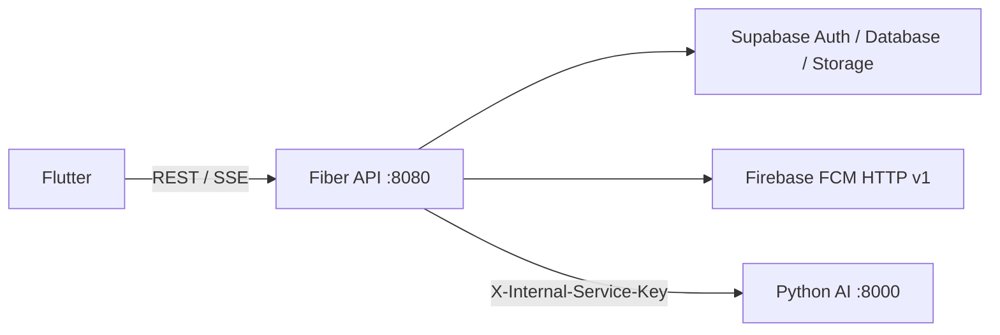

<div align="center">


# ยืมหน่อย · Backend API

**จัดการข้อมูล การเช่า และเชื่อมแอปกับบริการภายนอก**


[ภาพรวม](#overview) · [Tech stack](#stack) · [ตั้งค่า](#setup) · [เริ่มรัน](#run) · [API](#api) · [ตรวจงาน](#development) · [แก้ปัญหา](#troubleshooting)

[Project](../README.md) / [Frontend](../frontend/README.md) / **Backend** / [AI Service](../ai_service/README.md)

</div>

---

<a id="overview"></a>

## ✨ ส่วนนี้ทำอะไร

Go Backend เป็น REST API หลักของ **Yuemnoi** เชื่อม Flutter กับ Supabase, Firebase และ Python AI ใช้ **Hexagonal Architecture** แยก business entities / interfaces ออกจาก HTTP และบริการภายนอก

| ความสามารถ      | หน้าที่ของ Backend                                                         |
| --------------- | -------------------------------------------------------------------------- |
| 🔑 Auth         | สมัครสมาชิก, login, email OTP, เปลี่ยนรหัสผ่าน และซิงค์รูปจาก Google OAuth |
| 👤 Profile      | อ่าน / แก้ไขโปรไฟล์, contact และ FCM token ของผู้ใช้                       |
| 📸 Items        | ฟีดจาก ranked view, ค้นหา / กรองหมวดหมู่, CRUD และจัดการรูป                |
| 📅 Rental       | สร้างคำขอผ่าน Supabase RPC, ตรวจผู้มีสิทธิ์และเปลี่ยนสถานะส่งมอบ / รับคืน  |
| 💬 Chat contact | ตรวจสิทธิ์คู่สนทนาก่อนอ่านข้อมูลติดต่อ                                     |
| 🔔 Push         | ส่งแจ้งเตือนแชตผ่าน FCM HTTP v1 และจัดการ device token ที่หมดอายุ          |
| 🤖 AI Gateway   | ส่งคำขอ JSON / SSE ไป Python พร้อม internal service key                    |

การสร้างคำขอเช่าเรียก RPC `create_rental_request` ส่วน endpoint ส่งมอบ / รับคืนเปลี่ยนสถานะ booking เป็น `active` / `completed` ตามสิทธิ์และเงื่อนไขในโค้ด การหัก Wallet, คืนเงินมัดจำ และตรวจ OTP / QR ไม่ได้อยู่ใน handlers เหล่านี้ ต้องตรวจ logic ของฐานข้อมูลและระบบชำระเงินแยกก่อนอ้างว่า flow การเงินทำงานครบ

### ภาพรวมการเชื่อมต่อ



Frontend ยังใช้ Supabase โดยตรงในบางฟีเจอร์ รายละเอียดอยู่ใน [Frontend README](../frontend/README.md)

<a id="stack"></a>

## 🧰 Tech stack & versions

เวอร์ชันอ้างอิง [go.mod](go.mod) และ checksums อยู่ใน [go.sum](go.sum)

| เครื่องมือ / module              | เวอร์ชัน                                                    | ใช้ทำอะไร                                      |
| -------------------------------- | ----------------------------------------------------------- | ---------------------------------------------- |
| Go                               | **1.26.2** ตาม go directive; ใช้ toolchain ที่ตรงหรือรองรับ | ภาษา, HTTP client/server และ concurrency       |
| `github.com/gofiber/fiber/v3`    | v3.5.0                                                     | Router, handlers และ middleware                |
| `github.com/caarlos0/env/v11`    | v11.4.1                                                     | อ่าน env ลง typed configuration                |
| `github.com/go-playground/validator/v10` | v10.30.1 | ตรวจ `validate` tags ของ request DTOs ผ่าน Fiber `StructValidator` |
| `github.com/joho/godotenv`       | v1.5.1                                                      | โหลดไฟล์ `.env`                                |
| `github.com/nedpals/supabase-go` | v0.5.0                                                      | Supabase Auth / PostgREST                       |
| `firebase.google.com/go/v4`     | v4.22.0                                                     | Firebase Admin SDK สำหรับ FCM                  |
| `cloud.google.com/go/auth`      | v0.20.0                                                     | Credentials, OAuth และ HTTP transport ของ Google |
| `google.golang.org/api`         | v0.279.0                                                    | Client options สำหรับ Firebase SDK             |
| `golang.org/x/time`             | v0.16.0                                                     | Token Bucket ผ่าน package `rate`               |
| `github.com/stretchr/testify`    | v1.12.1                                                     | Assertions และ mocks ใน tests                  |
| Go standard library              | ตาม Go toolchain                                            | `net/http`, `log/slog` และ Supabase Storage adapter |

FCM adapter ใช้ Firebase Admin SDK ส่ง HTTP v1 และใช้ Google Auth จัดการ credentials / OAuth โดยคง data, Android channel และเสียงแจ้งเตือนเดิม ส่วน Supabase Storage ใช้ HTTP adapter ที่ส่ง context และคืน error แทนการเรียก Upload / Remove ของ SDK เดิม Supabase / Firebase / AI เป็นบริการภายนอก จึงไม่มีเวอร์ชัน server ที่ pin ไว้ใน go.mod

<a id="setup"></a>

## ⚙️ เตรียมเครื่อง & configuration

### 1. เครื่องมือและบริการที่ต้องมี

- Git และ [Go toolchain](https://go.dev/doc/install) ที่รองรับ `go 1.26.2`
- Supabase project พร้อม Auth และ schema ของแอปตามรายการด้านล่าง
- Python AI Service เมื่อต้องใช้ Chatbot
- Firebase service account เมื่อต้องส่ง push notifications จริง

ควรเก็บ checkout ของ `backend/`, `frontend/` และ `ai_service/` ไว้ในโครงสร้าง repository เดียวกัน เพราะ configuration และ tests บางส่วนอ้างอิงไฟล์ข้ามส่วน

### 2. เตรียม Supabase ให้ตรงกับโค้ด

**สร้าง project เปล่าอย่างเดียวยังไม่พอ**: checkout นี้ไม่มี SQL migrations / schema bootstrap สำหรับสร้างฐานข้อมูลครบทั้งระบบ ให้ใช้ schema ที่ทีมดูแลสำหรับ environment นั้น แล้วตรวจรายการสำคัญต่อไปนี้

| ประเภท         | สิ่งที่ Backend ใช้                                                                                   |
| -------------- | ----------------------------------------------------------------------------------------------------- |
| Tables         | `item_tb`, `profile_tb`, `booking_tb` และ `conversation_tb`                                           |
| View           | `home_feed_ranked_v` พร้อมข้อมูล rank / rating / review / booking ที่ repository อ่าน                 |
| RPC            | `check_email_exists(search_email)` → boolean                                                          |
| RPC            | `create_rental_request(p_user_id, p_item_id, p_start_at, p_end_at, p_rental_type, p_pickup_location)` |
| Storage        | `item_bk` และ `profile_bk` รองรับรูปแบบ URL ที่ adapters ใช้                                          |
| Auth → Profile | กลไกสร้างแถว `profile_tb` เมื่อสร้าง Auth user เพราะ registration flow ปัจจุบันอัปเดตแถวที่มีอยู่     |
| Permissions    | grants / RLS / Storage policies ให้ตรงกับทั้ง Backend และ Flutter ที่เข้าถึงโดยตรง                    |

Backend ใช้ตัวแปรชื่อ `SUPABASE_SERVICE_ROLE_KEY` และ SDK / adapters ตามเวอร์ชันในตาราง ให้ใช้ server credential ที่ตรงกับ integration นี้และเก็บไว้ฝั่งเซิร์ฟเวอร์ ดู [Supabase API keys](https://supabase.com/docs/guides/getting-started/api-keys) ก่อนเลือกหรือเปลี่ยนชนิดคีย์; README นี้ไม่ได้เปลี่ยน implementation ให้รองรับการย้ายคีย์แบบใหม่

OTP flow ปัจจุบันใช้ Supabase email OTP ผ่าน Magic Link template หากต้องการให้ผู้ใช้กรอกรหัสหกหลัก ต้องตั้ง template ให้แสดง `{{ .Token }}` ตาม flow ที่แอปใช้ Google login เริ่มจาก Supabase OAuth ใน Flutter ส่วน Backend ซิงค์รูปของผู้ใช้ที่ login แล้ว

### 3. สร้างไฟล์ `.env`

สร้างในโฟลเดอร์ `backend/` แล้วแทนค่า `replace-with-...` ด้วยค่าของ environment จริง ไม่มีไฟล์ `.env.example` ให้ copy ใน checkout นี้

```dotenv
PORT=8080
APP_ENV=debug

SUPABASE_URL=https://your-project.supabase.co
SUPABASE_SERVICE_ROLE_KEY=replace-with-backend-service-role-key

APP_SECRET_KEY=replace-with-client-app-key
INTERNAL_SERVICE_KEY=replace-with-shared-internal-key-at-least-32-chars

AI_SERVICE_URL=http://localhost:8000
AI_CLIENT_RUNTIME_PATH=../ai_service/config/chat_client_runtime.json

READ_TIMEOUT=15s
WRITE_TIMEOUT=90s
SHUTDOWN_TIMEOUT=5s

# ใส่เมื่อใช้ push notifications
# FIREBASE_SERVICE_ACCOUNT_PATH=service-account.json
```

`APP_SECRET_KEY` ใน Flutter ต้องตรงกับหนึ่งใน app keys ของ Backend และ `INTERNAL_SERVICE_KEY` ใน Python ต้องตรงกับคีย์ internal ที่ Backend ส่ง ทั้งสองคีย์มีหน้าที่ต่างกัน

### ตัวแปรทั้งหมดที่รองรับ

| ตัวแปร                          | Default                 | ต้องตั้งเมื่อ / ความหมาย                                        |
| ------------------------------- | ----------------------- | --------------------------------------------------------------- |
| `PORT`                          | `8080`                  | พอร์ต HTTP                                                      |
| `APP_ENV`                      | `debug`                 | ใช้ `release` เพื่อตรวจคอนฟิก production และใช้ JSON slog |
| `SUPABASE_URL`                  | ไม่มี                   | **จำเป็นทุกโหมด**                                               |
| `SUPABASE_SERVICE_ROLE_KEY`     | ไม่มี                   | **จำเป็นทุกโหมด**, server-only                                  |
| `FIREBASE_SERVICE_ACCOUNT_PATH` | ไม่มี                   | path ของ service account สำหรับ FCM                             |
| `FIREBASE_SERVICE_ACCOUNT_KEY`  | ไม่มี                   | service account JSON แบบ inline; มีลำดับก่อน path               |
| `APP_SECRET_KEY`                | ไม่มี                   | app key เดี่ยวหรือคั่น comma; ต้องมีคีย์ใน release              |
| `APP_SECRET_KEYS`               | ไม่มี                   | app keys เพิ่มเติมคั่น comma; รวมกับตัวแปรด้านบน                |
| `INTERNAL_SERVICE_KEY`          | ไม่มี                   | ต้องมีใน release; primary key ยาวอย่างน้อย **16 ตัวอักษร**      |
| `AI_SERVICE_URL`                | `http://localhost:8000` | **Base URL** ของ Python ไม่ต่อ `/api/chat`                   |
| `AI_SERVICE_TIMEOUT`            | `45s`                   | Go duration ที่มากกว่า 0; env ที่ระบุชัดเจนชนะ runtime JSON     |
| `AI_CLIENT_RUNTIME_PATH`        | ไม่มี                   | อ่าน gateway timeout จาก shared JSON เมื่อกำหนด path            |
| `READ_TIMEOUT`                  | `15s`                   | HTTP server read timeout                                        |
| `WRITE_TIMEOUT`                 | `90s`                   | HTTP server write timeout                                       |
| `SHUTDOWN_TIMEOUT`              | `5s`                    | เวลา graceful shutdown                                          |

[Config loader](internal/config/config.go) โหลด `.env` จาก working directory ก่อน และลอง `../../.env` หากไฟล์แรกโหลดไม่สำเร็จ แนะนำให้รันจาก `backend/` เพื่อให้ paths ของ Firebase และ shared runtime ชัดเจน Process environment ที่มีอยู่มีลำดับก่อนค่าจาก dotenv

`APP_ENV` เป็นชื่อคอนฟิกหลักของ runtime; deployment เดิมยังใช้ `GIN_MODE` เป็น fallback ได้ เมื่อกำหนด `APP_ENV` ไว้จะมีสิทธิ์สูงกว่า โดยคงการตรวจ app key / internal key ในโหมด `release` เหมือนเดิม

**Release configuration:** ตั้ง `APP_ENV=release` พร้อม app key อย่างน้อยหนึ่งตัวจาก `APP_SECRET_KEY` / `APP_SECRET_KEYS` และ internal primary key อย่างน้อย 16 ตัวอักษร โค้ดไม่ได้บังคับความยาวขั้นต่ำของ app key ส่วน credential ของ Firebase เป็นเงื่อนไขสำหรับ push; ขาดแล้ว server ยังเริ่มได้พร้อม warning

<details>
<summary>ตั้งค่า Firebase และการหมุนคีย์</summary>

วาง service account นอก source control แล้วตั้ง `FIREBASE_SERVICE_ACCOUNT_PATH` ให้ชัดเจน หรือส่ง JSON ผ่าน `FIREBASE_SERVICE_ACCOUNT_KEY` ในระบบจัดการ secrets ฝั่ง server Firebase project ต้องตรงกับแอปที่สร้าง FCM device token

Backend รวม app keys จากสองตัวแปรและรับค่าใดค่าหนึ่งผ่าน `X-App-Secret` สำหรับ internal key Backend ส่ง **ตัวแรกที่ไม่ว่าง** ของรายการคั่น comma แต่ Python ตรวจ **ทั้ง string แบบตรงตัว** จึงแนะนำให้ใช้ **คีย์เดียวที่เหมือนกัน** ใน Backend และ AI หากหมุนคีย์ ต้องให้ Python รับค่าเดียวกับ primary ที่ Backend ส่ง

</details>

<a id="run"></a>

## 🚀 ติดตั้ง & เริ่มรัน

จาก root ของ repository คำสั่งนี้ใช้ได้ทั้ง Windows PowerShell และ macOS / Linux:

```sh
cd backend
go version
go mod download
go run main.go
```

`main.go` เปิด HTTP server ด้วย Fiber `Listen` โดยตรง เมื่อแก้โค้ด ให้หยุดด้วย `Ctrl+C` แล้วรัน `go run main.go` ใหม่

ในโหมด debug เมื่อแสดง log ใน terminal ค่า `status=2xx` เป็นสีเขียว, `status=4xx` (รวม 404) เป็นสีเหลือง และ `status=5xx` เป็นสีแดง พร้อมสีเหลืองสำหรับ `level=WARN` และสีแดงสำหรับ `level=ERROR` รองรับ Windows console ด้วย เมื่อ redirect ไปไฟล์หรือ pipe จะเป็นข้อความไม่มีสี ส่วน `APP_ENV=release` ใช้ JSON log

เปิด terminal อีกหน้าตรวจ HTTP server:

**Windows PowerShell**

```powershell
Invoke-RestMethod http://localhost:8080/health
```

**macOS / Linux**

```bash
curl http://localhost:8080/health
```

ผลที่คาดหวัง:

```json
{ "status": "ok" }
```

`/health` ตรวจว่า handler ของ server ตอบได้ เป็นผลคงที่ จึงยังต้องลองรายการสินค้า, Auth, AI และ push แยกเพื่อยืนยัน dependencies

ตัวอย่างเรียกรายการสินค้า เมื่อใช้ app key จาก env ตัวอย่าง ให้แทน placeholder ใน header ด้วยค่าที่ตั้งไว้:

```powershell
Invoke-RestMethod 'http://localhost:8080/api/items' -Headers @{
  'X-App-Secret' = 'replace-with-client-app-key'
}
```

```bash
curl http://localhost:8080/api/items \
  -H 'X-App-Secret: replace-with-client-app-key'
```

Go เปิด HTTP server ที่ `:8080` ตามค่า default มือถือ Android ในโปรเจกต์นี้บล็อก cleartext HTTP จึงต้องมี HTTPS endpoint หรือ native debug network policy ก่อนเชื่อมจากแอป ดูรายละเอียด URL ใน Frontend README

<a id="api"></a>

## 🌐 API & authentication

Base path คือ `/api` เส้นทางทั้งหมดอยู่ใน [router.go](internal/ports/router.go)

**App key:** เมื่อกำหนด app keys ไว้ ต้องส่ง `X-App-Secret` แม้อยู่ใน debug mode ยกเว้น `/health` และ OPTIONS หากไม่มี app keys ใน debug middleware นี้จะข้ามการตรวจ

**User identity:** routes ที่ต้อง login ใช้ `Authorization: Bearer <Supabase access token>` แยกจาก app key และตรวจสิทธิ์เจ้าของ / คู่สัญญาตาม handler

| Method / route                                            | หน้าที่                    | User Bearer                           |
| --------------------------------------------------------- | -------------------------- | ------------------------------------- |
| `GET /health`                                             | HTTP liveness              | ไม่ต้อง                               |
| `POST /auth/register`, `POST /auth/login`                 | สมัคร / login              | ไม่ต้อง                               |
| `POST /auth/send-otp`, `POST /auth/verify-otp`            | ส่ง / ตรวจ email OTP       | ไม่ต้อง                               |
| `POST /auth/google-profile`, `POST /auth/change-password` | ซิงค์รูป / เปลี่ยนรหัสผ่าน | ต้องมี                                |
| `GET /user/profile`, `PUT /user/profile`                  | อ่าน / แก้โปรไฟล์          | ต้องมี                                |
| `PUT /user/contact`, `POST /user/fcm-token`               | Contact / device token     | ต้องมี                                |
| `GET /items`, `GET /items/:id`                            | ฟีด / รายละเอียด           | ไม่ต้อง                               |
| `POST /items`, `PUT /items/:id`, `DELETE /items/:id`      | จัดการอุปกรณ์              | ต้องมี; ตรวจเจ้าของ                   |
| `POST /rentals`                                           | สร้างคำขอเช่า              | ต้องมี                                |
| `POST /rentals/:id/handover`, `POST /rentals/:id/return`  | เปลี่ยนสถานะ               | ต้องมี; ตรวจผู้มีสิทธิ์               |
| `POST /chat/contact`, `POST /push/chat`                   | Contact / push             | ต้องมี                                |
| `POST /chat-ai`, `POST /chat-ai/stream`                   | AI JSON / SSE              | handler ปัจจุบันไม่บังคับ user Bearer |

ทุก route ในตารางยกเว้น `/health` ต้องเติม `/api` ด้านหน้า เช่น `/items` → `/api/items` เส้นทาง AI ยังผ่าน app-key middleware และ rate limiter แม้ handler จะไม่ตรวจ user Bearer

- รายการสินค้าใช้ query `search` และ `category`; ยังไม่มี pagination แบบ `limit` / `offset` ใน handler ปัจจุบัน
- สร้าง item รองรับ JSON หรือ multipart; field รูปชื่อ `images` ไม่เกิน **5 รูป**, รูปละ **5 MiB**, JPEG / PNG / WebP
- รูปโปรไฟล์ใช้ multipart field `image` ไม่เกิน **5 MiB**
- Rate limiter ใช้ `golang.org/x/time/rate` เป็น token bucket **ต่อ client IP ใน memory**: Auth เติม 5/minute, burst 5; AI เติม 15/minute, burst 15 และตอบ 429 เมื่อเกิน กวาด IP ที่ไม่ได้ใช้งานระหว่างรับคำขอโดยไม่สร้าง background goroutine; หลาย server instance ยังไม่แชร์ตัวนับ
- Supabase Auth / PostgREST / Storage จำกัดเวลาคำขอไว้ **60s** รวมการอ่าน response body และเคารพ context ที่หมดเวลาก่อน ส่วนการชดเชยไฟล์ / รายการหลังบันทึกล้มเหลวใช้ context แยกไม่เกิน **5s** เพื่อทำความสะอาดได้แม้คำขอหลักถูกยกเลิก การล้างข้อมูลเป็น best effort และมี warning หากไม่สำเร็จ รูปโปรไฟล์ที่ยังมีการอ้างอิงหรือตรวจสอบไม่ได้จะถูกเก็บไว้ และ rollback อุปกรณ์จะลบแถวสำเร็จก่อนล้างไฟล์
- FCM จำกัดเวลางานส่งรวม **10s** รองรับ cancellation ทั้ง OAuth และ delivery SDK อาจ retry ข้อผิดพลาดชั่วคราวภายในเวลานี้ ลบ device token เฉพาะ error `UNREGISTERED` ที่ SDK ระบุชนิดได้; HTTP 404 ทั่วไปไม่ทำให้ token ถูกลบ

### AI contract

Go ส่ง `/chat-ai` ไป `/api/chat` ของ Python และ `/chat-ai/stream` ไป `/api/chat/stream` พร้อม `X-Internal-Service-Key`

Gateway ส่ง SSE `status` (`step` และ `message`) ต่อทันทีตามข้อมูลจาก Python รวมถึงขั้นเตรียมข้อมูล วิเคราะห์คำถาม สร้างคำตอบ ตรวจคำตอบ และปรับปรุงคำตอบ โดยไม่จำลองความคืบหน้าหรือกำหนดเวลาเปลี่ยนสถานะเอง

Fiber ใช้ native handlers (`func(fiber.Ctx) error`), `c.Bind()` พร้อม struct validation และ `SendStreamWriter` โดยคง URL, JSON, HTTP status, auth และ error / `Retry-After` เดิม ก่อนเปิด SSE จะตรวจผลจาก upstream ก่อนเสมอ เมื่อเปิดแล้วจะส่ง bytes ต่อทันทีและแทรก SSE heartbeat comments เฉพาะรอยต่อ event เพื่อจับการตัดการเชื่อมต่อระหว่างรอข้อมูล โดยไม่แทรก comment กลาง event และไม่สร้างสถานะ AI เพิ่ม

การปิดสตรีม, `WRITE_TIMEOUT` และ server shutdown จะยกเลิก context และปิด upstream body สำหรับ Fiber การตัดการเชื่อมต่อก่อน upstream ตอบ headers ครั้งแรกยังไม่แจ้งผ่าน request context อัตโนมัติ ช่วงนี้จึงมี `AI_SERVICE_TIMEOUT` และ `WRITE_TIMEOUT` เป็นขอบเขตเวลา เมื่อเริ่มสตรีมแล้วตรวจ disconnect จาก write/flush errors ได้

HTTP transport กำหนด request body limit รวม **32 MiB** เพื่อรองรับ multipart รูปสินค้า 5 รูป รูปละ 5 MiB พร้อม overhead และยังตรวจจำนวน / ขนาด / MIME ของแต่ละรูปใน handler เช่นเดิม `net/http` ยังคงใช้กับ outbound clients ของ Supabase, FCM และ AI service

คำขอรองรับ `query` / `message` และ optional `session_id`, `history`, `context`, `questionnaire_answers`, `questionnaire_skipped`, `active_question_id` ผลตอบกลับมีข้อความ, การ์ด, แบบสอบถาม, references และข้อมูล scope / action / response kind / session context

`active_question_id` ระบุคำถามที่แสดงอยู่ แต่ไม่ถือว่าข้อความที่พิมพ์เป็นคำตอบของคำถามนั้นโดยอัตโนมัติ ให้ส่งข้อความเดิมและคำตอบแบบสอบถามที่ผู้ใช้เลือกจริง ส่วน `rental_duration` แยกจากหน่วยงบ `budget_unit`

คำถามรองรับ `branch_question_id`, `branch_choices` และ `branch_titles` ที่อ้างคำถามก่อนหน้าด้วย question ID และจับคู่ด้วย option ID Backend ส่งข้อมูลนี้พร้อมรหัสช้อยและหน่วยราคาเดิมในคำตอบ JSON, SSE และ context รอบถัดไป ข้อความที่ผู้ใช้กด “พิมพ์ตอบเอง” ส่งเป็น `questionnaire_answers[].text` ของข้อนั้น

Runtime ปัจจุบันให้ Go transport timeout **45s** และ Flutter response-ready timeout **30s** ตาม [chat_client_runtime.json](../ai_service/config/chat_client_runtime.json) ส่วน Python validated-answer deadline **30s** มาจาก [ai_runtime.json](../ai_service/config/ai_runtime.json) Backend ส่ง error code และ `Retry-After` ที่ปลอดภัยกลับให้ client โดยไม่มี retry loop อัตโนมัติ

รหัส `quota_temporarily_unavailable` ระบุเพดานการใช้ช่วงเวลาสั้น / cooldown ภายใน, `quota_exhausted` ระบุโควต้ารายวันภายใน, `providers_rate_limited` ระบุ HTTP 429 จาก provider, `providers_busy` ระบุการรอช่องประมวลผลจนหมดเวลา และ `review_unavailable` ระบุว่าไม่มีโมเดลตรวจคำตอบอิสระพร้อมใช้ Backend ส่งรหัสเหล่านี้โดยไม่รวมคิวกับโควต้า เวลารอใช้ `Retry-After` สำหรับ JSON และ `retry_after_seconds` สำหรับ SSE; HTTP 200 ที่เปิด SSE แล้วอาจมี `event: error` ตามมา

`structured_output_invalid` ระบุว่าการสร้างหรืออ่านข้อมูลคำตอบตามโครงสร้างไม่สำเร็จ ส่วน `response_quality_rejected` ระบุว่าคำตอบยังไม่ผ่านการตรวจคุณภาพ ทั้งสองรหัสส่งผ่านได้ทั้ง JSON ก่อนเปิด stream และ SSE โดยไม่ส่ง draft, assessment, validation path หรือรายละเอียด provider ไปยัง client

<a id="development"></a>

## 🧪 ตรวจงาน & build

จาก `backend/`:

```sh
go test ./...
go vet ./...
```

`go test ./...` รวม tests ใน `tests/` และ `internal/` ใช้ mock / httptest เป็นหลัก Live AI gateway test ต้อง opt-in และข้ามโดย default บาง tests ต้องมี sibling AI fixtures / runtime files ที่ตรงกับ checkout จึงควรตรวจว่าไฟล์เหล่านั้นมีครบก่อนรัน

ผลตรวจ Fiber v3 ครบ 23 endpoint พร้อมกรณีผิดพลาด การแก้ไข และข้อจำกัดที่ยังเหลืออยู่: [รายงานทดสอบ API](tests/API_TEST_REPORT.md)

**Build บน Windows PowerShell**

```powershell
New-Item -ItemType Directory -Force bin | Out-Null
go build -o ./bin/yuemnoi-api.exe .
.\bin\yuemnoi-api.exe
```

**Build บน macOS / Linux**

```bash
mkdir -p bin
go build -o ./bin/yuemnoi-api .
./bin/yuemnoi-api
```

รัน binary จาก `backend/` เช่นเดียวกับ development เพื่อให้ env และ relative paths ตรงกัน

### โครงสร้างที่ควรรู้

```text
backend/
├── main.go                  # Config, dependency injection, HTTP startup
├── internal/
│   ├── config/              # Typed env configuration
│   ├── domain/              # Entities และ interfaces
│   ├── adapters/
│   │   ├── supabase/        # Auth, data, storage
│   │   ├── fcm/             # FCM HTTP v1
│   │   └── aiservice/       # Python JSON / SSE client
│   └── ports/               # Fiber handlers, router, middleware
├── tests/                   # Tests และ HTTP mocks
├── .env                     # Server configuration — สร้างเอง
├── go.mod
└── go.sum
```

Domain ไม่ควร import Fiber หรือ infrastructure ส่วน composition อยู่ที่ root `main.go` กติกาเพิ่มเติมอยู่ใน [AGENTS.md](AGENTS.md)

ระบบเจ้าหน้าที่และตัวตนเปิดผ่าน `OPERATIONS_ENABLED` พร้อม `IDENTITY_ENCRYPTION_KEY` (base64 ของคีย์ 32 bytes), `IDENTITY_HMAC_KEY` (base64 ของคีย์อย่างน้อย 32 bytes) และ `IDENTITY_CLEANUP_INTERVAL` (ค่าเริ่มต้น 15m) โดยไม่ต้องมี AI Service สำหรับขั้นตอนยืนยันตัวตน

`POST /api/identity/sessions` รับ `consent_version: "identity-v1"` และวันเกิด `birth_date` แบบ ค.ศ. YYYY-MM-DD เมื่อส่งวันเกิดมาต้องเป็นวันที่จริงและไม่อยู่ในอนาคต ใช้คำขอทุกวัยแบบเดียวกัน ไม่มีเงื่อนไขผู้ปกครองหรืออายุขั้นต่ำ ยังรับ `is_minor` จากแอปรุ่นเก่าและส่ง `p_minor` เป็นข้อมูลประกอบใน schema เดิมเท่านั้น ไม่ใช้กำหนดสิทธิ์ ค่าอายุที่ขาดหรือ null ไม่ขัดขวาง Begin แต่ Submit ยังต้องมีวันเกิดตามบัตร แอปเก็บภาพชั่วคราวและเริ่มคำขอเมื่อกดส่ง จึงถ่ายภาพก่อนกรอกวันเกิดได้

`POST /api/identity/sessions/:id/submit` รับ multipart `legal_name`, `citizen_id`, `birth_date` และภาพ `card`/`selfie` แบบฟอร์มเพิ่ม `name_prefix` (นาย / นางสาว / นาง), `first_name`, `last_name`, `address_detail`, `postal_code` (ตัวเลข ASCII 5 หลัก ไม่ขึ้นต้นด้วย 0), `province`, `district`, `subdistrict` เมื่อส่งช่องใหม่อย่างน้อยหนึ่งช่องต้องกรอกครบทุกช่อง ระบบตัดช่องว่างหัวท้ายและประกอบชื่อรวม ชื่อแต่ละช่องจำกัด 150 ตัวอักษร ที่อยู่ 500 ตัวอักษร จังหวัด/อำเภอ/ตำบลช่องละ 100 ตัวอักษร และชื่อรวมไม่เกิน 450 bytes ข้อมูลเก็บใน `raw_encrypted` ร่วมกับเลขบัตรและวันเกิด เปิดอ่านได้ผ่าน `identity-detail` ที่ตรวจสิทธิ์เจ้าหน้าที่ ยังรองรับแอปรุ่นเดิมที่ส่งเฉพาะชื่อรวม

ผู้ใช้กรอกข้อมูลตามบัตรเองและส่งรูปบัตรกับใบหน้าเพื่อรอพนักงานตรวจ Go ตรวจ checksum เลขบัตร วันเกิด รูปแบบ/ขนาดภาพ ก่อนส่งสถานะ `pending` ไม่มี OCR หรือการส่งภาพเข้าบริการ AI และลบ route `read-card` แล้ว

แบบฟอร์มและหน้าสรุปของผู้ใช้ไม่มีช่องบัตรตลอดชีพหรือวันหมดอายุ Go ไม่รับค่าอายุบัตรจาก client โดยคำขอรอตรวจมี `expires_on = null`, `lifetime = false`, `analysis = {"review_mode":"manual"}` หน้าพนักงานให้ระบุวันหมดอายุหรือบัตรตลอดชีพจากภาพเมื่ออนุมัติ ส่ง `decision`, `checked: true`, `reason`, `lifetime` (boolean) และ `expires_on` (YYYY-MM-DD เมื่อไม่ใช่บัตรตลอดชีพ) ผ่าน `identity-review` ขาดข้อมูลอายุบัตรได้ `409 card_validity_required` บัตรหมดอายุได้ `409 card_expired` การปฏิเสธ/ขอข้อมูลเพิ่มไม่ต้องระบุอายุบัตร

ติดตั้ง [migration สำหรับทุกวัย](../supabase/migrations/20261011162207_remove_guardian_age_restrictions.sql) ก่อนใช้งาน Backend และ Admin รุ่นนี้ การอนุมัติยังตรวจสิทธิ์พนักงาน ห้ามตรวจคำขอตนเอง ตรวจข้อมูลซ้ำ พร้อมบันทึก audit และคงการตรวจอายุบัตรของบัญชีที่อนุมัติแล้ว

การส่งคำขอยืนยันลงทะเบียนหลักฐานก่อนอัปโหลดภาพบัตรและใบหน้าพร้อมกัน โดยใช้คนละ object path รอทั้งสองงานจบก่อนเรียก `identity_submit` หรือ rollback หากอัปโหลดงานหนึ่งล้มเหลวจะรออีกงานจบก่อนลบทั้งสอง path เพื่อไม่ให้ cleanup แข่งกับ worker ที่ยังอัปโหลดอยู่ คง context และ timeout ของ Storage เดิม รวมถึงงาน cleanup ตามกำหนดเผื่อ remote upload ที่หมดเวลาฝั่ง client การตรวจสิทธิ์ การเข้ารหัส และการอนุมัติโดยเจ้าหน้าที่คงเดิม ฝั่ง Flutter แสดงรับคำขอเมื่อ submit สำเร็จและโหลดสถานะล่าสุดต่อเบื้องหลัง

ตารางภายในแยกเป็น `identity_private` และ `ops_private` โดย Go ยังเรียก RPC ชื่อเดิมใน `public` ด้วย service role ดู [migration และการตรวจสอบฐานข้อมูล](../supabase/README.md)

`GET /api/identity/status` ส่ง `available` เพื่อบอกสิทธิ์เริ่มยืนยัน โดย `pilot` ยังคงหมายถึงสมาชิกกลุ่มทดลองเท่านั้น `POST /api/admin/actions/settings/identity` รับ `identity_open_to_all` และ/หรือ `enforce_identity` เป็น boolean พร้อม `reason` และคงค่าที่ไม่ได้ส่งมา หากส่งชนิดข้อมูลไม่ถูกต้องจะได้ HTTP 400 พร้อม `code: invalid_settings`

<a id="troubleshooting"></a>

## 🛠️ ติดตรงไหน ลองเช็กตรงนี้

| อาการ                          | เช็กอะไร                                                              |
| ------------------------------ | --------------------------------------------------------------------- |
| Config validation ไม่ผ่าน      | Working directory, Supabase values, Go duration และ release keys      |
| 401 ก่อนถึง handler            | `X-App-Secret` ไม่ตรงกับ app keys                                     |
| 401 ใน flow ส่วนตัว            | Supabase access token / session หมดอายุหรือไม่ถูกต้อง                 |
| ฟีด / register ใช้งานไม่ได้    | ตรวจ `home_feed_ranked_v`, `check_email_exists` และ schema            |
| อัปโหลด avatar ตอนสมัครล้มเหลว | ตรวจกลไกสร้าง profile row และ `profile_bk`                            |
| อีเมล OTP มีแต่ลิงก์           | ตั้ง Magic Link template ให้มี `{{ .Token }}`                         |
| Health ผ่านแต่ส่ง push ไม่ได้  | ตรวจ service account, Firebase project และ receiver FCM token         |
| AI 502 / 503                   | ตรวจ base URL, Python, internal key, provider error และ `Retry-After` |
| 429                            | รอ rate limiter คืนโควตา; อุปกรณ์ที่ใช้ IP เดียวกันแชร์ bucket        |
| Rental 409                     | ตรวจสถานะ / ช่วงเวลา / ผู้มีสิทธิ์ตาม booking                         |

---

นโยบายทุกวัยใช้ migration `supabase/migrations/20261011162207_remove_guardian_age_restrictions.sql` ยกเลิกการใช้ `is_minor` จำกัดลงประกาศ/จอง/อนุมัติตัวตนทั้ง Go guard และ database triggers รวมถึงถอด API `/api/identity/guardians`, คิวและคำสั่งผู้ปกครองจากระบบเจ้าหน้าที่ ข้อมูลประวัติผู้ปกครองและหลักฐานเก่ายังเก็บตามรอบลบเดิม การตรวจตัวตนโดยเจ้าหน้าที่ บัตรหมดอายุ และการระงับบัญชียังทำงานทุกวัย
