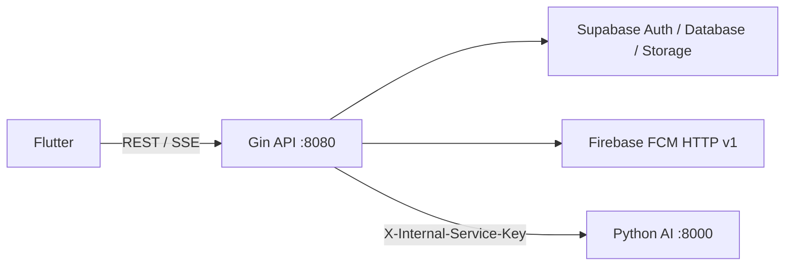

<div align="center">


# ยืมหน่อย · Backend API

**จัดการข้อมูล การเช่า และเชื่อมแอปกับบริการภายนอก**


[ภาพรวม](#overview) · [Tech stack](#stack) · [ตั้งค่า](#setup) · [เริ่มรัน](#run) · [API](#api) · [ตรวจงาน](#development) · [แก้ปัญหา](#troubleshooting)

[Project](../README.md) / [Frontend](../frontend/README.md) / **Backend** / [AI Service](../ai_service/README.md)

</div>

---

<a id="overview"></a>

## ✨ ส่วนนี้ทำอะไร

Go Backend เป็น REST API หลักของ **Yuemnoi** เชื่อม Flutter กับ Supabase, Firebase และ Python AI ใช้ **Hexagonal Architecture** แยก business entities / interfaces ออกจาก HTTP และบริการภายนอก

| ความสามารถ      | หน้าที่ของ Backend                                                         |
| --------------- | -------------------------------------------------------------------------- |
| 🔑 Auth         | สมัครสมาชิก, login, email OTP, เปลี่ยนรหัสผ่าน และซิงค์รูปจาก Google OAuth |
| 👤 Profile      | อ่าน / แก้ไขโปรไฟล์, contact และ FCM token ของผู้ใช้                       |
| 📸 Items        | ฟีดจาก ranked view, ค้นหา / กรองหมวดหมู่, CRUD และจัดการรูป                |
| 📅 Rental       | สร้างคำขอผ่าน Supabase RPC, ตรวจผู้มีสิทธิ์และเปลี่ยนสถานะส่งมอบ / รับคืน  |
| 💬 Chat contact | ตรวจสิทธิ์คู่สนทนาก่อนอ่านข้อมูลติดต่อ                                     |
| 🔔 Push         | ส่งแจ้งเตือนแชตผ่าน FCM HTTP v1 และจัดการ device token ที่หมดอายุ          |
| 🤖 AI Gateway   | ส่งคำขอ JSON / SSE ไป Python พร้อม internal service key                    |

การสร้างคำขอเช่าเรียก RPC `create_rental_request` ส่วน endpoint ส่งมอบ / รับคืนเปลี่ยนสถานะ booking เป็น `active` / `completed` ตามสิทธิ์และเงื่อนไขในโค้ด การหัก Wallet, คืนเงินมัดจำ และตรวจ OTP / QR ไม่ได้อยู่ใน handlers เหล่านี้ ต้องตรวจ logic ของฐานข้อมูลและระบบชำระเงินแยกก่อนอ้างว่า flow การเงินทำงานครบ

### ภาพรวมการเชื่อมต่อ



Frontend ยังใช้ Supabase โดยตรงในบางฟีเจอร์ รายละเอียดอยู่ใน [Frontend README](../frontend/README.md)

<a id="stack"></a>

## 🧰 Tech stack & versions

เวอร์ชันอ้างอิง [go.mod](go.mod) และ checksums อยู่ใน [go.sum](go.sum)

| เครื่องมือ / module              | เวอร์ชัน                                                    | ใช้ทำอะไร                                      |
| -------------------------------- | ----------------------------------------------------------- | ---------------------------------------------- |
| Go                               | **1.26.2** ตาม go directive; ใช้ toolchain ที่ตรงหรือรองรับ | ภาษา, HTTP client/server และ concurrency       |
| `github.com/gin-gonic/gin`       | v1.12.0                                                     | Router, handlers และ middleware                |
| `github.com/caarlos0/env/v11`    | v11.4.1                                                     | อ่าน env ลง typed configuration                |
| `github.com/joho/godotenv`       | v1.5.1                                                      | โหลดไฟล์ `.env`                                |
| `github.com/nedpals/supabase-go` | v0.5.0                                                      | Supabase Auth / PostgREST / Storage            |
| `github.com/stretchr/testify`    | v1.12.1                                                     | Assertions และ mocks ใน tests                  |
| Go standard library              | ตาม Go toolchain                                            | `net/http`, `log/slog`, OAuth / JWT สำหรับ FCM |
| Air — optional                   | ไม่ได้ pin ใน repository                                    | Hot reload; มีข้อจำกัดของ config ข้าม OS       |

FCM adapter ใช้ HTTP v1 และ Go standard library โดยตรง ไม่มี Firebase Admin SDK ใน Go dependencies ส่วน Supabase / Firebase / AI เป็นบริการภายนอก จึงไม่มีเวอร์ชัน server ที่ pin ไว้ใน go.mod

<a id="setup"></a>

## ⚙️ เตรียมเครื่อง & configuration

### 1. เครื่องมือและบริการที่ต้องมี

- Git และ [Go toolchain](https://go.dev/doc/install) ที่รองรับ `go 1.26.2`
- Supabase project พร้อม Auth และ schema ของแอปตามรายการด้านล่าง
- Python AI Service เมื่อต้องใช้ Chatbot
- Firebase service account เมื่อต้องส่ง push notifications จริง

ควรเก็บ checkout ของ `backend/`, `frontend/` และ `ai_service/` ไว้ในโครงสร้าง repository เดียวกัน เพราะ configuration และ tests บางส่วนอ้างอิงไฟล์ข้ามส่วน

### 2. เตรียม Supabase ให้ตรงกับโค้ด

**สร้าง project เปล่าอย่างเดียวยังไม่พอ**: checkout นี้ไม่มี SQL migrations / schema bootstrap สำหรับสร้างฐานข้อมูลครบทั้งระบบ ให้ใช้ schema ที่ทีมดูแลสำหรับ environment นั้น แล้วตรวจรายการสำคัญต่อไปนี้

| ประเภท         | สิ่งที่ Backend ใช้                                                                                   |
| -------------- | ----------------------------------------------------------------------------------------------------- |
| Tables         | `item_tb`, `profile_tb`, `booking_tb` และ `conversation_tb`                                           |
| View           | `home_feed_ranked_v` พร้อมข้อมูล rank / rating / review / booking ที่ repository อ่าน                 |
| RPC            | `check_email_exists(search_email)` → boolean                                                          |
| RPC            | `create_rental_request(p_user_id, p_item_id, p_start_at, p_end_at, p_rental_type, p_pickup_location)` |
| Storage        | `item_bk` และ `profile_bk` รองรับรูปแบบ URL ที่ adapters ใช้                                          |
| Auth → Profile | กลไกสร้างแถว `profile_tb` เมื่อสร้าง Auth user เพราะ registration flow ปัจจุบันอัปเดตแถวที่มีอยู่     |
| Permissions    | grants / RLS / Storage policies ให้ตรงกับทั้ง Backend และ Flutter ที่เข้าถึงโดยตรง                    |

Backend ใช้ตัวแปรชื่อ `SUPABASE_SERVICE_ROLE_KEY` และ SDK / adapters ตามเวอร์ชันในตาราง ให้ใช้ server credential ที่ตรงกับ integration นี้และเก็บไว้ฝั่งเซิร์ฟเวอร์ ดู [Supabase API keys](https://supabase.com/docs/guides/getting-started/api-keys) ก่อนเลือกหรือเปลี่ยนชนิดคีย์; README นี้ไม่ได้เปลี่ยน implementation ให้รองรับการย้ายคีย์แบบใหม่

OTP flow ปัจจุบันใช้ Supabase email OTP ผ่าน Magic Link template หากต้องการให้ผู้ใช้กรอกรหัสหกหลัก ต้องตั้ง template ให้แสดง `{{ .Token }}` ตาม flow ที่แอปใช้ Google login เริ่มจาก Supabase OAuth ใน Flutter ส่วน Backend ซิงค์รูปของผู้ใช้ที่ login แล้ว

### 3. สร้างไฟล์ `.env`

สร้างในโฟลเดอร์ `backend/` แล้วแทนค่า `replace-with-...` ด้วยค่าของ environment จริง ไม่มีไฟล์ `.env.example` ให้ copy ใน checkout นี้

```dotenv
PORT=8080
GIN_MODE=debug

SUPABASE_URL=https://your-project.supabase.co
SUPABASE_SERVICE_ROLE_KEY=replace-with-backend-service-role-key

APP_SECRET_KEY=replace-with-client-app-key
INTERNAL_SERVICE_KEY=replace-with-shared-internal-key-at-least-32-chars

AI_SERVICE_URL=http://localhost:8000
AI_CLIENT_RUNTIME_PATH=../ai_service/config/chat_client_runtime.json

READ_TIMEOUT=15s
WRITE_TIMEOUT=90s
SHUTDOWN_TIMEOUT=5s

# ใส่เมื่อใช้ push notifications
# FIREBASE_SERVICE_ACCOUNT_PATH=service-account.json
```

`APP_SECRET_KEY` ใน Flutter ต้องตรงกับหนึ่งใน app keys ของ Backend และ `INTERNAL_SERVICE_KEY` ใน Python ต้องตรงกับคีย์ internal ที่ Backend ส่ง ทั้งสองคีย์มีหน้าที่ต่างกัน

### ตัวแปรทั้งหมดที่รองรับ

| ตัวแปร                          | Default                 | ต้องตั้งเมื่อ / ความหมาย                                        |
| ------------------------------- | ----------------------- | --------------------------------------------------------------- |
| `PORT`                          | `8080`                  | พอร์ต HTTP                                                      |
| `GIN_MODE`                      | `debug`                 | ใช้ `release` เพื่อเปิด validation และ JSON slog ของ production |
| `SUPABASE_URL`                  | ไม่มี                   | **จำเป็นทุกโหมด**                                               |
| `SUPABASE_SERVICE_ROLE_KEY`     | ไม่มี                   | **จำเป็นทุกโหมด**, server-only                                  |
| `FIREBASE_SERVICE_ACCOUNT_PATH` | ไม่มี                   | path ของ service account สำหรับ FCM                             |
| `FIREBASE_SERVICE_ACCOUNT_KEY`  | ไม่มี                   | service account JSON แบบ inline; มีลำดับก่อน path               |
| `APP_SECRET_KEY`                | ไม่มี                   | app key เดี่ยวหรือคั่น comma; ต้องมีคีย์ใน release              |
| `APP_SECRET_KEYS`               | ไม่มี                   | app keys เพิ่มเติมคั่น comma; รวมกับตัวแปรด้านบน                |
| `INTERNAL_SERVICE_KEY`          | ไม่มี                   | ต้องมีใน release; primary key ยาวอย่างน้อย **16 ตัวอักษร**      |
| `AI_SERVICE_URL`                | `http://localhost:8000` | **Base URL** ของ Python ไม่ต่อ `/api/chat`                   |
| `AI_SERVICE_TIMEOUT`            | `45s`                   | Go duration ที่มากกว่า 0; env ที่ระบุชัดเจนชนะ runtime JSON     |
| `AI_CLIENT_RUNTIME_PATH`        | ไม่มี                   | อ่าน gateway timeout จาก shared JSON เมื่อกำหนด path            |
| `READ_TIMEOUT`                  | `15s`                   | HTTP server read timeout                                        |
| `WRITE_TIMEOUT`                 | `90s`                   | HTTP server write timeout                                       |
| `SHUTDOWN_TIMEOUT`              | `5s`                    | เวลา graceful shutdown                                          |

[Config loader](internal/config/config.go) โหลด `.env` จาก working directory ก่อน และลอง `../../.env` หากไฟล์แรกโหลดไม่สำเร็จ แนะนำให้รันจาก `backend/` เพื่อให้ paths ของ Firebase และ shared runtime ชัดเจน Process environment ที่มีอยู่มีลำดับก่อนค่าจาก dotenv

**Release configuration:** ตั้ง `GIN_MODE=release` พร้อม app key อย่างน้อยหนึ่งตัวจาก `APP_SECRET_KEY` / `APP_SECRET_KEYS` และ internal primary key อย่างน้อย 16 ตัวอักษร โค้ดไม่ได้บังคับความยาวขั้นต่ำของ app key ส่วน credential ของ Firebase เป็นเงื่อนไขสำหรับ push; ขาดแล้ว server ยังเริ่มได้พร้อม warning

<details>
<summary>ตั้งค่า Firebase และการหมุนคีย์</summary>

วาง service account นอก source control แล้วตั้ง `FIREBASE_SERVICE_ACCOUNT_PATH` ให้ชัดเจน หรือส่ง JSON ผ่าน `FIREBASE_SERVICE_ACCOUNT_KEY` ในระบบจัดการ secrets ฝั่ง server Firebase project ต้องตรงกับแอปที่สร้าง FCM device token

Backend รวม app keys จากสองตัวแปรและรับค่าใดค่าหนึ่งผ่าน `X-App-Secret` สำหรับ internal key Backend ส่ง **ตัวแรกที่ไม่ว่าง** ของรายการคั่น comma แต่ Python ตรวจ **ทั้ง string แบบตรงตัว** จึงแนะนำให้ใช้ **คีย์เดียวที่เหมือนกัน** ใน Backend และ AI หากหมุนคีย์ ต้องให้ Python รับค่าเดียวกับ primary ที่ Backend ส่ง

</details>

<a id="run"></a>

## 🚀 ติดตั้ง & เริ่มรัน

จาก root ของ repository คำสั่งนี้ใช้ได้ทั้ง Windows PowerShell และ macOS / Linux:

```sh
cd backend
go version
go mod download
go install github.com/air-verse/air@latest
air หรือ go run ./cmd/server
```

เปิด terminal อีกหน้าตรวจ HTTP server:

**Windows PowerShell**

```powershell
Invoke-RestMethod http://localhost:8080/health
```

**macOS / Linux**

```bash
curl http://localhost:8080/health
```

ผลที่คาดหวัง:

```json
{ "status": "ok" }
```

`/health` ตรวจว่า handler ของ server ตอบได้ เป็นผลคงที่ จึงยังต้องลองรายการสินค้า, Auth, AI และ push แยกเพื่อยืนยัน dependencies

ตัวอย่างเรียกรายการสินค้า เมื่อใช้ app key จาก env ตัวอย่าง ให้แทน placeholder ใน header ด้วยค่าที่ตั้งไว้:

```powershell
Invoke-RestMethod 'http://localhost:8080/api/items' -Headers @{
  'X-App-Secret' = 'replace-with-client-app-key'
}
```

```bash
curl http://localhost:8080/api/items \
  -H 'X-App-Secret: replace-with-client-app-key'
```

Go เปิด HTTP server ที่ `:8080` ตามค่า default มือถือ Android ในโปรเจกต์นี้บล็อก cleartext HTTP จึงต้องมี HTTPS endpoint หรือ native debug network policy ก่อนเชื่อมจากแอป ดูรายละเอียด URL ใน Frontend README

<details>
<summary>ใช้ Air สำหรับ hot reload</summary>

Air เป็นเครื่องมือเสริมที่ต้องติดตั้งแยก และไม่มีเวอร์ชัน pin ใน go.mod เมื่อมี Air ใน PATH แล้ว ฝั่ง Windows ใช้:

```powershell
air -c .air.toml
```

[.air.toml](.air.toml) มี Windows override ที่ชี้ entry point ถูกต้อง แต่ default build command สำหรับ macOS / Linux ยังชี้ `.` ซึ่งไม่มี Go files หากจะใช้ Air บนสองระบบนี้ ให้ปรับ `[build].cmd` เป็น `go build -o ./tmp/main ./cmd/server` ก่อน สำหรับ quick start ใช้ `go run ./cmd/server` ได้เลย

</details>

<a id="api"></a>

## 🌐 API & authentication

Base path คือ `/api` เส้นทางทั้งหมดอยู่ใน [router.go](internal/ports/router.go)

**App key:** เมื่อกำหนด app keys ไว้ ต้องส่ง `X-App-Secret` แม้อยู่ใน debug mode ยกเว้น `/health` และ OPTIONS หากไม่มี app keys ใน debug middleware นี้จะข้ามการตรวจ

**User identity:** routes ที่ต้อง login ใช้ `Authorization: Bearer <Supabase access token>` แยกจาก app key และตรวจสิทธิ์เจ้าของ / คู่สัญญาตาม handler

| Method / route                                            | หน้าที่                    | User Bearer                           |
| --------------------------------------------------------- | -------------------------- | ------------------------------------- |
| `GET /health`                                             | HTTP liveness              | ไม่ต้อง                               |
| `POST /auth/register`, `POST /auth/login`                 | สมัคร / login              | ไม่ต้อง                               |
| `POST /auth/send-otp`, `POST /auth/verify-otp`            | ส่ง / ตรวจ email OTP       | ไม่ต้อง                               |
| `POST /auth/google-profile`, `POST /auth/change-password` | ซิงค์รูป / เปลี่ยนรหัสผ่าน | ต้องมี                                |
| `GET /user/profile`, `PUT /user/profile`                  | อ่าน / แก้โปรไฟล์          | ต้องมี                                |
| `PUT /user/contact`, `POST /user/fcm-token`               | Contact / device token     | ต้องมี                                |
| `GET /items`, `GET /items/:id`                            | ฟีด / รายละเอียด           | ไม่ต้อง                               |
| `POST /items`, `PUT /items/:id`, `DELETE /items/:id`      | จัดการอุปกรณ์              | ต้องมี; ตรวจเจ้าของ                   |
| `POST /rentals`                                           | สร้างคำขอเช่า              | ต้องมี                                |
| `POST /rentals/:id/handover`, `POST /rentals/:id/return`  | เปลี่ยนสถานะ               | ต้องมี; ตรวจผู้มีสิทธิ์               |
| `POST /chat/contact`, `POST /push/chat`                   | Contact / push             | ต้องมี                                |
| `POST /chat-ai`, `POST /chat-ai/stream`                   | AI JSON / SSE              | handler ปัจจุบันไม่บังคับ user Bearer |

ทุก route ในตารางยกเว้น `/health` ต้องเติม `/api` ด้านหน้า เช่น `/items` → `/api/items` เส้นทาง AI ยังผ่าน app-key middleware และ rate limiter แม้ handler จะไม่ตรวจ user Bearer

- รายการสินค้าใช้ query `search` และ `category`; ยังไม่มี pagination แบบ `limit` / `offset` ใน handler ปัจจุบัน
- สร้าง item รองรับ JSON หรือ multipart; field รูปชื่อ `images` ไม่เกิน **5 รูป**, รูปละ **5 MiB**, JPEG / PNG / WebP
- รูปโปรไฟล์ใช้ multipart field `image` ไม่เกิน **5 MiB**
- Rate limiter เป็น token bucket **ต่อ client IP ใน memory**: Auth เติม 5/minute, burst 5; AI เติม 15/minute, burst 15 และตอบ 429 เมื่อเกิน

### AI contract

Go ส่ง `/chat-ai` ไป `/api/chat` ของ Python และ `/chat-ai/stream` ไป `/api/chat/stream` พร้อม `X-Internal-Service-Key`

คำขอรองรับ `query` / `message` และ optional `session_id`, `history`, `context`, `questionnaire_answers`, `questionnaire_skipped`, `active_question_id` ผลตอบกลับมีข้อความ, การ์ด, แบบสอบถาม, references และข้อมูล scope / action / response kind / session context

`active_question_id` ระบุคำถามที่แสดงอยู่ แต่ไม่ถือว่าข้อความที่พิมพ์เป็นคำตอบของคำถามนั้นโดยอัตโนมัติ ให้ส่งข้อความเดิมและคำตอบแบบสอบถามที่ผู้ใช้เลือกจริง ส่วน `rental_duration` แยกจากหน่วยงบ `budget_unit`

Runtime ปัจจุบันให้ Go transport timeout **45s** และ Flutter response-ready timeout **30s** ตาม [chat_client_runtime.json](../ai_service/config/chat_client_runtime.json) ส่วน Python validated-answer deadline **30s** มาจาก [ai_runtime.json](../ai_service/config/ai_runtime.json) Backend ส่ง error code และ `Retry-After` ที่ปลอดภัยกลับให้ client โดยไม่มี retry loop อัตโนมัติ

<a id="development"></a>

## 🧪 ตรวจงาน & build

จาก `backend/`:

```sh
go test ./...
go vet ./...
```

`go test ./...` รวม tests ใน `tests/` และ `internal/` ใช้ mock / httptest เป็นหลัก Live AI gateway test ต้อง opt-in และข้ามโดย default บาง tests ต้องมี sibling AI fixtures / runtime files ที่ตรงกับ checkout จึงควรตรวจว่าไฟล์เหล่านั้นมีครบก่อนรัน

**Build บน Windows PowerShell**

```powershell
New-Item -ItemType Directory -Force bin | Out-Null
go build -o ./bin/yuemnoi-api.exe ./cmd/server
.\bin\yuemnoi-api.exe
```

**Build บน macOS / Linux**

```bash
mkdir -p bin
go build -o ./bin/yuemnoi-api ./cmd/server
./bin/yuemnoi-api
```

รัน binary จาก `backend/` เช่นเดียวกับ development เพื่อให้ env และ relative paths ตรงกัน

### โครงสร้างที่ควรรู้

```text
backend/
├── cmd/server/main.go       # Config, dependency injection, HTTP startup
├── internal/
│   ├── config/              # Typed env configuration
│   ├── domain/              # Entities และ interfaces
│   ├── adapters/
│   │   ├── supabase/        # Auth, data, storage
│   │   ├── fcm/             # FCM HTTP v1
│   │   └── aiservice/       # Python JSON / SSE client
│   └── ports/               # Gin handlers, router, middleware
├── tests/                   # Tests และ HTTP mocks
├── .air.toml                # Optional hot reload
├── .env                     # Server configuration — สร้างเอง
├── go.mod
└── go.sum
```

Domain ไม่ควร import Gin หรือ infrastructure ส่วน composition อยู่ที่ `cmd/server` กติกาเพิ่มเติมอยู่ใน [AGENTS.md](AGENTS.md)

<a id="troubleshooting"></a>

## 🛠️ ติดตรงไหน ลองเช็กตรงนี้

| อาการ                          | เช็กอะไร                                                              |
| ------------------------------ | --------------------------------------------------------------------- |
| Config validation ไม่ผ่าน      | Working directory, Supabase values, Go duration และ release keys      |
| 401 ก่อนถึง handler            | `X-App-Secret` ไม่ตรงกับ app keys                                     |
| 401 ใน flow ส่วนตัว            | Supabase access token / session หมดอายุหรือไม่ถูกต้อง                 |
| ฟีด / register ใช้งานไม่ได้    | ตรวจ `home_feed_ranked_v`, `check_email_exists` และ schema            |
| อัปโหลด avatar ตอนสมัครล้มเหลว | ตรวจกลไกสร้าง profile row และ `profile_bk`                            |
| อีเมล OTP มีแต่ลิงก์           | ตั้ง Magic Link template ให้มี `{{ .Token }}`                         |
| Health ผ่านแต่ส่ง push ไม่ได้  | ตรวจ service account, Firebase project และ receiver FCM token         |
| AI 502 / 503                   | ตรวจ base URL, Python, internal key, provider error และ `Retry-After` |
| 429                            | รอ rate limiter คืนโควตา; อุปกรณ์ที่ใช้ IP เดียวกันแชร์ bucket        |
| Rental 409                     | ตรวจสถานะ / ช่วงเวลา / ผู้มีสิทธิ์ตาม booking                         |
| Air แจ้ง no Go files           | ใช้ `go run ./cmd/server` หรือแก้ default Air build target            |

---
