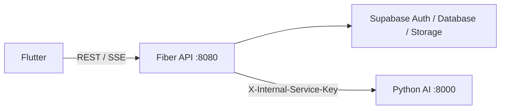

<div align="center">


# ยืมหน่อย · Backend API

**จัดการข้อมูล การเช่า และเชื่อมแอปกับบริการภายนอก**


[ภาพรวม](#overview) · [Tech stack](#stack) · [ตั้งค่า](#setup) · [เริ่มรัน](#run) · [API](#api) · [ตรวจงาน](#development) · [แก้ปัญหา](#troubleshooting)

[Project](../README.md) / [Frontend](../frontend/README.md) / **Backend** / [AI Service](../ai_service/README.md)

</div>

---

<a id="overview"></a>

## ✨ ส่วนนี้ทำอะไร

Go Backend เป็น REST API หลักของ **Yuemnoi** เชื่อม Flutter กับ Supabase และ Python AI ใช้ **Hexagonal Architecture** แยก business entities / interfaces ออกจาก HTTP และบริการภายนอก

| ความสามารถ      | หน้าที่ของ Backend                                                         |
| --------------- | -------------------------------------------------------------------------- |
| 🔑 Auth         | สมัครสมาชิก, login, email OTP, เปลี่ยนรหัสผ่าน และซิงค์รูปจาก Google OAuth |
| 👤 Profile      | อ่าน / แก้ไขโปรไฟล์, และข้อมูลติดต่อของผู้ใช้                       |
| 📸 Items        | ฟีดจาก ranked view, ค้นหา / กรองหมวดหมู่, CRUD และจัดการรูป                |
| 📅 Rental       | สร้างคำขอผ่าน Supabase RPC, ตรวจผู้มีสิทธิ์และเปลี่ยนสถานะส่งมอบ / รับคืน  |
| 💬 Chat contact | ตรวจสิทธิ์คู่สนทนาก่อนอ่านข้อมูลติดต่อ                                     |
| 🤖 AI Gateway   | ส่งคำขอ JSON / SSE ไป Python พร้อม internal service key                    |

การสร้างคำขอเช่าเรียก RPC `create_rental_request` และส่งมอบเป็น `active` ตอนคืน เจ้าของตรวจอุปกรณ์แล้วเรียก `POST /api/rentals/:id/return-confirmation` ด้วย `{"checked":true}` เพื่อเปลี่ยนสถานะเป็น `completed` ในธุรกรรมเดียว ผู้เช่าดูผลผ่าน `return-session` ใช้ migrations `20261125021333_return_without_renter_photos.sql` และ `20261125023043_complete_rental_return_on_merchant_receipt.sql` ใน `supabase/migrations/` เส้นทาง `return-evidence`, `return-inspection` และ `return` รองรับแอปรุ่นเดิม เจ้าของยืนยันจบรายการที่ค้างในสถานะ `awaiting_return` หรือ `return_ready` ผ่านเส้นทางใหม่ได้ การยกเลิกก่อนส่งมอบใช้ `cancel` พร้อมเหตุผลและหลักฐาน

ติดตั้ง [migration ป้องกันการเช่าซ้ำ](../supabase/migrations/20261126094244_enforce_item_rental_occupancy.sql) ก่อนเผยแพร่ Go และ Flutter รุ่นนี้ ฟีดและรายละเอียดอุปกรณ์ส่ง `is_rental_occupied` ตามสถานะ `confirmed`, `active`, `awaiting_return` และ `return_ready` ฐานข้อมูลป้องกันการเช่าอุปกรณ์ซ้ำข้ามช่วงเวลา และเปิดให้เช่าอีกครั้งเมื่อยกเลิกหรือคืนสำเร็จ ถ้ามีรายการเดิมที่ยังไม่จบมากกว่าหนึ่งรายการต่ออุปกรณ์ ให้ตรวจสอบรายการเหล่านั้นก่อนติดตั้ง migration

คิวเช่าต่อในแชทใช้ `POST /api/rentals/queue` สำหรับเลือกอุปกรณ์ ส่งคำขอ และตอบรับคิว ติดตั้ง `20261126120031_chat_rental_queue.sql` หลัง migration ป้องกันการเช่าซ้ำและการลบบัญชี โดยฐานข้อมูลต้องมี Supabase Cron (`pg_cron`) เปิดใช้งาน คิวแรกได้สิทธิ์ 24 ชั่วโมงหลังอุปกรณ์พร้อม ลูกค้าที่ยืนยันสิทธิ์ส่งคำขอเช่าจากการ์ดคิว แล้วผู้ปล่อยเช่ายืนยันคำขอ เจ้าของเลือก `pause_item` ตอนยืนยันรับคืนเพื่อพักการให้เช่าและเปิดประกาศอีกครั้งเมื่อซ่อมเสร็จ

ติดตั้ง `20261126131723_separate_rental_status_from_queue_hold.sql` หลัง migration คิวเช่าต่อและก่อนเผยแพร่ Go และ Flutter ที่ใช้ `is_rental_queue_held` รายละเอียดอุปกรณ์ใช้ฟิลด์นี้เพื่อตรวจสิทธิ์จากคิว ส่วนป้ายกำลังถูกเช่าอิง `is_rental_occupied` จากรายการเช่าที่ยังเปิดอยู่

ติดตั้ง `20261126170100_add_daily_price_to_rental_queue_cards.sql` เพื่อให้การ์ดคิวเช่าต่อส่งทั้งราคาชั่วโมงและรายวันเมื่อประกาศมีสองราคา การ์ดเดิมจะได้รับราคารายวันเพิ่มเมื่อราคาชั่วโมงยังตรงกับประกาศ

ติดตั้ง `20261127050048_customer_requested_rental_queue.sql` ก่อนเผยแพร่ Go และ Flutter ที่ใช้คิวเช่าฝั่งลูกค้า คำสั่ง `list` แสดงอุปกรณ์ของคู่สนทนาที่มีรายการเช่ากับคนอื่นอยู่ คำสั่ง `request` ใช้ `item_id` เพื่อเข้าคิวและสร้างการ์ดในแชท `join` ยังใช้กับการ์ดคำเชิญเดิมได้ขณะอุปกรณ์เข้าเงื่อนไข

ใช้ migrations พร้อมเพย์ตามลำดับ `20261124165600_rental_handover_payment.sql`, `20261124165607_rental_promptpay_qr.sql`, `20261124171624_rental_promptpay_national_id.sql` และ `20261125012154_start_rental_after_payment.sql` ใน `supabase/migrations/` คู่เช่าอ่านสถานะด้วย `GET /api/rentals/:id/handover-payment` ผู้ปล่อยเช่าใช้ `PUT` ที่เส้นทางเดียวกันเพื่อบันทึกเบอร์มือถือหรือเลขบัตรประชาชนสำหรับสร้าง QR พร้อมเพย์ตามยอดจอง เมื่อถึงเวลานัดและได้รับเงินสดหรือพร้อมเพย์แล้ว ผู้ปล่อยเช่าใช้ `POST` ที่เส้นทางเดียวกันเพื่อบันทึกการรับเงินและเปลี่ยนสถานะเป็น `active` ในธุรกรรมเดียวกัน

การบันทึกเลขบัตรพร้อมเพย์ต้องตั้ง `IDENTITY_ENCRYPTION_KEY` เป็น base64 ของคีย์ 32 ไบต์ และใช้ค่าเดียวกันในทุก instance ของ Go แม้ปิด `OPERATIONS_ENABLED` เซิร์ฟเวอร์ใช้คีย์ที่แยกตามบัญชีและวัตถุประสงค์ก่อนเข้ารหัสเลขบัตรลงฐานข้อมูล หากเปลี่ยนคีย์ เลขบัตรพร้อมเพย์ที่เข้ารหัสด้วยคีย์เดิมจะอ่านไม่ได้

หน้าตั้งค่าบัญชีใช้ `GET /api/user/promptpay` อ่านค่าของเจ้าของ session และใช้ `PUT` เพื่อบันทึก `promptpay_phone` หรือ `promptpay_national_id` อย่างใดอย่างหนึ่ง ระบบใช้บัญชีเดียวกับหน้าส่งมอบและแสดงเลขบัตรเฉพาะ 4 หลักท้ายผ่าน `national_id_last_four` ถ้าอ่านเลขบัตรเดิมไม่ได้ API จะคืนประเภทเพื่อให้ผู้ใช้กรอกข้อมูลใหม่ได้

API แจ้งเตือนและ worker ส่ง push ถูกถอดออกระหว่างปรับปรุงระบบ ข้อมูลและ schema แจ้งเตือนใน Supabase ยังเก็บไว้

ติดตั้ง `20261127045440_customer_chat_rental_requests.sql` ก่อนเผยแพร่ Go และ Flutter ที่ใช้ขั้นตอนส่งคำขอจากลูกค้า ลูกค้าเรียก `POST /api/rentals` พร้อม `conversation_id`, `payment_method`, `unit_price` และ `queue_message_id` เมื่อส่งจากคิว ระบบตรวจคู่สนทนา จุดนัดรับ ราคาและสิทธิ์คิว แล้วบันทึก booking สถานะ `pending` พร้อมการ์ดในแชท ผู้ปล่อยเช่าเรียก `POST /api/rentals/:id/confirm` โดยส่ง ID ของการ์ดใน `offer_message_id` เพื่อเปลี่ยนเป็น `confirmed` พร้อมอัปเดตการ์ด ระบบยกเลิกคำขอที่เลยเวลานัดรับหรือลบห้องแชทก่อนยืนยัน รายการ `pending` แสดงในแชท ข้อเสนอที่ผู้ปล่อยเช่าส่งไว้ก่อน migration ยังให้ผู้เช่ายืนยันตามขั้นตอนเดิมได้

ประกาศใหม่และประกาศที่แก้รายละเอียดหรือรูปจะถูกตั้งเป็น `pending_review` และซ่อนจากฟีดจนกว่าเจ้าหน้าที่จะอนุมัติ การตรวจรายการและการอนุมัติ/ปฏิเสธผ่าน RPC ฝั่ง Backend ที่ตรวจบัญชีเจ้าหน้าที่ในทุกคำขอ

ตอนอัปเดตข้อเสนอเดิม Go ใช้ PostgREST `eq` เทียบข้อความเดิมตรงตัว โดยเข้ารหัส URL เพื่อชดเชย SDK ที่ถอด encoding ก่อนส่ง กรณีทดสอบใน `rental_offer_test.go` ตรวจ filter จริงหลังถอด URL รวมข้อความไทย บรรทัดใหม่ และ JSON

### ภาพรวมการเชื่อมต่อ



Frontend ยังใช้ Supabase โดยตรงในบางฟีเจอร์ รายละเอียดอยู่ใน [Frontend README](../frontend/README.md)

บัญชีที่มี `app_metadata.dashboard_only = true` ใช้ได้เฉพาะ dashboard: `POST /api/auth/login`, OTP และ API ส่วนตัวของแอปตอบ HTTP 403 พร้อม `code: dashboard_only` โดยตรวจ metadata ปัจจุบันจาก Supabase Auth ทุกครั้ง `GET /api/auth/session` ใช้ตรวจ OAuth และ session ที่กู้คืน ส่วน dashboard ใช้ `POST /api/admin/login` และตรวจสิทธิ์เจ้าหน้าที่ก่อนคืน token ใช้ [migration](../supabase/migrations/20261017094213_restrict_dashboard_only_accounts.sql) เพื่อกำหนดบัญชี `admin_yuemnoi@gmail.com` และบังคับ RLS สำหรับการเข้าถึง Supabase โดยตรงด้วย JWT เดิม ทดสอบฐานข้อมูลแบบ rollback ได้ด้วย [dashboard_only_access.sql](../supabase/tests/dashboard_only_access.sql)

### การลบบัญชีและกู้คืน

- `POST /api/user/account/deletion` ใช้ Bearer token ของบัญชี ตอบ `delete_after` เมื่อจัดคิวลบสำเร็จ ฐานข้อมูลนับ 30 วันจากครั้งแรกและซ่อนโปรไฟล์ ประกาศ และข้อมูลที่เกี่ยวข้องในแอป รวมถึงรายละเอียดการเช่าและแชตระหว่างรอลบ รายการเช่าที่ค้างทั้งฝั่งผู้เช่าและเจ้าของอุปกรณ์ให้ HTTP 409 พร้อม `code: active_rentals`
- เมื่อบัญชีรอลบ `GET /api/auth/session` ตอบ HTTP 409 พร้อม `code: account_deletion_pending` และ `delete_after` เส้นทางกู้คืน `POST /api/auth/account/restore` ตรวจเจ้าของและ session ที่สร้างหลังขอลบ ก่อนยกเลิกคำขอและเปิดการเข้าถึงอีกครั้ง เมื่อพ้นกำหนด API ตอบ HTTP 410 ในช่วงที่ worker ยังดำเนินการอยู่
- งานลบบัญชีใน Go ตรวจคิวทุกนาที รับงานพร้อม lease และลบไฟล์ผ่าน Storage API ก่อนยืนยันลบข้อมูลบัญชีในฐานข้อมูล การลองใหม่ใช้คิวเดิม ประวัติการเช่าของคู่สัญญาที่ยังอยู่เก็บหลังลบข้อมูลระบุตัวตนและไฟล์ของบัญชีที่ลบ

ติดตั้ง [migration จัดคิวและกู้บัญชี](../supabase/migrations/20261126014914_schedule_restore_account_deletion.sql) และ [migration ลบบัญชีครบกำหนด](../supabase/migrations/20261126015023_purge_scheduled_account_deletions.sql) ก่อนเผยแพร่ Go และ Flutter รุ่นนี้ ลิงก์ไฟล์ใน bucket สาธารณะที่เคยแชร์แยกจากแอปอาจยังเข้าถึงได้ในช่วงรอลบจนกว่างาน Storage จะลบไฟล์

<a id="stack"></a>

## 🧰 Tech stack & versions

เวอร์ชันอ้างอิง [go.mod](go.mod) และ checksums อยู่ใน [go.sum](go.sum)

| เครื่องมือ / module                      | เวอร์ชัน                                                    | ใช้ทำอะไร                                                          |
| ---------------------------------------- | ----------------------------------------------------------- | ------------------------------------------------------------------ |
| Go                                       | **1.26.2** ตาม go directive; ใช้ toolchain ที่ตรงหรือรองรับ | ภาษา, HTTP client/server และ concurrency                           |
| `github.com/gofiber/fiber/v3`            | v3.5.0                                                      | Router, handlers และ middleware                                    |
| `github.com/caarlos0/env/v11`            | v11.4.1                                                     | อ่าน env ลง typed configuration                                    |
| `github.com/go-playground/validator/v10` | v10.30.1                                                    | ตรวจ `validate` tags ของ request DTOs ผ่าน Fiber `StructValidator` |
| `github.com/joho/godotenv`               | v1.5.1                                                      | โหลดไฟล์ `.env`                                                    |
| `github.com/nedpals/supabase-go`         | v0.5.0                                                      | Supabase Auth / PostgREST                                          |
| `cloud.google.com/go/auth`               | v0.20.0                                                     | Credentials, OAuth และ HTTP transport ของ Google                   |
| `golang.org/x/time`                      | v0.16.0                                                     | Token Bucket ผ่าน package `rate`                                   |
| `github.com/jellydator/ttlcache/v3`      | v3.4.1                                                      | Cache อายุข้อมูลตาม TTL สำหรับ IP buckets    |
| `github.com/lmittmann/tint`              | v1.2.1                                                      | Console handler สำหรับ `log/slog` ในโหมด debug                     |
| `github.com/stretchr/testify`            | v1.12.1                                                     | Assertions และ mocks ใน tests                                      |
| Go standard library                      | ตาม Go toolchain                                            | `net/http`, `log/slog` และ Supabase Storage adapter                |

Supabase Storage ใช้ HTTP adapter ที่ส่ง context และคืน error Supabase และ AI เป็นบริการภายนอก จึงไม่มีเวอร์ชัน server ที่ pin ไว้ใน go.mod

<a id="setup"></a>

## ⚙️ เตรียมเครื่อง & configuration

### 1. เครื่องมือและบริการที่ต้องมี

- Git และ [Go toolchain](https://go.dev/doc/install) ที่รองรับ `go 1.26.2`
- Supabase project พร้อม Auth และ schema ของแอปตามรายการด้านล่าง
- Python AI Service เมื่อต้องใช้ Chatbot

ควรเก็บ checkout ของ `backend/`, `frontend/` และ `ai_service/` ไว้ในโครงสร้าง repository เดียวกัน เพราะ configuration และ tests บางส่วนอ้างอิงไฟล์ข้ามส่วน

### 2. เตรียม Supabase ให้ตรงกับโค้ด

**สร้าง project เปล่าอย่างเดียวยังไม่พอ**: checkout นี้ไม่มี SQL migrations / schema bootstrap สำหรับสร้างฐานข้อมูลครบทั้งระบบ ให้ใช้ schema ที่ทีมดูแลสำหรับ environment นั้น แล้วตรวจรายการสำคัญต่อไปนี้

| ประเภท         | สิ่งที่ Backend ใช้                                                                                   |
| -------------- | ----------------------------------------------------------------------------------------------------- |
| Tables         | `public.item_tb`, `public.booking_tb`, `profiles.profile_tb`, `messaging.conversation_tb`, `messaging.chat_message_tb` |
| View           | `public.home_feed_ranked_v` สำหรับฟีด และ `profiles.public_profile_v` สำหรับโปรไฟล์ที่เปิดอ่านได้ |
| RPC            | `check_email_exists(search_email)` → boolean                                                          |
| RPC            | `create_rental_request(p_user_id, p_item_id, p_start_at, p_end_at, p_rental_type, p_pickup_location)` |
| Storage        | `item_bk` และ `profile_bk` รองรับรูปแบบ URL ที่ adapters ใช้                                          |
| Auth → Profile | Trigger สร้างแถว `profiles.profile_tb` เมื่อสร้าง Auth user และฐานข้อมูลกำหนดชื่อผู้ใช้เริ่มต้น |
| Permissions    | grants / RLS / Storage policies ให้ตรงกับทั้ง Backend และ Flutter ที่เข้าถึงโดยตรง                    |

ใช้ [migration แยก schema ตามโมดูล](../supabase/README.md) พร้อม Backend และ Flutter รุ่นนี้ โดย notification tables อยู่ใน `notifications` และ RPC คงชื่อเดิมใน `public`

Backend ใช้ตัวแปรชื่อ `SUPABASE_SERVICE_ROLE_KEY` และ SDK / adapters ตามเวอร์ชันในตาราง ให้ใช้ server credential ที่ตรงกับ integration นี้และเก็บไว้ฝั่งเซิร์ฟเวอร์ ดู [Supabase API keys](https://supabase.com/docs/guides/getting-started/api-keys) ก่อนเลือกหรือเปลี่ยนชนิดคีย์; README นี้ไม่ได้เปลี่ยน implementation ให้รองรับการย้ายคีย์แบบใหม่

OTP flow ปัจจุบันใช้ Supabase email OTP ผ่าน Magic Link template หากต้องการให้ผู้ใช้กรอกรหัสหกหลัก ต้องตั้ง template ให้แสดง `{{ .Token }}` ตาม flow ที่แอปใช้ Google login เริ่มจาก Supabase OAuth ใน Flutter ส่วน Backend ซิงค์รูปของผู้ใช้ที่ login แล้ว

การสมัครด้วยอีเมลและรหัสผ่านต้องเปิด **Confirm email** ใน Supabase Auth และใช้ลิงก์ `{{ .ConfirmationURL }}` ในเทมเพลต **Confirm signup** เพิ่ม `yuemnoi://login-callback/` ในรายการ Redirect URLs เพื่อเปิดแอปจากลิงก์ยืนยัน สำหรับการส่งถึงผู้ใช้ทั่วไป ให้ตั้ง Custom SMTP ของโปรเจกต์ด้วย [การยืนยันอีเมล](https://supabase.com/docs/guides/auth/passwords) · [Custom SMTP](https://supabase.com/docs/guides/auth/auth-smtp)

ใช้ [migration บังคับกฎชื่อผู้ใช้](../supabase/migrations/20261127034456_enforce_profile_usernames.sql) ก่อนเผยแพร่ Backend และ Flutter รุ่นนี้ ฐานข้อมูลเติมชื่อเริ่มต้นให้โปรไฟล์ที่ยังไม่มีชื่อผู้ใช้ ตรวจชื่อซ้ำโดยไม่แยกตัวพิมพ์ และอนุญาตให้เปลี่ยนได้ทุก 30 วันนับจากการเปลี่ยนครั้งล่าสุด สำหรับฐานข้อมูลอื่น ให้ตรวจชื่อเดิมที่ไม่ว่างว่าตรงรูปแบบ `^[A-Za-z0-9._]{1,100}$` และไม่ซ้ำกันเมื่อเทียบแบบพิมพ์เล็กก่อนรัน migration

ใช้ [migration สร้างชื่อผู้ใช้จากอีเมล](../supabase/migrations/20261127041408_derive_username_from_email.sql) ต่อ เพื่อใช้ส่วนก่อน `@` เป็นชื่อเริ่มต้น ระบบเติมเลขท้ายเมื่อชื่อซ้ำ และอัปเดตชื่อสุ่มของบัญชีที่ยังไม่เคยเปลี่ยนชื่อเอง

### 3. สร้างไฟล์ `.env`

สร้างในโฟลเดอร์ `backend/` แล้วแทนค่า `replace-with-...` ด้วยค่าของ environment จริง ไม่มีไฟล์ `.env.example` ให้ copy ใน checkout นี้

```dotenv
PORT=8080
APP_ENV=debug

SUPABASE_URL=https://your-project.supabase.co
SUPABASE_SERVICE_ROLE_KEY=replace-with-backend-service-role-key

APP_SECRET_KEY=replace-with-client-app-key
INTERNAL_SERVICE_KEY=replace-with-shared-internal-key-at-least-32-chars

AI_SERVICE_URL=http://localhost:8000
AI_CLIENT_RUNTIME_PATH=../ai_service/config/chat_client_runtime.json

READ_TIMEOUT=15s
WRITE_TIMEOUT=90s
SHUTDOWN_TIMEOUT=5s

```

`APP_SECRET_KEY` ใน Flutter ต้องตรงกับหนึ่งใน app keys ของ Backend และ `INTERNAL_SERVICE_KEY` ใน Python ต้องตรงกับคีย์ internal ที่ Backend ส่ง ทั้งสองคีย์มีหน้าที่ต่างกัน

### ตัวแปรทั้งหมดที่รองรับ

| ตัวแปร                          | Default                 | ต้องตั้งเมื่อ / ความหมาย                                    |
| ------------------------------- | ----------------------- | ----------------------------------------------------------- |
| `PORT`                          | `8080`                  | พอร์ต HTTP                                                  |
| `APP_ENV`                       | `debug`                 | ใช้ `release` เพื่อตรวจคอนฟิก production และใช้ JSON slog   |
| `SUPABASE_URL`                  | ไม่มี                   | **จำเป็นทุกโหมด**                                           |
| `SUPABASE_SERVICE_ROLE_KEY`     | ไม่มี                   | **จำเป็นทุกโหมด**, server-only                              |
| `APP_SECRET_KEY`                | ไม่มี                   | app key เดี่ยวหรือคั่น comma; ต้องมีคีย์ใน release          |
| `APP_SECRET_KEYS`               | ไม่มี                   | app keys เพิ่มเติมคั่น comma; รวมกับตัวแปรด้านบน            |
| `INTERNAL_SERVICE_KEY`          | ไม่มี                   | ต้องมีใน release; primary key ยาวอย่างน้อย **16 ตัวอักษร**  |
| `AI_SERVICE_URL`                | `http://localhost:8000` | **Base URL** ของ Python ไม่ต่อ `/api/chat`                  |
| `AI_SERVICE_TIMEOUT`            | `45s`                   | Go duration ที่มากกว่า 0; env ที่ระบุชัดเจนชนะ runtime JSON |
| `AI_CLIENT_RUNTIME_PATH`        | ไม่มี                   | อ่าน gateway timeout จาก shared JSON เมื่อกำหนด path        |
| `READ_TIMEOUT`                  | `15s`                   | HTTP server read timeout                                    |
| `WRITE_TIMEOUT`                 | `90s`                   | HTTP server write timeout                                   |
| `SHUTDOWN_TIMEOUT`              | `5s`                    | เวลา graceful shutdown                                      |

[Config loader](internal/config/config.go) โหลด `.env` จาก working directory ก่อน และลอง `../../.env` หากไฟล์แรกโหลดไม่สำเร็จ แนะนำให้รันจาก `backend/` เพื่อให้ loader พบไฟล์คอนฟิกตาม path ข้างต้น Process environment ที่มีอยู่มีลำดับก่อนค่าจาก dotenv

`APP_ENV` เป็นชื่อคอนฟิกหลักของ runtime; deployment เดิมยังใช้ `GIN_MODE` เป็น fallback ได้ เมื่อกำหนด `APP_ENV` ไว้จะมีสิทธิ์สูงกว่า โดยคงการตรวจ app key / internal key ในโหมด `release` เหมือนเดิม

**Release configuration:** ตั้ง `APP_ENV=release` พร้อม app key อย่างน้อยหนึ่งตัวจาก `APP_SECRET_KEY` / `APP_SECRET_KEYS` และ internal primary key อย่างน้อย 16 ตัวอักษร โค้ดไม่ได้บังคับความยาวขั้นต่ำของ app key

<details>
<summary>การหมุนคีย์</summary>

Backend รวม app keys จากสองตัวแปรและรับค่าใดค่าหนึ่งผ่าน `X-App-Secret` สำหรับ internal key Backend ส่ง **ตัวแรกที่ไม่ว่าง** ของรายการคั่น comma แต่ Python ตรวจ **ทั้ง string แบบตรงตัว** จึงแนะนำให้ใช้ **คีย์เดียวที่เหมือนกัน** ใน Backend และ AI หากหมุนคีย์ ต้องให้ Python รับค่าเดียวกับ primary ที่ Backend ส่ง

</details>

<a id="run"></a>

## 🚀 ติดตั้ง & เริ่มรัน

จาก root ของ repository คำสั่งนี้ใช้ได้ทั้ง Windows PowerShell และ macOS / Linux:

```sh
cd backend
go version
go mod download
go run main.go หรือ go run .
```

`main.go` เปิด HTTP server ด้วย Fiber `Listen` โดยตรง เมื่อแก้โค้ด ให้หยุดด้วย `Ctrl+C` แล้วรัน `go run main.go` ใหม่

ในโหมด debug ใช้รูปแบบและสีมาตรฐานของ `tint` เมื่อแสดง log ใน terminal รองรับ Windows console ด้วย เมื่อ redirect ไปไฟล์หรือ pipe จะเป็นข้อความไม่มีสี ส่วน `APP_ENV=release` ใช้ JSON log ระดับ Info ตามเดิม Access log เก็บเฉพาะ method, path, status และ latency โดยไม่เก็บ headers, query หรือ body

CORS ใช้ Fiber middleware ร่วมกับการตรวจ origin ตาม hostname เดิม: `http`/`https` ของ `localhost`, `127.0.0.1`, `yuemnoi.com`, subdomains ของ `yuemnoi.com` และ `.ts.net` อนุญาต credentials เฉพาะ origin ที่ผ่านการตรวจ คำขอ native ที่ไม่มี Origin ใช้ `*` โดยไม่มี credentials และ OPTIONS ยังคงตอบ 204 ก่อนตรวจ app key เพิ่ม `Vary: Origin` เพื่อให้ HTTP cache แยก response ตาม origin

Rate limiter ยังคงเป็น token bucket ของ `x/time/rate`: auth และ admin login แชร์ burst 5 เติม 1 token ทุก 12 วินาที, AI JSON/SSE แชร์ burst 15 เติม 1 token ทุก 4 วินาที และ identity/complaints แชร์ burst 5 อีกชุดหนึ่ง ทุกชุดแยกตาม client IP และเก็บ bucket ใน `ttlcache` จนไม่ได้ใช้งาน 10 นาที รวมคำขอที่ถูกปฏิเสธในการต่ออายุ idle TTL คำขอที่ถูกปฏิเสธไม่หัก token และคง JSON 429 กับข้อความเดิม ไม่เปลี่ยนเป็น fixed/sliding window

เปิด terminal อีกหน้าตรวจ HTTP server:

**Windows PowerShell**

```powershell
Invoke-RestMethod http://localhost:8080/health
```

**macOS / Linux**

```bash
curl http://localhost:8080/health
```

ผลที่คาดหวัง:

```json
{ "status": "ok" }
```

`/health` ตรวจว่า handler ของ server ตอบได้ เป็นผลคงที่ จึงยังต้องลองรายการสินค้า, Auth และ AI แยกเพื่อยืนยัน dependencies

ตัวอย่างเรียกรายการสินค้า เมื่อใช้ app key จาก env ตัวอย่าง ให้แทน placeholder ใน header ด้วยค่าที่ตั้งไว้:

```powershell
Invoke-RestMethod 'http://localhost:8080/api/items' -Headers @{
  'X-App-Secret' = 'replace-with-client-app-key'
}
```

```bash
curl http://localhost:8080/api/items \
  -H 'X-App-Secret: replace-with-client-app-key'
```

Go เปิด HTTP server ที่ `:8080` ตามค่า default มือถือ Android ในโปรเจกต์นี้บล็อก cleartext HTTP จึงต้องมี HTTPS endpoint หรือ native debug network policy ก่อนเชื่อมจากแอป ดูรายละเอียด URL ใน Frontend README

<a id="api"></a>

## 🌐 API & authentication

Base path คือ `/api` เส้นทางทั้งหมดอยู่ใน [router.go](internal/ports/router.go)

**App key:** เมื่อกำหนด app keys ไว้ ต้องส่ง `X-App-Secret` แม้อยู่ใน debug mode ยกเว้น `/health` และ OPTIONS หากไม่มี app keys ใน debug middleware นี้จะข้ามการตรวจ

**User identity:** routes ที่ต้อง login ใช้ `Authorization: Bearer <Supabase access token>` แยกจาก app key และตรวจสิทธิ์เจ้าของ / คู่สัญญาตาม handler

| Method / route                                            | หน้าที่                            | User Bearer                           |
| --------------------------------------------------------- | ---------------------------------- | ------------------------------------- |
| `GET /health`                                             | HTTP liveness                      | ไม่ต้อง                               |
| `POST /auth/register`, `POST /auth/login`                 | สมัคร / login                      | ไม่ต้อง                               |
| `POST /auth/send-otp`, `POST /auth/verify-otp`            | ส่ง / ตรวจ email OTP               | ไม่ต้อง                               |
| `POST /auth/google-profile`, `POST /auth/change-password` | ซิงค์รูป / เปลี่ยนรหัสผ่าน         | ต้องมี                                |
| `GET /user/profile`, `PUT /user/profile`                  | อ่าน / แก้โปรไฟล์                  | ต้องมี                                |
| `PUT /user/contact`                                       | Contact             | ต้องมี                                |
| `GET /items`, `GET /items/:id`                            | ฟีด / รายละเอียด                   | ไม่ต้อง                               |
| `POST /items`, `PUT /items/:id`, `DELETE /items/:id`      | จัดการอุปกรณ์                      | ต้องมี; ตรวจเจ้าของ                   |
| `GET /items/:id/auto-reply`, `PUT /items/:id/auto-reply` | อ่าน / บันทึกข้อความตอบกลับอัตโนมัติ | ต้องมี; ตรวจเจ้าของ                   |
| `POST /rentals`                                           | สร้างคำขอเช่า                      | ต้องมี                                |
| `POST /rentals/:id/confirm`                               | ผู้ปล่อยเช่ายืนยันคำขอเป็น `confirmed` | ต้องมี ตรวจเจ้าของอุปกรณ์และการ์ดคำขอ |
| `POST /rentals/:id/handover-payment`, `POST /rentals/:id/return`  | เปลี่ยนสถานะ                       | ต้องมี; ตรวจผู้มีสิทธิ์               |
| `POST /chat/contact`                                      | Contact                     | ต้องมี                                |
| `POST /chat-ai`, `POST /chat-ai/stream`                   | AI JSON / SSE                      | handler ปัจจุบันไม่บังคับ user Bearer |

ทุก route ในตารางยกเว้น `/health` ต้องเติม `/api` ด้านหน้า เช่น `/items` → `/api/items` เส้นทาง AI ยังผ่าน app-key middleware และ rate limiter แม้ handler จะไม่ตรวจ user Bearer

การตอบกลับอัตโนมัติรับ JSON `{ "enabled": true, "message": "ข้อความตอบกลับ" }` จำกัดข้อความหลัง trim ไม่เกิน 500 Unicode code points และเปิดใช้ได้เมื่อข้อความไม่ว่าง ค่าเริ่มต้นปิดไว้ เจ้าของต้องกดบันทึกก่อนมีผล โดยใช้ตารางตั้งค่าส่วนตัวแยกจาก item สาธารณะ ต้องติดตั้ง migrations `item_auto_reply` และ `item_auto_reply_actor_guard` ใน `../supabase/migrations/` ร่วมกับ API รุ่นนี้

เมื่อผู้เช่าส่งการ์ด `[ITEM_INQUIRY:{...}]` ฐานข้อมูลตรวจคู่สนทนาและเจ้าของอุปกรณ์จริง แล้วส่งข้อความเพียงครั้งเดียวต่อผู้เช่า–อุปกรณ์–เจ้าของ แม้ห้องเดิมจะเปลี่ยนไปคุยอุปกรณ์อื่นหรือเจ้าของไม่ได้เปิดแอป การแก้ข้อความ/ปิด–เปิดใหม่ไม่ reset ประวัติและไม่ส่งย้อนหลัง สินค้าที่เจ้าของซ่อนยังตอบการสอบถามในแชทเดิมได้ ข้อความเข้าสตรีม Realtime และประวัติแชทปกติ

Migration ย้ายการรักษา `conversation_tb.last_message` มาอยู่ฝั่งฐานข้อมูลพร้อมข้อความตอบกลับ และป้องกัน client รุ่นเดิมเขียนทับด้วยข้อความขาเข้า ตรวจแบบ rollback ด้วย `../supabase/tests/item_auto_reply.sql` โดยไม่มีข้อความทดสอบค้างในห้องจริง

- รายการสินค้าใช้ query `search` และ `category`; ยังไม่มี pagination แบบ `limit` / `offset` ใน handler ปัจจุบัน
- รายละเอียด `GET /api/items/:id` ส่ง `owner_name` โดยใช้ `display_name` ของเจ้าของจาก `profiles.public_profile_v` และใช้ “ผู้ใช้งาน” เมื่อยังไม่ได้ตั้งชื่อ หน้าอุปกรณ์ที่ถูกใจใช้ข้อมูลนี้แสดงชื่อบัญชีเจ้าของแต่ละชิ้น
- สร้าง item รองรับ JSON หรือ multipart; field รูปชื่อ `images` ไม่เกิน **5 รูป**, รูปละ **5 MiB**, JPEG / PNG / WebP
- รูปโปรไฟล์ใช้ multipart field `image` ไม่เกิน **5 MiB**
- รูปสินค้าใหม่เก็บที่ `item_bk/<owner_user_id>/<item_id>/<filename>` หลังสร้างไอดีสินค้า ส่วนรูปโปรไฟล์ทั้งตอนสมัครและแก้ไขเก็บที่ `profile_bk/<user_id>/<filename>`; URL และการลบรูปเดิมยังอ้างอิง path ที่บันทึกไว้
- Rate limiter ใช้ `golang.org/x/time/rate` เป็น token bucket **ต่อ client IP ใน memory**: Auth เติม 5/minute, burst 5; AI เติม 15/minute, burst 15 และตอบ 429 เมื่อเกิน กวาด IP ที่ไม่ได้ใช้งานระหว่างรับคำขอโดยไม่สร้าง background goroutine; หลาย server instance ยังไม่แชร์ตัวนับ
- Supabase Auth / PostgREST / Storage จำกัดเวลาคำขอไว้ **60s** รวมการอ่าน response body และเคารพ context ที่หมดเวลาก่อน ส่วนการชดเชยไฟล์ / รายการหลังบันทึกล้มเหลวใช้ context แยกไม่เกิน **5s** เพื่อทำความสะอาดได้แม้คำขอหลักถูกยกเลิก การล้างข้อมูลเป็น best effort และมี warning หากไม่สำเร็จ รูปโปรไฟล์ที่ยังมีการอ้างอิงหรือตรวจสอบไม่ได้จะถูกเก็บไว้ และ rollback อุปกรณ์จะลบแถวสำเร็จก่อนล้างไฟล์

### AI contract

Go ส่ง `/chat-ai` ไป `/api/chat` ของ Python และ `/chat-ai/stream` ไป `/api/chat/stream` พร้อม `X-Internal-Service-Key`

Gateway ส่ง SSE `status` (`step` และ `message`) ต่อทันทีตามข้อมูลจาก Python รวมถึงขั้นเตรียมข้อมูล วิเคราะห์คำถาม สร้างคำตอบ ตรวจคำตอบ และปรับปรุงคำตอบ โดยไม่จำลองความคืบหน้าหรือกำหนดเวลาเปลี่ยนสถานะเอง

Fiber ใช้ native handlers (`func(fiber.Ctx) error`), `c.Bind()` พร้อม struct validation และ `SendStreamWriter` โดยคง URL, JSON, HTTP status, auth และ error / `Retry-After` เดิม ก่อนเปิด SSE จะตรวจผลจาก upstream ก่อนเสมอ เมื่อเปิดแล้วจะส่ง bytes ต่อทันทีและแทรก SSE heartbeat comments เฉพาะรอยต่อ event เพื่อจับการตัดการเชื่อมต่อระหว่างรอข้อมูล โดยไม่แทรก comment กลาง event และไม่สร้างสถานะ AI เพิ่ม

การปิดสตรีม, `WRITE_TIMEOUT` และ server shutdown จะยกเลิก context และปิด upstream body สำหรับ Fiber การตัดการเชื่อมต่อก่อน upstream ตอบ headers ครั้งแรกยังไม่แจ้งผ่าน request context อัตโนมัติ ช่วงนี้จึงมี `AI_SERVICE_TIMEOUT` และ `WRITE_TIMEOUT` เป็นขอบเขตเวลา เมื่อเริ่มสตรีมแล้วตรวจ disconnect จาก write/flush errors ได้

HTTP transport กำหนด request body limit รวม **32 MiB** เพื่อรองรับ multipart รูปสินค้า 5 รูป รูปละ 5 MiB พร้อม overhead และยังตรวจจำนวน / ขนาด / MIME ของแต่ละรูปใน handler เช่นเดิม `net/http` ยังคงใช้กับ outbound clients ของ Supabase และ AI service

คำขอรองรับ `query` / `message` และ optional `session_id`, `history`, `context`, `questionnaire_answers`, `questionnaire_skipped`, `active_question_id` ผลตอบกลับมีข้อความ, การ์ด, แบบสอบถาม, references และข้อมูล scope / action / response kind / session context

`active_question_id` ระบุคำถามที่แสดงอยู่ แต่ไม่ถือว่าข้อความที่พิมพ์เป็นคำตอบของคำถามนั้นโดยอัตโนมัติ ให้ส่งข้อความเดิมและคำตอบแบบสอบถามที่ผู้ใช้เลือกจริง ส่วน `rental_duration` แยกจากหน่วยงบ `budget_unit`

คำถามรองรับ `branch_question_id`, `branch_choices` และ `branch_titles` ที่อ้างคำถามก่อนหน้าด้วย question ID และจับคู่ด้วย option ID Backend ส่งข้อมูลนี้พร้อมรหัสช้อยและหน่วยราคาเดิมในคำตอบ JSON, SSE และ context รอบถัดไป ข้อความที่ผู้ใช้กด “พิมพ์ตอบเอง” ส่งเป็น `questionnaire_answers[].text` ของข้อนั้น

Runtime ปัจจุบันให้ Go transport timeout **45s** และ Flutter response-ready timeout **30s** ตาม [chat_client_runtime.json](../ai_service/config/chat_client_runtime.json) ส่วน Python validated-answer deadline **30s** มาจาก [ai_runtime.json](../ai_service/config/ai_runtime.json) Backend ส่ง error code และ `Retry-After` ที่ปลอดภัยกลับให้ client โดยไม่มี retry loop อัตโนมัติ

รหัส `quota_temporarily_unavailable` ระบุเพดานการใช้ช่วงเวลาสั้น / cooldown ภายใน, `quota_exhausted` ระบุโควต้ารายวันภายใน, `providers_rate_limited` ระบุ HTTP 429 จาก provider, `providers_busy` ระบุการรอช่องประมวลผลจนหมดเวลา และ `review_unavailable` ระบุว่าไม่มีโมเดลตรวจคำตอบอิสระพร้อมใช้ Backend ส่งรหัสเหล่านี้โดยไม่รวมคิวกับโควต้า เวลารอใช้ `Retry-After` สำหรับ JSON และ `retry_after_seconds` สำหรับ SSE; HTTP 200 ที่เปิด SSE แล้วอาจมี `event: error` ตามมา

`structured_output_invalid` ระบุว่าการสร้างหรืออ่านข้อมูลคำตอบตามโครงสร้างไม่สำเร็จ ส่วน `response_quality_rejected` ระบุว่าคำตอบยังไม่ผ่านการตรวจคุณภาพ ทั้งสองรหัสส่งผ่านได้ทั้ง JSON ก่อนเปิด stream และ SSE โดยไม่ส่ง draft, assessment, validation path หรือรายละเอียด provider ไปยัง client

<a id="development"></a>

## 🧪 ตรวจงาน & build

จาก `backend/`:

```sh
go test ./...
go vet ./...
```

ไฟล์ทดสอบทั้งหมดอยู่ใน `tests/` แยกเป็น `adapters/supabase`, `domain` และ `ports` ใช้ package ภายนอกที่ import โค้ดจาก `internal/` พร้อม mocks และ `httptest` จึงไม่ต้องมี credentials หรือบริการจริง HTTP middleware tests ครอบคลุม CORS allowlist/preflight/native, Vary header, token-bucket refill และ burst แบบ concurrent, การแชร์ quota ข้าม routes และ proxy IP การทดสอบภาพหลักฐานและพิกัดเรียกผ่าน HTTP handler จริง

รันเฉพาะชุดทดสอบด้วย `go test ./tests/...` หรือเลือกโฟลเดอร์ เช่น `go test ./tests/ports` และวัด coverage ของโค้ดต้นทางด้วย `go test '-coverpkg=github.com/chn-benmat/yuemnoi_app/backend/internal/...' ./tests/...` คำสั่ง `go test ./...` ด้านบนยังครอบคลุมทุกชุดตามเดิม

**Build บน Windows PowerShell**

```powershell
New-Item -ItemType Directory -Force bin | Out-Null
go build -o ./bin/yuemnoi-api.exe .
.\bin\yuemnoi-api.exe
```

**Build บน macOS / Linux**

```bash
mkdir -p bin
go build -o ./bin/yuemnoi-api .
./bin/yuemnoi-api
```

รัน binary จาก `backend/` เช่นเดียวกับ development เพื่อให้ env และ relative paths ตรงกัน

### โครงสร้างที่ควรรู้

```text
backend/
├── main.go                  # Config, dependency injection, HTTP startup
├── internal/
│   ├── config/              # Typed env configuration
│   ├── domain/              # Entities และ interfaces
│   ├── adapters/
│   │   ├── supabase/        # Auth, data, storage
│   │   └── aiservice/       # Python JSON / SSE client
│   └── ports/               # Fiber handlers, router, middleware
├── tests/                   # External tests แยก adapters/, domain/, ports/
├── .env                     # Server configuration — สร้างเอง
├── go.mod
└── go.sum
```

Domain ไม่ควร import Fiber หรือ infrastructure ส่วน composition อยู่ที่ root `main.go` กติกาเพิ่มเติมอยู่ใน [AGENTS.md](AGENTS.md)

ระบบเจ้าหน้าที่และตัวตนเปิดผ่าน `OPERATIONS_ENABLED` พร้อม `IDENTITY_ENCRYPTION_KEY` (base64 ของคีย์ 32 bytes), `IDENTITY_HMAC_KEY` (base64 ของคีย์อย่างน้อย 32 bytes) และ `IDENTITY_CLEANUP_INTERVAL` (ค่าเริ่มต้น 15m) โดยไม่ต้องมี AI Service สำหรับขั้นตอนยืนยันตัวตน

`POST /api/identity/sessions` รับ `consent_version: "identity-v1"` และวันเกิด `birth_date` แบบ ค.ศ. YYYY-MM-DD เมื่อส่งวันเกิดมาต้องเป็นวันที่จริงและไม่อยู่ในอนาคต ใช้คำขอทุกวัยแบบเดียวกัน ไม่มีเงื่อนไขผู้ปกครองหรืออายุขั้นต่ำ ยังรับ `is_minor` จากแอปรุ่นเก่าและส่ง `p_minor` เป็นข้อมูลประกอบใน schema เดิมเท่านั้น ไม่ใช้กำหนดสิทธิ์ ค่าอายุที่ขาดหรือ null ไม่ขัดขวาง Begin แต่ Submit ยังต้องมีวันเกิดตามบัตร แอปเก็บภาพชั่วคราวและเริ่มคำขอเมื่อกดส่ง จึงถ่ายภาพก่อนกรอกวันเกิดได้

`POST /api/identity/sessions/:id/submit` รับ multipart `legal_name`, `citizen_id`, `birth_date` และภาพ `card`/`selfie` แบบฟอร์มเพิ่ม `name_prefix` (นาย / นางสาว / นาง), `first_name`, `last_name`, `address_detail`, `postal_code` (ตัวเลข ASCII 5 หลัก ไม่ขึ้นต้นด้วย 0), `province`, `district`, `subdistrict` เมื่อส่งช่องใหม่อย่างน้อยหนึ่งช่องต้องกรอกครบทุกช่อง ระบบตัดช่องว่างหัวท้ายและประกอบชื่อรวม ชื่อแต่ละช่องจำกัด 150 ตัวอักษร ที่อยู่ 500 ตัวอักษร จังหวัด/อำเภอ/ตำบลช่องละ 100 ตัวอักษร และชื่อรวมไม่เกิน 450 bytes ข้อมูลเก็บใน `raw_encrypted` ร่วมกับเลขบัตรและวันเกิด เปิดอ่านได้ผ่าน `identity-detail` ที่ตรวจสิทธิ์เจ้าหน้าที่ ยังรองรับแอปรุ่นเดิมที่ส่งเฉพาะชื่อรวม

ผู้ใช้กรอกข้อมูลตามบัตรเองและส่งรูปบัตรกับใบหน้าเพื่อรอพนักงานตรวจ แอปและ Go ตรวจเลขบัตรเฉพาะตัวเลข ASCII ครบ 13 หลักโดยไม่ตรวจ checksum และให้เจ้าหน้าที่ตรวจความถูกต้องจากหลักฐาน Go ยังตรวจวันเกิด รูปแบบ/ขนาดภาพ ก่อนส่งสถานะ `pending` ไม่มี OCR หรือการส่งภาพเข้าบริการ AI และลบ route `read-card` แล้ว

แบบฟอร์มและหน้าสรุปของผู้ใช้ไม่มีช่องบัตรตลอดชีพหรือวันหมดอายุ Go ไม่รับค่าอายุบัตรจาก client โดยคำขอรอตรวจมี `expires_on = null`, `lifetime = false`, `analysis = {"review_mode":"manual"}` หน้าพนักงานอนุมัติผ่าน `identity-review` ด้วย `decision: "approved"`, `checked: true` โดยไม่ต้องส่งเหตุผลหรืออายุบัตร การปฏิเสธ/ขอข้อมูลเพิ่มยังต้องส่ง `reason` 3–500 ตัวอักษรและ `checked: true` คำสั่งอื่นยังบังคับเหตุผลตามเดิม

ติดตั้ง [migration สำหรับฟอร์มอนุมัติ](../supabase/migrations/20261017083657_simplify_identity_approval.sql) และ [migration ยกเลิกอายุบัตร](../supabase/migrations/20261017132150_remove_identity_card_expiry.sql) เพื่อให้ฐานข้อมูลรองรับ contract นี้ ผลอนุมัติและสิทธิ์ปล่อยเช่าไม่ตรวจวันหมดอายุบัตร รวมถึงวันที่เดิมและค่าจาก client รุ่นเก่า คำขอที่อนุมัติใหม่เก็บ `expires_on = null`, `lifetime = false` เพื่อรองรับ schema เดิม การอนุมัติยังตรวจสิทธิ์เจ้าหน้าที่ ห้ามตรวจคำขอตนเอง ตรวจข้อมูลซ้ำ บันทึก audit และกำหนดเวลาลบหลักฐานตามเดิม ทดสอบ contract แบบ rollback ได้ด้วย [ชุดทดสอบ SQL](../supabase/tests/identity_approval.sql)

ติดตั้ง [migration สำหรับทุกวัย](../supabase/migrations/20261011162207_remove_guardian_age_restrictions.sql) ก่อนใช้งาน Backend และ Admin รุ่นนี้ การอนุมัติยังตรวจสิทธิ์พนักงาน ห้ามตรวจคำขอตนเอง ตรวจข้อมูลซ้ำ พร้อมบันทึก audit

การส่งคำขอยืนยันลงทะเบียนหลักฐานก่อนอัปโหลดภาพบัตรและใบหน้าพร้อมกัน โดยใช้คนละ object path รอทั้งสองงานจบก่อนเรียก `identity_submit` หรือ rollback หากอัปโหลดงานหนึ่งล้มเหลวจะรออีกงานจบก่อนลบทั้งสอง path เพื่อไม่ให้ cleanup แข่งกับ worker ที่ยังอัปโหลดอยู่ คง context และ timeout ของ Storage เดิม รวมถึงงาน cleanup ตามกำหนดเผื่อ remote upload ที่หมดเวลาฝั่ง client การตรวจสิทธิ์ การเข้ารหัส และการอนุมัติโดยเจ้าหน้าที่คงเดิม ฝั่ง Flutter แสดงรับคำขอเมื่อ submit สำเร็จและโหลดสถานะล่าสุดต่อเบื้องหลัง

ตารางภายในแยกเป็น `identity_private` และ `ops_private` โดย Go ยังเรียก RPC ชื่อเดิมใน `public` ด้วย service role ดู [migration และการตรวจสอบฐานข้อมูล](../supabase/README.md)

ติดตั้ง [migration เปิดยืนยันตัวตนทุกบัญชี](../supabase/migrations/20261125175317_remove_identity_pilot.sql) ก่อนใช้งาน Backend และ Admin รุ่นนี้ ผู้ใช้ที่เข้าสู่ระบบเริ่มยืนยันตัวตนได้ทุกบัญชีที่ไม่ถูกระงับ `GET /api/identity/status` และ `status` ใน `GET /api/identity/account` ยังส่ง `available: true` สำหรับแอปรุ่นเดิม ส่วน `control.suspended` ระบุสถานะระงับบัญชี

ติดตั้ง [migration ตรวจข้อมูลก่อนทำรายการเช่า](../supabase/migrations/20261127053847_require_rental_verification.sql) และเปิด `OPERATIONS_ENABLED` ก่อนเผยแพร่ Go และ Flutter รุ่นนี้ `POST /api/items` และ `POST /api/rentals` ตรวจว่าบัตรของผู้ทำรายการได้รับอนุมัติและมีเบอร์ติดต่อที่บันทึกในโปรไฟล์ หากขาดข้อมูลจะตอบ HTTP 403 พร้อม `code: rental_verification_required` และสถานะ `rental_verification` แบบเดียวกับ `GET /api/identity/status` ฐานข้อมูลตรวจซ้ำตอนเพิ่มแถว `POST /api/admin/actions/settings/identity` ยังรับ `enforce_identity` แบบ boolean พร้อม `reason` สำหรับตรวจเจ้าของประกาศที่รับการจองใหม่ หากส่งค่าผิดชนิดจะได้ HTTP 400 พร้อม `code: invalid_settings`

<a id="troubleshooting"></a>

## 🛠️ ติดตรงไหน ลองเช็กตรงนี้

| อาการ                          | เช็กอะไร                                                              |
| ------------------------------ | --------------------------------------------------------------------- |
| Config validation ไม่ผ่าน      | Working directory, Supabase values, Go duration และ release keys      |
| 401 ก่อนถึง handler            | `X-App-Secret` ไม่ตรงกับ app keys                                     |
| 401 ใน flow ส่วนตัว            | Supabase access token / session หมดอายุหรือไม่ถูกต้อง                 |
| ฟีด / register ใช้งานไม่ได้    | ตรวจ `home_feed_ranked_v`, `check_email_exists` และ schema            |
| อัปโหลด avatar ตอนสมัครล้มเหลว | ตรวจกลไกสร้าง profile row และ `profile_bk`                            |
| อีเมล OTP มีแต่ลิงก์           | ตั้ง Magic Link template ให้มี `{{ .Token }}`                         |
| AI 502 / 503                   | ตรวจ base URL, Python, internal key, provider error และ `Retry-After` |
| 429                            | รอ rate limiter คืนโควตา; อุปกรณ์ที่ใช้ IP เดียวกันแชร์ bucket        |
| Rental 409                     | ตรวจสถานะ / ช่วงเวลา / ผู้มีสิทธิ์ตาม booking                         |

---

นโยบายทุกวัยใช้ migration `supabase/migrations/20261011162207_remove_guardian_age_restrictions.sql` ยกเลิกการใช้ `is_minor` จำกัดลงประกาศ/จอง/อนุมัติตัวตนทั้ง Go guard และ database triggers รวมถึงถอด API `/api/identity/guardians`, คิวและคำสั่งผู้ปกครองจากระบบเจ้าหน้าที่ ข้อมูลประวัติผู้ปกครองและหลักฐานเก่ายังเก็บตามรอบลบเดิม การตรวจตัวตนโดยเจ้าหน้าที่และการระงับบัญชียังทำงานทุกวัย

### ข้อมูลบัตรประชาชนในตั้งค่าบัญชี

ติดตั้ง `supabase/migrations/20261021065036_identity_account_details.sql` ก่อนเปิด Backend รุ่นนี้ `GET /api/identity/account` อ่านเฉพาะข้อมูลของเจ้าของ Bearer token ส่ง `fields`, `status`, `has_identity`, `selfie_with_card` และรายการ `evidence` (ID/kind) โดยไม่ส่ง ciphertext, HMAC หรือ object path; `GET /api/identity/account/evidence/:id` ตรวจเจ้าของและกำหนดลบก่อนส่งภาพ base64 ใน `data` ทั้งสอง route ใช้ `Cache-Control: private, no-store` และไม่บันทึกข้อมูลตัวตนใน response log

การแก้ไขใช้ session/submit เดิม ส่งข้อมูลส่วนบุคคลและที่อยู่ครบ พร้อม `selfie_with_card: true` และแนบเฉพาะภาพที่เปลี่ยน ระบบคัดลอกภาพเดิมที่ยังไม่หมดอายุเข้าสู่คำขอใหม่ได้ รูปเดิมที่ยังอ่านได้สามารถใช้ต่อได้แม้ไม่มีธง selfie_with_card ของรุ่นใหม่ โดยคง metadata เดิม ไม่ใช้ธงดังกล่าวแทนผลตรวจของเจ้าหน้าที่ การส่งซ้ำถูกป้องกันระหว่าง pending เลขบัตรเทียบกับ HMAC เดิมทั้ง Go และ database trigger หากต่างจะได้ `409 citizen_id_locked` และต้องติดต่อเจ้าหน้าที่ กรณีข้อมูลเก่าถูก purge แล้วจะแสดงเลขที่ปกปิดไว้และให้กรอกช่องอื่นใหม่ โดยคง HMAC เลขบัตรเดิม

ข้อมูลที่อนุมัติล่าสุดเก็บเป็น ciphertext ใน `identity_profiles.raw_encrypted` จนกว่าข้อมูลบัญชีนั้นถูกแทนที่หรือลบบัญชี ใช้คีย์และการเข้ารหัสเดิม ข้อมูล pending/corrections/rejected ไม่ทับ snapshot หรือสิทธิ์เดิม เมื่อเจ้าหน้าที่อนุมัติผ่าน workflow เดิมจึงแทนที่ snapshot โดยอัตโนมัติ หากอัปโหลดล้มเหลวจะยกเลิกรอบ capture ก่อน rollback รูป และจะไม่ลบรูปของคำขอที่เปลี่ยนเป็น pending แล้ว

ติดตั้ง [migration เก็บรูปหน้าบัตรที่อนุมัติ](../supabase/migrations/20261126012643_retain_approved_identity_card.sql) แล้วเผยแพร่ Go และข้อความการเก็บรักษารุ่นใหม่ในแอปและ Admin แอปรุ่นใหม่ส่ง multipart `consent_version: identity-v2` เมื่อยืนยันส่งคำขอหรือแก้ไขข้อมูล API เริ่มรอบถ่ายยังรับ `identity-v1` ตามเดิม ส่วนคำขอที่ส่งจากแอปรุ่นเดิมใช้ระยะเก็บรักษาเดิม

รูปหน้าบัตรของคำขอที่อนุมัติล่าสุดและมี `identity-v2` เก็บใน bucket ส่วนตัวโดยไม่มีกำหนดหมดอายุ รูปเดิมครบกำหนดลบเมื่อคำขอใหม่ได้รับอนุมัติหรือแถวข้อมูลยืนยันของบัญชีถูกลบ รูปคู่บัตรและหลักฐานอื่นหมดอายุตามกำหนดเดิม ส่วนข้อมูลดิบของคำขอถูกล้างตามกำหนดแม้ยังเก็บรูปหน้าบัตร เจ้าของดูรูปผ่าน API ของบัญชีและการเปิดหลักฐานของเจ้าหน้าที่มี audit ตามเดิม รูปที่ลบแล้วต้องถ่ายใหม่

งาน cleanup ใช้ private Storage API ลบไฟล์ และยืนยันผลกลับไปที่ RPC ตามเดิมเมื่อสำเร็จ หากแถวหลักฐานถูกลบตอนล้างข้อมูลบัญชี ตาราง `identity_private.card_files_to_delete` จะเก็บตำแหน่งไฟล์ไว้ให้ worker ลบและลองใหม่ได้

ตรวจด้วย `go test ./...`, `go vet ./...`, `go build ./...` และ `supabase/tests/identity_account_details.sql` ซึ่งสร้าง fixture แล้ว rollback ครอบคลุม ownership, สิทธิ์ RPC, เลขบัตรคงเดิม, pending/corrections/approval และการหมดอายุหลักฐาน


## ค้นหาสถานที่นัดรับ

- `GET /api/locations/search?q=สวนเบญจกิติ`: คำค้น 2–200 ตัวอักษร ผลเป็น array ของ `{name, display_name, latitude, longitude, type}` จากสถานที่จริงทั่วประเทศไทย ไม่มีการแทนผลลัพธ์ด้วยรายการยอดนิยม
- `GET /api/locations/reverse?lat=13.7292243&lon=100.5585211`: object โครงสร้างเดียวกัน ใช้พิกัดที่ผู้ใช้เลือก
- ใช้ app-secret middleware เดิม รองรับ guest โดยไม่ต้องมี bearer token; 400 คือคำค้น/พิกัดไม่ถูกต้อง, 429 พร้อม `Retry-After: 1` คือโควตาเต็ม, 502 คือ upstream ขัดข้อง ไม่มีการเปิดเผยรายละเอียดภายใน
- `GEOCODING_URL` ค่าเริ่มต้น `https://nominatim.openstreetmap.org` เป็น Nominatim-compatible origin เปลี่ยนผู้ให้บริการที่ backend และ restart ได้โดยไม่อัปเดตแอป
- [นโยบาย Nominatim](https://operations.osmfoundation.org/policies/nominatim/): ห้าม autocomplete, ไม่เกิน 1 request/วินาทีรวมทุกผู้ใช้, ต้องระบุแอปและแสดง attribution Frontend จึงเรียก Nominatim เมื่อผู้ใช้กด Search เท่านั้น แสดง © OpenStreetMap contributors และลิงก์ ODbL
- Client instance เดียวที่ main ฉีดให้ routes รวมโควตา search/reverse และแคชผลสำเร็จ 24 ชั่วโมง ไม่เกิน 512 คำค้น/พิกัด ไม่ retry อัตโนมัติ **เมื่อใช้ public Nominatim ให้รัน geocoding ผ่าน backend เพียง instance เดียว** ถ้าต้อง scale หลาย replicas หรือมี traffic เกินโควตา ให้ใช้ geocoding gateway ที่รวมโควตาข้าม replicas หรือเปลี่ยนเป็นผู้ให้บริการ/self-hosted ที่รองรับ traffic ก่อน ห้ามกระจาย public quota แยกทุก replica


### รายการแนะนำระหว่างพิมพ์

`GET /api/locations/suggest?q=สวนเบญ` รับคำค้น 2–200 ตัวอักษรและคืน array โครงสร้าง Place เดียวกับ search ใช้ Photon (ค่าเริ่มต้น `PLACE_SUGGESTIONS_URL=https://photon.komoot.io`) ที่รองรับ autocomplete โดยไม่ส่ง prefix ไป Nominatim กรองประเทศไทยและเลขบ้านที่ไม่ตรง มีแคช 30 นาทีไม่เกิน 512 คำและจำกัด upstream รวมประมาณ 2.8 ครั้ง/วินาที/instance UI หน่วง 600ms หลังหยุดพิมพ์และทิ้งผลคำเก่า

[Photon demo policy](https://github.com/komoot/photon#demo-server) อนุญาตให้ใช้ในโปรเจกต์ที่มีคำขอปริมาณเหมาะสม ไม่มีการรับประกัน uptime และอาจ throttle/ban เมื่อใช้มาก ก่อนขยาย traffic ให้เปลี่ยน `PLACE_SUGGESTIONS_URL` เป็น private instance หรือผู้ให้บริการที่รองรับปริมาณนั้น ไม่ใช้ Nominatim public เป็น fallback อัตโนมัติของ autocomplete


### ขยายการค้นหาที่อยู่

แปลงเลขไทยเป็นเลขอารบิก ขยาย ถ./ซ./ต./อ./จ. และกทม. ค้นหาเลขบ้านตรงก่อน หากไม่มีผล Photon จะลองตัดเลขบ้านออกและค้นหาชื่อถนน โดยตรวจว่าข้อความพื้นที่สัมพันธ์กับผลจริง จำกัดไม่เกิน 3 รูปแบบคำค้นต่อครั้งและใช้ limiter เดียวกันทุกคำสำรอง (ประมาณ 2.8 requests/s, deadline 12s) แคชผลรวมด้วยคำค้นที่ normalize แล้ว

ผลที่พบเพียงถนน/พื้นที่จากคำค้นเลขบ้านมี `is_approximate: true` ให้ UI แสดงว่าต้องเลื่อนหมุดเลือกจุดนัดรับ ไม่ใส่เลขบ้านที่ค้นลงในพิกัดถนน การกด Search บนคีย์บอร์ดรวมผล Nominatim + Photon (ตัดชื่อ/พิกัดซ้ำ) และยังทำงานได้เมื่อ provider หนึ่งล้มเหลว มี deadline รวม 14s; autocomplete ใช้ Photon เท่านั้นตามเดิม ที่อยู่ที่ไม่อยู่ในฐานข้อมูลยังอาจไม่พบ และถนนชื่อเดียวกันอาจอยู่ต่างจังหวัด จึงควรระบุเขต/จังหวัดเพื่อให้ตรงพื้นที่


### ภาษาแสดงผลสถานที่

Nominatim ขอ `namedetails=1` พร้อม `accept-language=th,en` และเลือก `name:th` เฉพาะเมื่อเป็นข้อความไทยจริง Photon ใช้ `lang=default` เพื่อชื่อท้องถิ่น ไม่บังคับอังกฤษตามภาษาคำค้น (public Photon ไม่รองรับ `lang=th`) ถ้าชื่อยังเป็นอังกฤษ ใช้ชื่อจุดนัดรับตามถนน/พื้นที่ภาษาไทยจริง หรือ “จุดนัดรับที่เลือก” เมื่อไม่มีข้อมูลชื่อไทย พร้อมคืน `original_name` ให้ UI แสดงชื่อเดิมแยกไว้ ไม่เดาคำแปลชื่อเฉพาะหรือเปลี่ยนพิกัด
