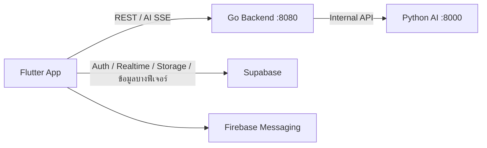

<div align="center">


# ยืมหน่อย · Mobile App

**หาอุปกรณ์ที่ใช่ คุย นัดรับ และจัดการการเช่าในแอปเดียว**


[ภาพรวม](#overview) · [Tech stack](#stack) · [ตั้งค่า](#setup) · [เริ่มรัน](#run) · [Build](#build) · [ตรวจงาน](#development) · [แก้ปัญหา](#troubleshooting)

[Project](../README.md) / **Frontend** / [Backend](../backend/README.md) / [AI Service](../ai_service/README.md)

</div>

---

<a id="overview"></a>

## ✨ ส่วนนี้ทำอะไร

Frontend คือแอป Flutter ของแพลตฟอร์มเช่าอุปกรณ์ระหว่างผู้ใช้ **Yuemnoi** มีโค้ดแอปและ native project สำหรับ Android / iOS ใช้ **Clean Architecture** แยกตามฟีเจอร์ และ **BLoC / Cubit** จัดการสถานะ

| ส่วนของแอป       | สิ่งที่มีในโค้ด                                                           |
| ---------------- | ------------------------------------------------------------------------- |
| 🔑 Auth          | สมัครสมาชิก, Email/Password, Google Sign-In, กู้รหัสผ่าน และเปิดดูแบบ Guest |
| 🔎 Discovery     | ฟีดอุปกรณ์, ค้นหา, กรองหมวดหมู่, รายละเอียดสินค้า และรายการโปรด           |
| 📸 Listings      | ลงประกาศ / แก้ไขอุปกรณ์, เลือกรูป และบีบอัดรูปก่อนส่ง                     |
| 📅 Rental        | ขอเช่า, ติดตามสถานะ, หน้าส่งมอบ / รับคืน และรีวิว                         |
| 💬 Chat          | ห้องแชตผ่าน Supabase Realtime, แนบรูป, typing และ presence                |
| 🤖 AI Assistant  | คำตอบ JSON / SSE, การ์ดสินค้า, แบบสอบถาม และบริบทของแชตปัจจุบัน           |
| 📍 Location      | ตำแหน่งผู้ใช้, จุดนัดพบ, แผนที่ และเส้นทาง                                |
| 🔔 Notifications | Firebase Cloud Messaging และการแจ้งเตือนในเครื่อง                         |
| 👤 Profile       | โปรไฟล์, อุปกรณ์ของฉัน และรายการเช่า                                      |

> **สถานะที่ควรรู้:** Wallet และการเติมเงินใน [WalletCubit](lib/features/wallet/presentation/bloc/wallet_cubit.dart) ยังเป็นข้อมูลจำลองในเครื่อง ส่วน PromptPay QR ในหน้าส่งมอบยังเป็น mockup จึงยังไม่ใช่ระบบรับชำระเงินจริงที่พร้อมใช้งาน

### แอปเชื่อมกับอะไรบ้าง



การเชื่อมต่อปัจจุบันเป็น **Hybrid**: แอปเรียก Go สำหรับ Auth บางส่วน, โปรไฟล์, ลงประกาศ, คำขอเช่า, ขั้นตอนรับคืน, กล่องแจ้งเตือน และ AI ขณะเดียวกันยังอ่าน / เขียน Supabase โดยตรงในบางฟีเจอร์ เช่น ฟีดและแชต จึงต้องเตรียม database permissions และ RLS ให้ตรงกับโค้ดด้วย

แจ้งเตือนแชต สถานะการเช่า และระบบ: เมื่อแอปอยู่ด้านหน้าใช้แบนเนอร์พร้อมเสียงในแอป ห้องแชตที่กำลังอ่านจะไม่เด้ง/ไม่มีเสียง เมื่อแอปอยู่เบื้องหลังให้ FCM notification payload แสดงผ่าน OS ตามสิทธิ์และ channel ที่ผู้ใช้ตั้งไว้ ประวัติและสถานะอ่านซิงค์ผ่าน Go; เก็บ token แยกต่อเครื่องใน `notification_device_tb` แทน `profile_tb.fcm_token` ดู [ข้อตกลงและการตรวจงาน](../docs/notifications.md)

แอปตรวจ `GET /api/auth/session` ก่อนยอมรับ session จากรหัสผ่าน, Google OAuth และการกู้คืนเมื่อเปิดแอป บัญชีที่ backend กำหนด `app_metadata.dashboard_only = true` จะแสดงข้อความให้ใช้ Dashboard และออกจาก session เฉพาะแอป การตรวจจาก backend ครอบคลุม metadata ใน session เดิมที่ยังไม่อัปเดต ระหว่างที่ยังตรวจสิทธิ์ไม่สำเร็จ แอปจะไม่เปิดใช้ token สำหรับข้อมูลส่วนตัว ต้องติดตั้ง backend และ [migration แยกสิทธิ์ dashboard](../supabase/migrations/20261017094213_restrict_dashboard_only_accounts.sql) ร่วมกัน

<a id="stack"></a>

## 🧰 Tech stack & versions

เวอร์ชันแพ็กเกจด้านล่างอ้างอิง [pubspec.lock](pubspec.lock) ส่วนช่วงเวอร์ชันที่อนุญาตอยู่ใน [pubspec.yaml](pubspec.yaml)

| เครื่องมือ                            | เวอร์ชัน / ข้อกำหนด                                    | ใช้ทำอะไร                       |
| ------------------------------------- | ------------------------------------------------------ | ------------------------------- |
| Flutter                               | **≥ 3.44.0** ตาม lockfile; ไม่มีไฟล์ pin SDK รุ่นเดียว | UI และ native build             |
| Dart                                  | **≥ 3.12.0, < 4.0.0** ตาม lockfile                     | ภาษาและ runtime ของแอป          |
| flutter_bloc / equatable              | 8.1.6 / 2.1.0                                          | State และการเปรียบเทียบ state   |
| go_router / app_links                 | 17.5.0 / 7.2.1                                         | Navigation และ deep links       |
| dio                                   | 5.11.1                                                 | REST API และ SSE                |
| supabase_flutter                      | 2.17.1                                                 | Auth, Realtime และ Storage      |
| flutter_dotenv                        | 6.0.1                                                  | โหลด configuration จาก asset    |
| firebase_core / firebase_messaging    | 3.15.2 / 15.2.10                                       | Firebase และ push notifications |
| flutter_local_notifications           | 22.3.0                                                 | การแจ้งเตือนในเครื่อง           |
| flutter_map / geolocator / latlong2   | 8.3.2 / 14.0.3 / 0.10.1                                | แผนที่และพิกัด                  |
| image_picker / flutter_image_compress | 1.2.3 / 2.5.1                                          | เลือกและลดขนาดรูป               |
| shared_preferences                    | 2.5.5                                                  | ข้อมูลและการตั้งค่าในเครื่อง    |
| build_runner / json_serializable      | 2.16.1 / 6.14.1                                        | เครื่องมือสร้างโค้ด             |
| bloc_test / mocktail / flutter_lints  | 9.1.7 / 1.0.5 / 6.0.0                                  | Tests, mocks และ lint           |

แม้ manifest จะระบุ Dart เป็น `^3.11.5` แต่ dependency ชุดที่ล็อกไว้ต้องการ Dart **3.12.0 ขึ้นไป** จึงควรเลือก Flutter SDK ที่ให้ Dart ตรงตาม lockfile

<details>
<summary>ดูแพ็กเกจ UI / media และเครื่องมือ native เพิ่มเติม</summary>

| แพ็กเกจ                                 | เวอร์ชัน        |
| --------------------------------------- | --------------- |
| cupertino_icons / font_awesome_flutter  | 1.0.9 / 11.0.0  |
| google_fonts / google_nav_bar           | 8.2.1 / 5.0.7   |
| cached_network_image / flutter_markdown | 3.4.1 / 0.7.7+1 |
| intl / timezone                         | 0.20.3 / 0.11.1 |
| audioplayers / gal                      | 6.8.1 / 2.3.3   |
| share_plus / url_launcher               | 13.3.0 / 6.3.2  |
| qr_flutter / mobile_scanner             | 4.1.0 / 7.4.2   |
| permission_handler / json_annotation    | 12.0.3 / 4.12.0 |
| flutter_launcher_icons                  | 0.14.4          |
| Android Gradle Plugin / Gradle wrapper  | 9.0.1 / 9.1.0   |
| Kotlin plugin / Google Services plugin  | 2.3.20 / 4.4.2  |
| Firebase Android BoM / desugar library  | 33.10.0 / 2.1.4 |

Android ตั้ง Java / Kotlin compilation target เป็น **17**; ค่า compileSdk, minSdk, targetSdk และ NDK รับจาก Flutter SDK ดู [settings.gradle.kts](android/settings.gradle.kts), [build.gradle.kts](android/app/build.gradle.kts) และ [Gradle wrapper](android/gradle/wrapper/gradle-wrapper.properties)

iOS project ตั้ง deployment target เป็น **13.0** แต่ยังต้องตรวจ minimum ที่ plugins ต้องการเมื่อ build ไม่มีการ pin รุ่น Android Studio / Xcode / CocoaPods ใน repository

`flutter` และ `flutter_test` เป็น SDK dependencies; ค่า `0.0.0` ใน lockfile ไม่ใช่เวอร์ชัน Flutter SDK

</details>

<a id="setup"></a>

## ⚙️ เตรียมเครื่อง & configuration

### 1. เครื่องมือที่ต้องมี

- Git และ [Flutter SDK](https://docs.flutter.dev/install) ที่ผ่านข้อกำหนดด้านบน โดย Dart มากับ Flutter
- Android: Android Studio / Android SDK, emulator หรือมือถือที่เปิด USB debugging และ JDK ที่รองรับชุด Gradle ของโปรเจกต์
- iOS: **macOS + Xcode** และเครื่องมือ native dependencies ตาม Flutter setup
- Supabase project ที่มี schema, views, RPCs, Storage และ permissions ของแอป
- Go Backend ที่อุปกรณ์ปลายทางเข้าถึงได้; เปิด Python AI เพิ่มเมื่อใช้ Chatbot
- Firebase project เมื่อ build Android หรือทดสอบ push notifications

จากโฟลเดอร์ root ของ repository:

```sh
cd frontend
flutter --version
dart --version
flutter doctor -v
flutter doctor --android-licenses
```

คำสั่ง license ใช้เมื่อเตรียม Android SDK ส่วน iOS ให้ทำตาม [Flutter iOS setup / deployment](https://docs.flutter.dev/deployment/ios) การ build / รัน iOS ต้องใช้ macOS; repository นี้ไม่มี native project สำหรับ Windows / macOS / Linux desktop

### 2. สร้างไฟล์ `.env.local`

สร้างไฟล์ในโฟลเดอร์ `frontend/` แล้วแก้ค่าตัวอย่างให้เป็นค่าของ environment ที่ใช้:

```dotenv
API_URL=https://your-backend.example.com
SUPABASE_URL=https://your-project.supabase.co
SUPABASE_PUBLISHABLE_KEY=replace-with-supabase-publishable-key
APP_SECRET_KEY=replace-with-client-app-key
```

| ตัวแปร                     | จำเป็นเมื่อ                        | วิธีตั้งค่า                                                                                               |
| -------------------------- | ---------------------------------- | --------------------------------------------------------------------------------------------------------- |
| `API_URL`                  | เรียก Go Backend                   | **URL ต้นทาง ไม่เติม `/api`** เพราะโค้ดเติม path ให้แล้ว                                               |
| `SUPABASE_URL`             | ใช้ Auth / ข้อมูล / Realtime       | URL ของ Supabase project เดียวกับ Backend                                                                 |
| `SUPABASE_PUBLISHABLE_KEY` | เริ่ม Supabase client              | Publishable key สำหรับแอป ดู [ประเภท API keys](https://supabase.com/docs/guides/getting-started/api-keys) |
| `APP_SECRET_KEY`           | Backend ตั้ง app key ไว้           | ต้องเป็นหนึ่งในคีย์ที่ Backend รับ; ส่งผ่าน `X-App-Secret`                                                |
| `GOOGLE_WEB_CLIENT_ID`     | Google login บน Android | Web OAuth client ID จาก Google Cloud ใช้เป็น `serverClientId` ของ native Google Sign-In และต้องอยู่ในรายการ Client IDs ของ Google provider ใน Supabase |

[AppConfig](lib/core/config/app_config.dart) อ่านค่าจาก `--dart-define` ก่อน แล้ว fallback ไปที่ dotenv ส่วน API client มี fallback เป็น `http://127.0.0.1:8080` หากไม่ได้ตั้ง API URL ค่านี้ไม่เหมาะกับมือถือจริง

ไฟล์ `.env.local` ถูกประกาศเป็น **Flutter asset** ใน pubspec จึงต้องมีไฟล์แม้จะส่งค่าผ่าน dart defines ทั้งหมดแล้ว และค่าที่ติดไปกับแอปสามารถถูกอ่านได้: ใส่เฉพาะ configuration ฝั่ง client; เก็บ Supabase service role, Firebase service account และคีย์ AI ไว้ฝั่งเซิร์ฟเวอร์

### 3. เลือก URL ให้ตรงกับอุปกรณ์

| รันบน                    | ต้นทางของ Backend ในเครื่องพัฒนา                                          |
| ------------------------ | ------------------------------------------------------------------------- |
| Android Emulator มาตรฐาน | `10.0.2.2:8080`                                                           |
| iOS Simulator            | `127.0.0.1:8080`                                                          |
| มือถือจริง               | IP ของเครื่องพัฒนาใน LAN เดียวกัน หรือ HTTPS hostname ที่มือถือเข้าถึงได้ |

**Android manifest ปัจจุบันตั้ง `usesCleartextTraffic="false"`** จึงควรใช้ HTTPS endpoint สำหรับการรันตามคู่มือนี้ หากต้องใช้ `http://10.0.2.2:8080` ระหว่างพัฒนา ต้องตั้ง native network policy สำหรับ debug ให้รองรับก่อน รวมถึงตรวจ ATS บน iOS เมื่อต้องใช้ HTTP ดู [AndroidManifest.xml](android/app/src/main/AndroidManifest.xml) และ [Info.plist](ios/Runner/Info.plist)

### 4. เตรียมบริการที่แอปใช้

| บริการ            | สิ่งที่ต้องเตรียม                                                                                                                                                                                                  |
| ----------------- | ------------------------------------------------------------------------------------------------------------------------------------------------------------------------------------------------------------------ |
| Supabase Database | `public` สำหรับ item/booking/review, `messaging` สำหรับ conversation/message, `profiles` สำหรับ `profile_tb` และ `public_profile_v`, `notifications` สำหรับ inbox/device/outbox พร้อม RLS / grants ดู [migration และการเปิดใช้พร้อมกัน](../supabase/README.md) |
| Supabase Realtime | เปิดใช้งานตามตารางและ channels ของ chat / booking / presence                                                                                                                                                       |
| Supabase Storage  | buckets `item_bk`, `profile_bk` และ `chat_bk`; แชตใช้ signed URLs และต้องมี policies ที่ตรงกับผู้ใช้                                                                                                               |
| Google login      | เปิด Google provider ใน Supabase; Android ต้องมี Web client ID และ Android OAuth client ที่ตรง package/SHA-1 ส่วน iOS / เว็บใช้ OAuth เดิมพร้อม redirect allowlist `yuemnoi://login-callback/` ดู [Google OAuth setup](https://supabase.com/docs/guides/auth/social-login/auth-google) |
| Firebase Android  | เพิ่ม Android app ID `com.example.frontend` แล้ววาง `android/app/google-services.json` ที่ตรงกับ project                                                                                                           |
| Firebase iOS      | เพิ่ม iOS app ให้ตรง bundle ID และเพิ่ม `GoogleService-Info.plist` เข้า Runner target; ตั้ง APNs / native capabilities เมื่อทดสอบ FCM                                                                              |

รูปที่อัปโหลดใหม่ใช้ path `chat_bk/<conversation_id>/<filename>`, `item_bk/<owner_user_id>/<item_id>/<filename>` และ `profile_bk/<user_id>/<filename>` รวมถึงรูปตรวจสภาพคืนสินค้าที่อยู่ใต้เจ้าของและสินค้าเดียวกัน ต้องใช้ [migration สิทธิ์ Storage](../supabase/migrations/20261017151602_organize_storage_image_folders.sql) ร่วมกับแอปและ backend เวอร์ชันนี้ รูปแชตเก่ายังอ่านและลบได้ตามสิทธิ์ผู้ส่ง โดยไม่ได้ย้ายไฟล์เดิม

Firebase initialization ใช้ `Firebase.initializeApp()` แบบ native และแจ้ง warning หากเริ่มไม่ได้ ดู [Firebase Flutter setup](https://firebase.google.com/docs/flutter/setup) ไฟล์ Firebase configuration ไม่ได้ติดมาใน repository และ checkout นี้ไม่มีชุด SQL migrations สำหรับสร้าง Supabase ทั้งระบบอัตโนมัติ

#### Google Sign-In บน Android

Android ใช้ `google_sign_in` 7.2.0 เปิดหน้าต่างเลือกบัญชีของระบบ แล้วส่ง Google ID token เข้า Supabase `signInWithIdToken` ก่อนตรวจสิทธิ์ผ่าน backend ตามเดิม แอปล้างสถานะบัญชี Google ก่อนเปิดตัวเลือกทุกครั้ง กดยกเลิกแล้วกลับสู่หน้า login และกดใหม่ได้ รูปแบบหน้าต่างขึ้นกับ Android และ Google Play services บนอุปกรณ์

หากอุปกรณ์หรือ emulator ยังไม่มีบัญชี Google ในระบบ Google Play services จะเปิดหน้าเพิ่มบัญชีก่อน บัญชีที่ล็อกอินไว้เฉพาะใน Chrome ไม่ได้ทำให้มีรายการบัญชี Android โดยอัตโนมัติ

1. ใน Google Cloud project ของ `GOOGLE_WEB_CLIENT_ID` เพิ่ม OAuth client ประเภท **Android** สำหรับ package `com.example.frontend` และ SHA-1 ของ certificate ที่เซ็นแอป ตรวจค่าจาก `android/` ด้วย `./gradlew signingReport` หรือ `./gradlew.bat signingReport` บน Windows
2. กำหนด `GOOGLE_WEB_CLIENT_ID` เป็น client ประเภท **Web application** แล้วเพิ่ม ID เดียวกันใน Google provider ของ Supabase ห้ามใส่ client secret ในแอป
3. ลงทะเบียน certificate ของทุก build ที่ใช้จริง รวมถึง Play App Signing สำหรับแอปจาก Play Store หากเปลี่ยน Firebase configuration ให้ดาวน์โหลด `google-services.json` ใหม่ โดยไฟล์ที่ไม่มี OAuth clients ยังต้องตั้ง Web client ID และลงทะเบียน Android client ใน Google Cloud ให้ครบ
4. เพิ่ม native plugin แล้วต้องหยุดและรัน `flutter run` ใหม่ การ hot reload อย่างเดียวไม่ติดตั้ง plugin

ดูรายละเอียด [การตั้งค่า Android ของ Flutter Google Sign-In](https://pub.dev/packages/google_sign_in_android) การเปิด browser เป็น fallback ไม่ถูกใช้เมื่อ native login บน Android ล้มเหลว

หาก popup แสดงบัญชีได้ แต่เลือกแล้วกลับหน้า login ให้ตรวจ Logcat เฉพาะ `Auth` / `Auth.Api.Credentials` เมื่อพบ `UNREGISTERED_ON_API_CONSOLE` ต้องลงทะเบียน Android OAuth client ด้วย package และ certificate SHA-1 ใน Google Cloud project เดียวกับ Web client ID ที่แอปใช้ การตั้ง SHA-1 ใน Firebase คนละ project อย่างเดียวไม่เพียงพอ ข้อผิดพลาดนี้อาจถูก Android Credential Manager รายงานเป็นการยกเลิก จึงอาจไม่มีข้อความ error บนหน้า login

แผนที่ปัจจุบันใช้ Google tile URL ส่วนค้นหาพิกัด / เส้นทางใช้ Nominatim และ OSRM จากโค้ด ไม่มี env สำหรับ map key ใน AppConfig

<a id="run"></a>

## 🚀 ติดตั้ง & เริ่มรัน

คำสั่งต่อไปนี้ใช้ได้ทั้ง PowerShell และ macOS / Linux shell เมื่ออยู่ใน `frontend/` และตั้งบริการตามหัวข้อก่อนหน้าครบแล้ว:

```sh
flutter pub get
flutter devices
flutter run --dart-define-from-file=.env.local --dart-define-from-file=../ai_service/config/chat_client_runtime.json
```

หากต่อหลายอุปกรณ์ ให้เพิ่ม `-d <device-id>` โดยเลือก ID จาก `flutter devices`

เริ่มบริการตาม [Backend README](../backend/README.md) และ [AI README](../ai_service/README.md) ใน terminal แยกกันก่อนทดสอบ AI แชต แอปอาจเปิดบางหน้าหรือ Guest mode ได้เมื่อบริการบางตัวไม่พร้อม แต่ flow ที่อ่านข้อมูลจริงยังต้องมี configuration และบริการของมันครบ

### AI configuration ที่ใช้ร่วมกับ Backend

[chat_client_runtime.json](../ai_service/config/chat_client_runtime.json) เป็น compile-time configuration ฝั่งแอป แก้ไฟล์แล้วต้องรัน / build ใหม่ ส่งไฟล์ JSON ตามคำสั่งด้านบนเพื่อใช้ configuration กลางร่วมกัน หากไม่ได้ส่ง แอปจะใช้ defaults ในโค้ดซึ่งตรงกับค่าในไฟล์ปัจจุบัน

| ค่า                                      | ค่าในไฟล์ | ความหมาย                                                    |
| ---------------------------------------- | --------- | ----------------------------------------------------------- |
| `AI_CHAT_HISTORY_MAX_MESSAGES`           | 16        | ประวัติสูงสุดที่ส่ง                                         |
| `AI_CHAT_HISTORY_MAX_CHARACTERS`         | 24000     | จำกัดขนาดประวัติ                                            |
| `AI_CHAT_REQUEST_TIMEOUT_SECONDS`        | 45        | เวลา transport                                              |
| `AI_CHAT_IDLE_TIMEOUT_SECONDS`           | 20        | เวลารอ stream โดยไม่มีข้อมูล                                |
| `AI_CHAT_STREAM_UPDATE_MILLISECONDS`     | 50        | จังหวะอัปเดตข้อความ                                         |
| `AI_CHAT_RESPONSE_READY_TIMEOUT_SECONDS` | 30        | จากส่งคำขอจนได้ validated answer ครบ                        |
| `AI_GATEWAY_TIMEOUT_SECONDS`             | 45        | Go ใช้จากไฟล์เดียวกันเมื่อกำหนด path; Flutter ไม่อ่านค่านี้ |

มี `AI_CHAT_TIMING_DIAGNOSTICS` เพิ่มเติมเป็น dart define แบบ boolean ค่าเริ่มต้น `false` สำหรับ diagnostics; ไม่ได้อยู่ใน JSON ด้านบน

SSE `ready` ส่งคำตอบที่ผ่านการตรวจครบแล้ว ก่อน `metadata`, `delta` และ `done` การวัด response ready แยกจากการแสดงตัวอักษรและการ render UI ค่า timeout เป็นขอบเขตการทำงาน ไม่ใช่ผลรับรองความเร็วของระบบ

เมื่อคำขอล้มเหลว แอปแยก `quota_temporarily_unavailable` เป็นโควต้าชั่วคราว, `quota_exhausted` เป็นโควต้ารายวัน และ `providers_busy` เป็นติดคิว ส่วน `providers_rate_limited` แจ้งติดโควต้าตาม provider โดยไม่เดารอบเวลา ปุ่มลองอีกครั้งเปิดตาม `retry_after_seconds` / `Retry-After` จริง; การแสดงประมาณหนึ่งนาทีอาจเป็นเวลารอ 1–60 วินาที และไม่มีการส่งซ้ำอัตโนมัติ กรณีไม่ทราบเวลารอจะไม่แสดงเวลาที่คาดเดา

`structured_output_invalid` แจ้งสร้างรูปแบบคำตอบไม่สำเร็จ และ `response_quality_rejected` แจ้งคำตอบไม่ผ่านการตรวจคุณภาพ โดยไม่ใช้ข้อความเรื่องโควต้าหรือคิว แอปยังส่ง retry เฉพาะเมื่อผู้ใช้กดปุ่ม; การกู้ draft หนึ่งรอบและตรวจซ้ำทำใน Python ภายในคำขอเดิม

เมื่อส่งคำตอบแบบสอบถามแล้วล้มเหลว สรุปตัวเลือกยังอยู่ในแชต หากพิมพ์ต่อ แอปส่งข้อความใหม่พร้อมบริบทและคำตอบแบบสอบถามที่ยังไม่ได้ประมวลผล โดยไม่ส่งข้อความแจ้งข้อผิดพลาดเป็นคำตอบของยืมหน่อย AI ปุ่มลองอีกครั้งใช้สำเนาคำขอล่าสุดเดิมทั้ง history, context และ answer IDs จึงไม่เพิ่มข้อความผู้ใช้ซ้ำ

กด “พิมพ์ตอบเอง” เพื่อผูกข้อความกับคำถามที่แสดงอยู่ แอปเก็บคำตอบเป็น `text`, ไปข้อถัดไป และส่งรวมกับช้อยเมื่อตอบครบ สรุปคำตอบแสดงในกล่องเดียว การพิมพ์แชตปกติยังส่งข้อความให้ AI ปรับความต้องการได้ คำถามที่มี `branch_question_id` เลือกเวอร์ชันใน `branch_choices` / `branch_titles` ด้วยรหัสช้อยของคำถามก่อนหน้า และคงรหัสช้อยของเวอร์ชันนั้นเมื่อส่งคำตอบ

สถานะขณะรอคำตอบเปลี่ยนตาม SSE `status.message` ของขั้นตอนจริง (`status.step`: `preparing`, `planning`, `evidence`, `review`, `repair`) เช่น “กำลังวิเคราะห์คำถาม”, “กำลังสร้างคำตอบ”, “กำลังตรวจคำตอบ” และ “กำลังสรุปคำคำตอบ” กรณีแก้หลังตรวจ วินาทีที่ผ่านไปนับจากเริ่มคำขอ อัปเดตทุกวินาทีและไม่เริ่มใหม่เมื่อสถานะเปลี่ยน หยุดเมื่อจบคำขอ ข้อผิดพลาด `structured_output_invalid` ใช้ข้อความ “ยืมหน่อย AI สร้างคำตอบไม่ได้” ข้างไอคอน

### เช็กว่าพร้อมใช้งาน

1. เปิด Home แล้วโหลดรายการจาก environment ที่ตั้งไว้
2. ลอง login และเปิดโปรไฟล์
3. ทดสอบห้องแชตด้วยผู้ใช้ทดสอบสองบัญชี
4. ส่งข้อความหา AI ผ่าน Go และดูคำตอบ / การ์ด / แบบสอบถาม
5. ทดสอบกล้อง, ตำแหน่ง และ notification บนอุปกรณ์เป้าหมาย

<a id="build"></a>

## 📦 Build สำหรับทดสอบและเตรียมเผยแพร่

จากโฟลเดอร์ `frontend/`:

```sh
# Android APK
flutter build apk --release --dart-define-from-file=.env.local --dart-define-from-file=../ai_service/config/chat_client_runtime.json

# Android App Bundle
flutter build appbundle --release --dart-define-from-file=.env.local --dart-define-from-file=../ai_service/config/chat_client_runtime.json

# iOS — ใช้ macOS และตั้ง native project / signing ให้ครบก่อน
flutter build ipa --release --dart-define-from-file=.env.local --dart-define-from-file=../ai_service/config/chat_client_runtime.json
```

| Artifact          | ตำแหน่ง                                            |
| ----------------- | -------------------------------------------------- |
| APK               | `build/app/outputs/flutter-apk/app-release.apk`    |
| App Bundle        | `build/app/outputs/bundle/release/app-release.aab` |
| iOS archive / IPA | `build/ios/archive/` และ `build/ios/ipa/`          |

Android ใช้ `--split-per-abi` เพิ่มในคำสั่ง APK ได้ หากต้องการแยกไฟล์ตาม CPU

> **ก่อนขึ้น Store:** Android project ปัจจุบันใช้ application ID `com.example.frontend` และ release signing ยังชี้ไปที่ **debug key** ต้องตั้ง ID, signing และ Firebase configuration ของแอปจริงก่อนเผยแพร่ ฝั่ง iOS ต้องตั้ง bundle ID, signing และ native dependencies ด้วย ดู [Android release guide](https://docs.flutter.dev/deployment/android) และ [iOS release guide](https://docs.flutter.dev/deployment/ios)

<a id="development"></a>

## 🧪 พัฒนา & ตรวจงาน

```sh
flutter analyze
flutter test test/core
flutter test test/features/chatbot/response_ready_deadline_test.dart
flutter test test/features/wallet/wallet_cubit_test.dart
```

ชุดเต็มใช้ `flutter test` แต่มี [home_supabase_live_search_test.dart](test/features/home/home_supabase_live_search_test.dart) ที่เรียก Supabase จริงโดยไม่มี opt-in guard จึงไม่ใช่ชุด offline ทั้งหมด ส่วน chatbot live tests บางไฟล์ต้องเปิด opt-in และเตรียม Go / Python ไว้ก่อน การผ่าน unit tests หรือ smoke test ไม่ใช่การรับรองคุณภาพ AI หรือ p95 บนอุปกรณ์จริง

<details>
<summary>เครื่องมือสร้างโค้ดและไอคอน</summary>

เมื่อเพิ่ม / แก้ model ที่ใช้ `@JsonSerializable`:

```sh
dart run build_runner build --delete-conflicting-outputs
```

เมื่อแก้ configuration ของ app icon:

```sh
dart run flutter_launcher_icons
```

โค้ดปัจจุบันไม่มี model ที่ใช้ annotation ดังกล่าว จึงไม่ต้องสร้างโค้ดเป็นขั้นตอนบังคับในการเริ่มโปรเจกต์

</details>

### โครงสร้างที่ควรรู้

```text
frontend/
├── lib/
│   ├── main.dart            # Startup, services และ session
│   ├── app.dart             # Root widget
│   ├── core/                # Config, network, routes, theme, services, widgets
│   └── features/            # Auth, home, rental, chat, AI, profile, wallet ฯลฯ
├── assets/                  # Prompt fonts, images, icons, sounds
├── android/                 # Native Android project
├── ios/                     # Native iOS project
├── web/                     # Web project; ตรวจความพร้อมของแต่ละฟีเจอร์แยกจาก mobile
├── test/                    # Unit / widget / live tests
├── .env.local               # Client configuration — สร้างเอง
├── pubspec.yaml             # Dependencies / assets / app version
└── pubspec.lock             # Resolved dependency versions
```

ภายในแต่ละ feature ส่วนใหญ่แยก `data/`, `domain/` และ `presentation/` ดูกติกาการพัฒนาเพิ่มเติมใน [AGENTS.md](AGENTS.md)

หน้ายืนยันตัวตนเปิดฟอร์ม “ตรวจข้อมูล แล้วส่งคำขอ” พร้อมป๊อปอัพอธิบายการใช้ภาพบัตร ใบหน้า และข้อมูล ทุกวัยใช้ flow เดียวกันโดยไม่ต้องมีผู้ปกครอง ผู้ใช้ยินยอมแล้วถ่ายบัตรต่อด้วยใบหน้าได้ทันที กรอกข้อมูลรวมวันเกิดตามบัตรเพียงครั้งเดียวใต้เลขบัตร ภาพอยู่ชั่วคราวในหน้านี้และอัปโหลดเมื่อกดส่งเท่านั้น Cubit เริ่มหรือใช้คำขอเดิมที่ยังไม่หมดอายุ แล้วส่งข้อมูลให้เจ้าหน้าที่ตรวจ ไม่ใช้วันเกิดหรือสถานะผู้เยาว์เดิมเพื่อตัดสิทธิ์ การแก้วันเกิดไม่ล้างภาพและไม่เริ่มคำขอใหม่เพราะช่วงอายุเปลี่ยน แต่ต้องยืนยันความถูกต้องอีกครั้ง บัญชีที่ถูกระงับยังถูกจำกัดตามเดิม ทดสอบด้วย `flutter test test/features/identity`

ที่อยู่ในหน้ายืนยันตัวตนเลือกจังหวัด → อำเภอ/เขต → ตำบล/แขวงจากรายการที่พิมพ์ค้นหาได้ เมื่อเปลี่ยนพื้นที่ระดับบนจะล้างค่าระดับถัดไปและรหัสไปรษณีย์ เมื่อเลือกตำบล/แขวงจะเติมรหัสหลักให้อัตโนมัติ พื้นที่ที่มีหลายรหัสมีตัวเลือกเพิ่มเติม และผู้ใช้ยังแก้รหัสเองได้ การเปลี่ยนที่อยู่หรือรหัสต้องยืนยันความถูกต้องใหม่ ข้อมูลพื้นที่อยู่ใน asset ของแอปและยังส่งชื่อภาษาไทยตาม API เดิม ดูแหล่งข้อมูลและวิธีอัปเดตใน [assets/data/README.md](assets/data/README.md)

<a id="troubleshooting"></a>

## 🛠️ ติดตรงไหน ลองเช็กตรงนี้

| อาการ                                 | เช็กอะไร                                                                          |
| ------------------------------------- | --------------------------------------------------------------------------------- |
| SDK / dependency resolution ไม่ผ่าน   | Dart ต้องตรงข้อกำหนด **≥ 3.12.0** และ Flutter **≥ 3.44.0** ใน lockfile            |
| Build แจ้งว่าไม่พบ `.env.local`       | สร้างไฟล์ใน `frontend/` เพราะ pubspec ประกาศเป็น asset                            |
| Supabase is not configured            | ตรวจ URL และ `SUPABASE_PUBLISHABLE_KEY` แล้วเริ่มแอปใหม่                          |
| API 404 หรือ path ซ้ำ                 | ตั้ง `API_URL` เป็น origin โดยไม่ต่อ `/api`                                    |
| Android เรียก Backend ในเครื่องไม่ได้ | ตรวจ HTTPS / cleartext policy, emulator host, LAN และ firewall                    |
| API ตอบ 401                           | ตรวจ `APP_SECRET_KEY` ให้ตรง Backend; flow ส่วนตัวต้องมี user session ด้วย        |
| Google login บน Android ไม่เปิดตัวเลือกบัญชี | ตรวจ `GOOGLE_WEB_CLIENT_ID`, Android OAuth package/SHA-1 และ Google Play services; รันแอปใหม่หลังเพิ่ม plugin |
| Google login บน iOS / เว็บไม่กลับแอป | ตรวจ Google provider, Supabase redirect allowlist และ `yuemnoi://login-callback/` |
| Google Services task ล้มเหลว          | ตรวจ `google-services.json` และ application ID ว่าตรงกัน                          |
| ไม่มี push notification               | ตรวจ Firebase / APNs, permission, FCM token และ Backend service account           |
| AI timeout / quota เต็ม               | ตรวจ Go → AI URL / internal key / runtime / provider quotas ตาม AI README         |

---

## Package adapters และ local cache

- ช่อง OTP ใช้ `pinput 6.0.2` โดยยังส่งรหัสเมื่อกดยืนยัน; validators และเบอร์โทรใช้ `form_builder_validators` กับ `phone_numbers_parser` ผ่าน helpers กลาง เบอร์ไทยตรวจตาม metadata ของ package
- Skeleton ใช้ `skeletonizer`; หน้าดูภาพใช้ `photo_view`; แชตผู้ใช้และ AI ใช้ `flutter_chat_ui 2.11.1` จัดการรายการข้อความ พร้อม custom builders สำหรับการ์ดเช่า/คืนและแบบสอบถามเดิม ตรึง pinput/chat UI รุ่นนี้เพื่อให้ใช้ Flutter Material ชุดเดียวกับแอป
- JSON DTO ที่เป็นการแปลงข้อมูลตรงใช้ `json_serializable`; aliases และ coercions อยู่ใน converters ส่วนการรวมหลาย records และการคำนวณ business state ยังอยู่ใน mapper เดิม
- SSE ใช้ EventFlux ผ่าน adapter ของ logical lines จาก `ApiClient` จึงคง Dio, app headers, HTTP error mapping และการยกเลิกคำขอไว้ส่วนกลาง ไม่เปิด reconnect POST อัตโนมัติ
- Drift เก็บ Home snapshot และข้อความแชตที่ server ยืนยันแล้ว 50 รายการล่าสุดต่อห้อง โดยแยก owner ของแต่ละบัญชี ล้าง cache บัญชีเมื่อออกจากระบบ และไม่สร้าง offline outbox ภาพ signed URL ยังต้องเข้าถึง Storage ได้
- Cache เดิมใน SharedPreferences ไม่ใช่แหล่งข้อมูลหลักและไม่ย้ายข้อมูลส่วนตัวที่ไม่มี owner กำกับ ฐานข้อมูลใหม่เติมจาก server เมื่อเปิดข้อมูลครั้งถัดไป; preferences เช่นประวัติค้นหาและการปักหมุดยังใช้ SharedPreferences ตามเดิม

เมื่อแก้ DTO หรือ schema ให้รัน:

```powershell
dart run build_runner build --delete-conflicting-outputs
```

Web ต้องมี `web/sqlite3.wasm` จาก sqlite3.dart **3.7.1** และ `web/drift_worker.js` ที่คอมไพล์จาก Drift รุ่นใน lockfile พร้อม `cache_assets.LICENSE.txt` ซึ่งรวมไว้ใน checkout แล้ว เมื่ออัปเดต Drift/SQLite ให้สร้าง assets ให้ตรงกันและ build Web ใหม่:

```powershell
Invoke-WebRequest https://github.com/simolus3/sqlite3.dart/releases/download/sqlite3-3.7.1/sqlite3.wasm -OutFile web/sqlite3.wasm
dart compile js -O2 --no-source-maps web/drift_worker.dart -o web/drift_worker.js
flutter build web
```

Tests ของ cache ใช้ SQLite ในเครื่องและ HTTP fixtures จึงตรวจ persistence, account isolation, empty snapshots และ late responses ได้โดยไม่เรียกบริการจริง ส่วน live Supabase/AI tests ต้องเลือกแยกจากการตรวจ offline

หน้าตั้งค่าบัญชีเพิ่ม “ข้อมูลบัตรประชาชน” ที่ `/setting/identity` ผ่าน Go API ของเจ้าของ session แสดงรูปคู่บัตร รูปบัตร ข้อมูลส่วนบุคคล และที่อยู่ วันเกิดหน้าแก้ไขใช้ปี ค.ศ. เลขบัตรอ่านได้อย่างเดียว การแก้ไขต้องยืนยันก่อนส่งให้เจ้าหน้าที่ ข้อมูลและสิทธิ์เดิมยังมีผลระหว่าง pending และถามก่อนออกเฉพาะเมื่อมีการแก้ไขที่ยังไม่ได้ส่ง รูปเก่าที่หมดอายุต้องเพิ่มใหม่ ใช้ migration `../supabase/migrations/20261021065036_identity_account_details.sql` กับ Backend รุ่นเดียวกัน ทดสอบหน้าใหม่และ flow เดิมด้วย `flutter test test/features/identity test/features/profile/presentation/pages/account_screens_test.dart`
